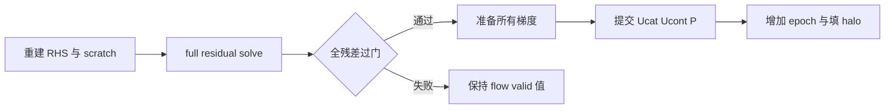

# AVWiS C3 多步状态、提交语义与 deferred workspace

_2026-10-11 · C3 第二增量 · 单层固定全周期 analytic_shear · double/3D · locked AMReX 26.04 / SHA `9219ba416b7ba2073dd1b12bf19fdce27391f17b`_

## 🎯 交付与状态

在上一轮已验证的 C3/C7 工作区上，推进优先级 A：生产 deferred pressure scratch
由 solver 持久复用，全部梯度准备移到 flow state 提交之前，并增加真实四步耦合
演化回归。CPU tiled face kernels 改为遍历 `tilebox()`，消除原有整 FAB 重复赋值。
此次没有改变正交/epsilon=0 的数值分支，也没有改成每步全量 face-to-cell 重构。

C3/G2、M2/M4 和 P5-005 仍进行中；C4 未开始。主任务统计保持
14 已完成、20 进行中、19 未开始，共 53。没有关闭一般非正交、物理 BC、完整应力、
legacy SNES/BDF2、IBM/FSI、shear restart 或 C7 profiling/MPI+CUDA 门。

开始前读取任务清单、C3/C7 报告、README、迁移方案、曲线规格、审阅及已有 diff。
初始内容 SHA-256 和 tracked diff 保存于 `/tmp/avwis-c3-continuation-initial-sha.json`
与 `/tmp/avwis-c3-continuation-initial.diff`；历史 C3/C7 报告和 C7 专用文件保持原样。
未访问/修改 `../../CUDA/`，未运行 git reset/checkout/clean，未提交 commit，
未修改 MEMORY.md、AGENTS.md 或 OpenClaw 配置。

## 📐 数学与字段契约

令 $I$ 为原有 cell-to-face 中心插值与面积向量内积，$G$ 为 C3 的完整压力面通量，
$C$ 为 centered logical difference 与 cell metric 组合的物理梯度。本轮保留：

$$
u^*=u^n+\Delta t\,[\mathcal A(U^n,u^n)+\nu L_hu^n],\qquad U^*=I(u^*),
$$

$$
L_h\Phi=D(U^*)/\Delta t,\quad
U^{n+1}=U^*-\Delta t\,G(\Phi),\quad
u^{n+1}=u^*-\Delta t\,C(\Phi),\quad P^{n+1}=P^n+\Phi.
$$

`Ucont` 是有限体积质量通量权威，`Ucat` 是传输/黏性使用的 cell 速度。
这是两个各有离散修正的表示，不能断言 $U^{n+1}=I(u^{n+1})$ 或
$u^{n+1}=R(U^{n+1})$。从 `Ucat` 重新覆盖已投影 `Ucont` 会改变散度；每步从面平均
重构整个 `Ucat` 会反复施加空间滤波。在尚无新时间离散/reference 决策的情况下，
本轮不采用它们。M2 最终单一权威与逐字段 freshness 仍 OPEN。

当前 explicit predictor 不读取旧 `P` 梯度；压力/速度耦合由本步实际求解的 `Phi`
及其 cell/face 修正提供。非零初压测试不意味着已经实现 legacy pressure-history/SNES
耦合。已有 centered explicit Euler 稳定性 guard 仍仅是 guard。

### Epoch、halo 与失败事务

|对象/阶段|不变量与边界|
|---|---|
|MetricData|固定且只读；workspace 绑定其对象地址、epoch、BA/DM，另一相同 mapping/layout/epoch 的对象也拒绝|
|Flow valid state|数值求解/梯度校验失败时，已规范 owner 的投影入口 `Ucat/Ucont/P` valid 值及 valid epoch 保持；原有测试逐位核对|
|提交|先求解 full operator，再准备全部三个 face flux 与 cell gradient，最后修改 flow 并增加一次 valid epoch|
|Halo|成功后 owner sync 和 periodic halo 完成，halo epoch 等于 valid epoch；共同 epoch 表示通信新鲜，不表示两种速度互逆|
|Scratch/Phi|允许失败后改变，不承诺回滚；下次 solve 重新生成系数/RHS、清零 Phi/BC，重算所有 action/gauge 数据|
|完整 advance|history/predictor 已在投影前改变；仍是 fatal failure，无整步回滚、减 dt 重试保证|
|设备/MPI 致命错误|不属于可恢复数值事务；commit 中 AMReX 通信本身仍可能申请内部缓冲|



### Workspace 与成本选择

`DeferredProjectionWorkspace` 包含六个 face MultiFab（b/flux 各三方向）与七个
cell MultiFab（BC、work RHS、action、residual、physical RHS、weighted gauge、三分量
cell gradient）。非零 shear solver 构造时分配一次；零剪切和既有正交 solver 不分配。
成员封装，仅 solver、solve 函数及测试 friend bridge 可以访问。

此次只复用这些存储，不缓存 MLABecLaplacian/MLMG 或 coarse hierarchy。系数仍逐次
从 metric/beta 构造并做 owner sync，不引入 stale coefficient 的隐含许可。
scratch 持久占用增加 idle solver 的驻留内存；未测量峰值内存或宣称速度提升。

## 🔧 修改文件

|文件|本轮责任|
|---|---|
|`src/AVWiSMappedOperators.H`|封装 bound workspace；保留原独立 solve 入口并增加复用 overload|
|`src/AVWiSDeferredProjection.cpp`|workspace 构造/绑定拒绝/存储复用；两处 tiled kernel；inner 上限与失败诊断|
|`src/AVWiSSolver.{H,cpp}`|仅非零 shear 持有 workspace；增加最近成功 advance 的投影报告并在 initialize 清零|
|`src/AVWiSProjection.cpp`|使用 bound workspace；所有修正准备前置；明确质量/cell 表示与失败语义|
|`src/AVWiSTime.cpp`|真实 advance 保存返回的 projection diagnostics|
|`tests/contracts/AVWiSC3ContractChecks.cpp`|四步混合模态状态/守恒/history/halo；复用、wrong owner、失败后恢复；读写 checkpoint 拒绝|
|`tests/c3_shear_regression.py`|检验每步数值报告，保留原三网格/强度/分块矩阵|
|`tests/static_contract_check.sh`|workspace、full gate、tile、实际多步与拒绝静态契约|
|任务清单、README、审阅追记、迁移方案、规格及本报告|同步当前限定能力，不重写历史报告或改动 P 级统计|

## 🧪 回归、命令与结果

四步初值使用 $a=\sin[2\pi(\xi+\eta)]$、$b=\cos[2\pi(\xi-\zeta)]$：
$u=(0.35+0.1a+0.03b,0.05a,a+0.07b)$、$P=0.2a$。
每步实际调用 `advance_one_step(dt=1e-5,nu=0.01)`，强制 predictor 散度大于
`1e-8`、`max|Phi|>1e-6`；没有使用 free-stream shortcut 充当耦合证据。
逐步验证 cell/face 修正、三个时间层、time/step/history depth、全域体积加权动量、
实际 residual/divergence 及 freshness。epsilon=0 另建单 Box 正交 peer，推进同一
初值四步，对照 `Ucat/Ucont/P`，同时保留旧 pressure recovery 与 100 步自由流。

CPU 十个 fixture 的四步最大 full relative residual 为 `8.2155e-12`，最大投影散度
`1.2273e-11`；动量漂移最大 `3.3307e-16`，状态修正误差最大 `2.2205e-16`，
history error 为 0，零剪切四步正交最大差 `5.6844e-13`。未放宽任何数值门。
epsilon=0 沿用 C2 的 diagonal solver/report；其 deferred outer/inner/full-relative
字段为默认 0，表示未进入 deferred 路径，不解释成实测 full residual 为零。

|CPU 网格|四步 outer counts|四步累计 inner counts（分别逐步）|
|---|---|---|
|16x16x4|13 / 13 / 12 / 11|285 / 268 / 226 / 186|
|32x32x4|14 / 13 / 11 / 10|917 / 812 / 631 / 626|
|64x64x4|14 / 12 / 10 / 9|3176 / 2591 / 2325 / 2466|

表中 inner 是各步内所有 outer solve 的次数总和，不是单次 inner 超过配置上限。
浅 hierarchy 的成本仍很高，不能因为次数高而称数值错误，也不能因复用分配而称
性能已提升。下一轮应先审查 hierarchy/smoothing 及分项时间/内存。

三个 consumer 复用已锁定 installed dependency，GNU 13.3.0 / OpenMPI 4.1.6 /
CUDA 12.6.85，GPU arch 89；未重建依赖，未使用版本 mismatch override。
构建/运行目录沿用上一轮，不覆盖历史报告中的数字。

```bash
cmake --build build/c3-20261011-cpu -j 4
cmake --build build/c3-20261011-mpi -j 4
cmake --build build/c3-20261011-cuda -j 3
ctest --test-dir build/c3-20261011-cpu --output-on-failure
ctest --test-dir build/c3-20261011-mpi --output-on-failure
ctest --test-dir build/c3-20261011-cuda --output-on-failure
python3 -B /tmp/avwis-c3-continuation-mpi-validation.py
bash amrex_port/tests/static_contract_check.sh
git diff --check
```

|验证|结果|证据位置|
|---|---|---|
|CPU 最终完整 CTest|54/54 PASS，49.01 s|`/tmp/avwis-c3-continuation-cpu-ctest-final.log`|
|MPI 最终完整 CTest|55/55 PASS，85.58 s|`/tmp/avwis-c3-continuation-mpi-ctest-final.log`|
|CUDA 最终完整适用 CTest|45/45 PASS，275.86 s|`/tmp/avwis-c3-continuation-cuda-ctest-final.log`|
|C3 MPI 多 rank/tile|17 组 PASS；六范数最大相对差 `6.6707e-15`|`build/c3-20261011-mpi/c3_continuation_multirank/comparison.json`|
|CPU/MPI/CUDA 六范数|MPI peer 最大差 0，CUDA peer `1.3668e-14`，PASS|`build/c3-20261011-cpu/c3_continuation_backend_norms.json`|
|静态契约与 diff 格式|PASS；任务统计与初始文件保护复核 PASS|`/tmp/avwis-c3-continuation-audit.log`|

MPI 矩阵为 stretched=0.15、negative=-0.25、zero=0、affine=0.15/stretch=0，各配
`(rank,max_grid)=(1,8)/(2,8)/(4,4)/(4,16)`，最后一组含三个空闲 ranks。
另跑四 rank/单 Box 的 `fabarray.mfiter_tile_size="4 4 2"`。每组都执行内部完整
数值契约，比较原四 operator/energy 范数及四步末态速度、压力 L2；没有用近零
残差的相对差作为后端尺度，也没有宣称全场逐点或 MPI+CUDA 验收。

C3 专项在全套中分别为 CPU 41.71 s、MPI 47.00 s、CUDA 168.49 s；三个后端都执行
十个 fixture。所有最终套件均无失败或跳过项。CUDA 不适用的 CPU-only I/O 测试沿用
既有 CMake scope 排除，45/45 不表示 MPI/GPU restart 已支持。

JSON/stdout 在各 backend 的 `c3_shear/` 与 MPI 的 `c3_continuation_multirank/`；
build 日志为 `/tmp/avwis-c3-continuation-{cpu,mpi,cuda}-build-final.log`。
同时进行的验证会影响墙钟时间，这些 CTest 总时间不构成隔离性能基准。

### 失败诊断与修正

首次新增 CPU focused regression 在 64 网格后续步失败：outer=1，inner=800，
initial residual `0.374477`，final residual `1.22558e-12`。
追加锁定 MLMG `getResidualHistory()` 诊断显示，第 400 次 `8.66292e-8`、第 600 次
`9.81099e-11`，残差持续下降，证据支持增加工作预算而非放宽容差。
最终内层上限改为 1600，仍用 relative `1e-12`/absolute `0`，bottom smoothing=256；
full gate 仍 `1e-11`，散度仍 `1e-10`，RHS automatic repair 仍关闭。
日志：`/tmp/avwis-c3-continuation-cpu-focused.log`、
`/tmp/avwis-c3-continuation-64-diagnostic.log`、
`/tmp/avwis-c3-continuation-64-history.log`。最终失败不会生成 PASS summary。

每个 numerical fixture 在 CPU/MPI/CUDA 上都检查 checkpoint reader/writer 的准确
shear provenance 拒绝原因，且使用空路径验证拒绝先于文件访问；epsilon=0 也拒绝。
schema-v3 与 shear checkpoint/restart scope 未扩展。

## 🚧 下一步与仍开放门

1. M2：决定是否更换速度离散，冻结单一权威、逐字段 epoch 与 consistency 定义；
   需要长期/reference、时间步收敛及 cell/face aliasing 证据，不能用重构次数替代数学决策。
2. M4：拆分 diagonal solve、cross action、halo 与分配/内存成本，审查浅 hierarchy；
   再讨论 hierarchy/operator cache，而非先扩大 epsilon/拉伸或放宽 tolerance。
3. 继续更长时间与 dt/dt/2 耦合演化、更多 mixed modes/full-field 后端回归及 legacy
   reference。四步契约不是物理 CFD 或完整 legacy 验收。
4. P5-005 nonlinear residual/Jacobian、M6 完整 stress、C4 19 点与非正交 BC、
   shear restart、IBM/FSI、AMR、MPI+CUDA 继续独立开放。

## 🔗 依据与通知

本地依据：[上一轮 C3 报告](./AMReX_C3_弱剪切算子与算法决策_20261011.md)、
[C7 报告](./AMReX_C7_MPI_CPU-GPU对照_20261011.md)、
[曲线规格](./AVWiS曲线坐标实现规格.md)、[主任务清单](./AMReX移植任务清单.md)。
AMReX API 依据为锁定源码 `Src/LinearSolvers/MLMG/AMReX_MLMG.H` 中
`getInitResidual/getFinalResidual/getResidualHistory/getNumIters` 与 solve 的
`max(relative*max_norm,absolute)` 停止语义，未采用网上新版本 API。

所有结果归档和最终静态复核完成后，仅执行一次指定命令：
`openclaw message send --channel telegram --target '5602246804' --account default
--reply-to '4908' --message '<本轮简要结果>'`。退出码 0，CLI 确认
`Sent via telegram. Message ID: 4911`；日志为
`/tmp/avwis-c3-continuation-telegram.log`。未重试，未发送 system event/heartbeat。
