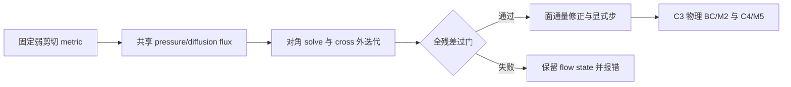

# AVWiS C3 弱剪切算子、算法决策与验证

_日期：2026-10-11 · C7 后续增量 · 单层/固定网格/double · locked AMReX 26.04，SHA `9219ba416b7ba2073dd1b12bf19fdce27391f17b`_

---

## 🎯 交付与状态

本轮优先实现生产数值算法：新增固定弱 xy 剪切 mapping、可复用完整/cross face
梯度通量、压力/黏性共享 stencil、全残差驱动的周期 deferred projection、速度
变换特化和包含 cross 项的显式稳定性估计。真实 `compute_advection_rhs`、
`compute_viscous_rhs`、`project_mapped`、`advance_one_step` 均进入测试。

C3 标为**进行中：限定全周期弱剪切数值切片已验证**，不关闭一般 G2。
C4 仍未开始；本子集不是一般曲线、完整 VWiS 19 点算子、legacy 整机等价或完整
物理 CFD 验收。P5-005 从未开始转为进行中，因为可达 residual 审计、方案决策及
明确算法选择/拒绝接口已经落地；完整 SNES/隐式替代尚未实现。
主任务统计为 14 已完成、20 进行中、19 未开始，共 53。

开始时已存在 C7 对任务清单、审阅、CMake、README、RunMode、contract facade/bridge
的未提交改动，以及 C7 报告、两个输入、快照契约和 Python 比较器。已逐项检查并
保留，新增文件的初始 SHA-256 保存在 `/tmp/avwis-c3-initial-sha.json` 用于结束复核。
未触碰 `../../CUDA/`；未运行 reset/checkout/clean；未提交 commit；未改 MEMORY.md、
AGENTS.md、OpenClaw 配置或无关项目。初次失败生成的本轮 `Backtrace.0` 已移动到
`build/c3-20261011-cpu/diagnostics/initial-mlmg-backtrace.0`，没有清理旧产物。

## 📐 数学定义与几何边界

### Mapping 和 metric

沿用 separable provider 的 `scale/stretch` 定义，记其输出为 $(X,Y,Z)$，令

$$
x=X+\epsilon(Y-y_{lo}),\qquad y=Y,\qquad z=Z,\qquad |\epsilon|\le0.25.
$$

`epsilon` 是物理剪切斜率，无量纲；不是一般节点 skewness 或任意曲面参数。
节点、analytic ghost 延拓、共享三角面面积向量和 polyhedral volume 均由已有
`MetricData` 构造，不另造一套 metric。该线性剪切的行列式为 1，所以正体积和
$J_x>0$ 继承 separable base；面保持平面，不涉及新的翘曲四边形规则选择。
M1 的一般 legacy 几何等价仍 OPEN。

记 $A=dX/d\xi$、$B=dY/d\eta$、$C=dZ/d\zeta$，则

$$
J_x=ABC,\quad \nabla\xi=(1/A,-\epsilon/A,0),\quad
\nabla\eta=(0,1/B,0),\quad \nabla\zeta=(0,0,1/C),
$$

$$
g^{mk}=\begin{pmatrix}
(1+\epsilon^2)/A^2&-\epsilon/(AB)&0\\
-\epsilon/(AB)&1/B^2&0\\
0&0&1/C^2
\end{pmatrix}.
$$

运行只接受全周期及 `avwisbcs.enabled=0`。周期关系是平移晶格：跨逻辑 x 周期
平移 $(s_xL_x,0,0)$，跨逻辑 y 周期平移 $(\epsilon s_yL_y,s_yL_y,0)$；不是按
Cartesian y 轴平移同一物理标量。坐标 ghost 保留平移，metric/flow halo 按逻辑周期
同步。物理壁面/inlet/outlet/slip BC 一律拒绝，不能套用 C5 的正交法向路径。

### 共享 face flux、散度和 RHS

存储 $Q_f^{mk}=\mathbf S_f^m\cdot\nabla\xi_f^k$。法向导数为两侧 cell 差除 $h_m$；
切向导数为左右 cell 的中心导数平均：

$$
(\delta_k\phi)_f=\frac{\phi_{R+e_k}-\phi_{R-e_k}+\phi_{L+e_k}-\phi_{L-e_k}}{4h_k},\quad k\ne m.
$$

生产 helper `metric_face_gradient_value` 定义

$$
G_f^m(\phi)=\beta_f\sum_kQ_f^{mk}(\delta_k\phi)_f,\quad
L_h\phi=D(G(\phi)),\quad
D_c(U)=\frac{\sum_m(U_{f+}^m-U_{f-}^m)}{V_c}.
$$

`compute_metric_face_gradient_flux` 提供 full/diagonal/cross 三种 action，写后同步
face owner。黏性对每个 Cartesian 分量调用同一个 stencil：$RHS_{\nu,l}=\nu L_hu_l$；
本轮 `beta=1`、常密度/常黏度。对流保留 $F_{f,l}=U_f I_f(u_l)$、$RHS=-D(F)$；
新的速度变换使 $U_f=\mathbf u_f\cdot\mathbf S_f$ 包含剪切法向分量。
不重复乘面积/Jacobian；有限体积算子只除一次 $V_c$。

### 压力外迭代、退化和失败语义

`MLABecLaplacian` 表示 $A_{diag}=-V L_{diag}$，配置 face 系数
$b_f=\beta_fQ_f^{mm}h_m$。令 $b=-\alpha V D(U^*)/\Delta t$，外迭代为

$$
A_{diag}\Phi^{r+1}=b+V L_{cross}\Phi^r.
$$

每次 inner solve 使用相对容差 $10^{-12}$；随后以物理体积加权固定 pressure gauge，
重算 full $G$ 和 $L_h$，只在

$$
\frac{\|L_h\Phi+b/V\|_\infty}{\|b/V\|_\infty}\le10^{-11}
$$

时接受。最终 $U^{n+1}=U^*-(\Delta t/\alpha)G(\Phi)$ 复用同一个完整 face flux。
报告同时保存 full 相对/绝对残差与 inner/outer iterations。默认最多 40 次外迭代，
可配置 `[1,100]`；超限或 inner 失败以异常结束。检查积分 RHS compatibility：
$|\sum b|\le10^{-12}N\|b\|_\infty$，即物理 RHS 的体积加权积分；关闭 MLMG 自动
solvability repair，不静默减 RHS 均值。

仅在投影成功后修改 `Ucat/Ucont/P`。定向测试验证外迭代失败时这三个 flow state
逐位保持；`Phi`、scratch RHS 和 halo 属 workspace，不承诺回滚。完整
`advance_one_step` 仍按既有 fatal-failure 模式运行，尚未实现整步 history/predictor
事务回滚或减 dt 重试。

`epsilon=0` 的节点与 separable base 相同，黏性调用原对角 stencil，压力调用既有
`project_orthogonal`；跨 Box 与单 Box 正交投影的压力/速度最大差约 $4.44\times10^{-16}$。
旧正交默认路径保留其现有实现；新 deferred 路径的“不修补 RHS”契约不反向修改它。
非零 shear 的 roundoff-scale 散度可按 `64*machine_epsilon*divergence_scale` 直接跳过，
不把零自由流变成无意义的近零压力求解。

### 重构与显式稳定性

$x$-face 法向与 $(1,-\epsilon,0)$ 平行，$y/z$-face 仍平行对应轴。
六个归一化面约束的 least-squares 系统特化为

$$
 u_y=\tfrac12(U_{y-}/S_{y-,y}+U_{y+}/S_{y+,y}),\quad
 u_x=\tfrac12(U_{x-}/S_{x-,x}+U_{x+}/S_{x+,x})+\epsilon u_y,
$$

$u_z$ 为原 z 对角平均。$\chi=|\epsilon|/\sqrt{1+\epsilon^2}$ 时，归一化法向矩阵
条件数 $(1+\chi)/(1-\chi)$，在配置上限约为 1.641。常量重构紧容差通过；这是固定
法向子集的 M2 特化，不是一般六面数值求逆或 legacy 三 cofactor 等价结论。

投影后的 `Ucat` 保留 C2 已有的 incremental cell physical gradient 更新，以保持
零剪切连续退化。`Ucont` 是质量守恒权威；不在投影后从 `Ucat` 重新覆盖它。
本轮未强制把 `Ucat` 重构自已投影 `Ucont`，也不宣称这两种离散表示逐点互逆。
该生产接缝须由后续 C3/M2 单独决策并保持 C2 回归；规格中的最终单一权威流水线尚未关闭。

非零 shear 稳定性 guard 用 $\nabla\xi$ 各 Cartesian 分量绝对值上界估算逻辑输运 CFL；
扩散数用 $2\nu\Delta t[\sum_m\sum_l\max|\partial\xi^m/\partial x_l|/h_m]^2$，包含
cross 项，是保守上界。它不是 centered advection 的非线性稳定性证明。
零 shear 保留原正交 guard。单步推进仍为 explicit Euler，$\alpha=1$。

## 🔍 P5-005 与 M3–M6 决策记录

|门|源码/原型证据|本轮决定|状态与剩余条件|
|---|---|---|---|
|P5-005|`Integrator.C` 创建 matrix-free SNES Jacobian、NewtonTR/KSP；`SolveFunction` 可达 residual 为 $(U^n-U)/dt+0.5R(U)+0.5R^n-Dp$。BDF2 形状分支存在，但 `UData.h:78` 返回 timeCoeff=1|C3 数值切片继续使用明示 explicit Euler + projection。`avwis.time_integrator` 只接受 `explicit_euler`，BDF2/SNES 不会静默降级|限定决策/接口完成，P 级任务进行中；真正 nonlinear residual/Jacobian、停止条件、失败/reference 和隐式策略仍 OPEN|
|M3|legacy `PoissonSolver.C:137–205` 对 HYPRE RHS 做全域均值修补；LHS 的 boundary/IBM 分支改变 cross stencil|首条 shear 仅 periodic，显式 compatibility、volume-weighted gauge，物理 BC 拒绝。不能从旧“outflow”名字推断 datum|周期子集冻结；每个 legacy case BC/datum/history 与一般非正交物理 BC OPEN|
|M4|共享 full/cross action；CPU 三网格、signed epsilon 扫描及 full residual 门通过；inner failure 曾实际出现，见诊断|限定 `abs(epsilon)<=0.25`、全周期、显式 opt-in 的生产数值原型。全残差不达标即失败|受控数值子门通过；更强拉伸、更多模态/物理 case、成本/内存和普适生产许可 OPEN|
|M5|锁定 AMReX `MLABecLaplacian/MLMG` 可表达对角 preconditioner，cross 独立 action 已实现；affine arbitrary-vector reference 可检验 xy 子集|C3 采用现有对角 MLMG + full cross deferred，避免把标准 Cartesian Poisson 当一般算子|C4 custom MLLinOp vs PETSc/HYPRE 过渡 OPEN；未实现 custom multilevel BC/transfer/GPU 原型|
|M6|`RHSSolver.C:887–895/1120–1128/1353–1361` 中既有 metric component gradient，又有 `r11*csi0+r21*csi1+r31*csi2` 等 transpose-gradient 项|本轮明确选择 constant-coefficient component Laplacian；`avwis.viscous_operator` 只接受 `component_laplacian`。压力/黏性共享 cross stencil，负能量率验证|限定模型选择完成；完整 stress divergence、变黏度、legacy 逐项对照与其 MMS OPEN|

选择 component Laplacian 的依据是可复用已验 C2 基线并隔离 metric/cross 误差。
常黏度、连续不可压缩时 stress divergence 可化为 component Laplacian，但离散场和
边界并不保证额外 grad(div u) 项严格为零；不得据此宣传逐点 legacy 等价。
SNES 过渡层能保留原 residual 但需要明确数据 adapter、ABI/reference 和收敛语义；
AMReX 隐式替代可减少格式转换，但需要重新验证 Jacobian/耦合。这两条长期路线
本轮均未作最终选择，也未把 explicit Euler 称为隐式方程已收敛。



## 🔧 文件和接口落地

|文件|责任|
|---|---|
|`src/AVWiSCoordinateMapping.{H,cpp}`|新增生产 `AnalyticShearCoordinateMapping`，factory 的 epsilon 入口与有限/范围拒绝|
|`src/AVWiSMappedOperators.{H,cpp}`|新增 deferred mode/config、full/diagonal/cross stencil、metric transform API 与原 orthogonal compatibility wrapper；epoch/layout 检查|
|`src/AVWiSDeferredProjection.cpp`|新增 reusable periodic pressure solve 与 full face-gradient flux，不含 MMS/case 判断|
|`src/AVWiSProjection.cpp`|`project_mapped` dispatch、full pressure correction、全残差/迭代报告和 commit 顺序；epsilon=0 留原 orthogonal 分支|
|`src/AVWiSViscosity.cpp`、`AVWiSTime.cpp`|黏性消费共享 stencil，显式步调用新 mapped projector；非零 shear 的含 cross 稳定性估计|
|`src/AVWiSSolver.{H,cpp}`、`main.cpp`|mapping 参数解析、solver 生命周期/metric metadata、重构、投影 diagnostics 字段|
|`src/AVWiSCheckpoint.cpp`|读/写均显式拒绝 shear，避免 schema-v3 遗漏 epsilon provenance，包括 epsilon=0|
|`src/RunMode.{H,cpp}`|新增 C3 contract dispatch；time_integrator/viscous_operator 的显式选择与拒绝|
|`tests/contracts/AVWiSC3ContractChecks.cpp`、既有 facade/bridge|制造解、独立 assembled action、守恒/耗散、失败保护、生产 step/free-stream checks|
|`inputs/c3_shear_periodic.in`、`c3_reject_*.in`、`tests/c3_shear_regression.py`、`CMakeLists.txt`|受控输入、三网格/强度扫描、6 种负向接口；Python 只编排真正数值契约，不增 comparator 单测|
|任务清单、README、迁移方案、规格与审阅追记|同步限定状态/接口和后续门；原历史报告保留当时事实|

## 🧪 验证命令与结果

### 构建/运行命令

三个 consumer 目录均为本轮新目录，使用既有 installed locked CPU/MPI/CUDA dependency。
GNU 13.3.0、OpenMPI 4.1.6、CUDA 12.6.85；CUDA arch 89，硬件沿用 C7 实测
RTX 4060 Laptop GPU。本轮不重建/修改依赖或声称 CUDA-aware MPI。
修正后的目标均重新 build 并运行对应适用测试。

```bash
cmake -S amrex_port -B build/c3-20261011-cpu -DCMAKE_BUILD_TYPE=Release \
  -DAMReX_DIR="$PWD/build/deps/amrex-26.04-git-install/lib/cmake/AMReX"
cmake --build build/c3-20261011-cpu -j 4
ctest --test-dir build/c3-20261011-cpu --output-on-failure

cmake -S amrex_port -B build/c3-20261011-mpi -DCMAKE_BUILD_TYPE=Release \
  -DAMReX_DIR="$PWD/build/deps/amrex-26.04-mpi-c7-install/lib/cmake/AMReX" \
  -DMPIEXEC_PREFLAGS=--oversubscribe
cmake --build build/c3-20261011-mpi -j 4
ctest --test-dir build/c3-20261011-mpi --output-on-failure

cmake -S amrex_port -B build/c3-20261011-cuda -DCMAKE_BUILD_TYPE=Release \
  -DCMAKE_CUDA_ARCHITECTURES=89 \
  -DAMReX_DIR="$PWD/build/deps/amrex-26.04-cuda-install/lib/cmake/AMReX"
cmake --build build/c3-20261011-cuda -j 3
ctest --test-dir build/c3-20261011-cuda --output-on-failure

ctest --test-dir build/c3-20261011-cpu -R 'avwis_c3|unknown_mode' --output-on-failure
bash amrex_port/tests/static_contract_check.sh
git diff --check
```

### CPU 数值门

三网格均为 $N\times N\times4$、scale `(1.1,0.9,1.05)`、stretch
`(0.25,-0.15,0.1)`、epsilon `0.15`、`dt=1e-5`、`nu=0.01`，多 Box。
制造标量 $\phi=\sin[2\pi(\xi+\eta)]$；速度 $(0.35,0,\phi)$。
解析 Laplacian 同时含 $-2\epsilon\phi_{XY}$ 和 $(1+\epsilon^2)\phi_{XX}$，
因此不是只检验拉伸正交子问题。网格只细化有非平凡误差的 x/y 方向。

|N|Laplacian L2|advection L2|physical gradient L2|full relative residual|外迭代|
|---:|---:|---:|---:|---:|---:|
|16|0.6745719392|0.03728561204|0.1545902933|7.53269e-12|13|
|32|0.1705868715|0.009376612880|0.03887529720|9.84013e-12|13|
|64|0.04277184892|0.002347616573|0.009733108594|2.40852e-12|14|

误差比：Laplacian 3.9544/3.9883、对流 3.9764/3.9941、梯度 3.9766/3.9941，
均高于预设 $2^{1.8}$。epsilon `-0.25/-0.1/0/0.1/0.25` 的 16 网格扫描通过；
非零 shear 外迭代 11–18 次，epsilon=0 直接使用正交路径。
上表 discrete pressure recovery 的累计 inner iterations 为 182/656/2367，
affine fixture 为 128。64x64x4 的成本明显偏高；此为正确性原型实测，
不能据此关闭 M4 性能门，下一轮须分析浅 hierarchy 和 scratch 复用。

Affine fixture 令 stretch=0：单 sine 的 pressure/cross eigenvalue 最大 action 误差
约 `1.6556e-12`；独立任意周期向量的 assembled 11 点 action 相对 L2 差
约 `1.5803e-15`，门槛 `1e-12`。这里的 11 点由 7 点对角 + 4 个 xy edge 邻居组成，
不宣称已经验证包含 xz/yz 的完整 VWiS 19 点路径。

十个数值运行均检查：正体积/GCL、常量速度重构、全域物理体积守恒、压力/黏性
共享 flux、负 diffusion energy rate、volume-weighted pressure recovery、
外迭代超限/不兼容 RHS/stale metric 拒绝、失败 flow state 保持、非零 predictor 散度的
生产耦合一步（断言 Phi 非平凡）及其投影后散度和
100 步自由流。耦合一步另使用 $(0.35+0.1\phi,0.05\phi,\phi)$，
CPU 最大 step divergence 为 `9.51e-12`（门槛 `1e-10`）。CPU 最大 pressure recovery 误差约 `1.2284e-11`；最大积分守恒缺陷
约 `6.22e-15`；100 步 free stream 与 pressure drift 为零。容差没有全局放宽。

### 最终后端和审计结果

最终 CPU 全套 **54/54 PASS，23.83 s**；MPI 全套 **55/55 PASS，59.18 s**。
CUDA 最终全套 **45/45 PASS，161.69 s**，C3/unknown-mode 专项另为
**8/8 PASS，70.67 s**。三个全套均针对最后的源码/契约（含单 Box 和非平凡耦合步）
完成，最终没有失败/跳过项；平台不适用的 CPU restart 等测试由既有 CMake 配置排除，
不混算为 CUDA PASS。
完整最终日志：`/tmp/avwis-c3-{cpu,mpi,cuda}-ctest-final.log`；配置与编译日志
为 `/tmp/avwis-c3-{cpu,mpi,cuda}-{configure,build}.log`，CUDA 专项日志为
`/tmp/avwis-c3-cuda-focused-final.log`。每个数值 run 的 JSON/原始 stdout
与 `regression.json` 保存在对应 `build/c3-20261011-*/c3_shear/`，无外部 comparator
生成的空 PASS。后端比较只检验报告中的物理误差/能量范数与每次内部数值契约，
不外推为 C3 的全场逐点一致性或 MPI+CUDA 验收。

MPI 额外执行 16 组数值契约：stretch epsilon=0.15、negative=-0.25、zero=0、
affine=0.15/stretch=0，各配 `(ranks,max_grid_size)=(1,8)/(2,8)/(4,4)/(4,16)`。
最后一组只有一个 Box、三个空闲 ranks。所有内部数值契约通过，四个非零物理范数
`lap_l2/adv_l2/gradient_l2/energy_rate` 与同 fixture 单 rank 的最大相对差
`6.6707e-15`（门槛 `1e-12`）。执行命令为
`python3 /tmp/avwis-c3-mpi-validation.py`，原始逐组日志/JSON及汇总保存在
`build/c3-20261011-mpi/c3_multirank/`。例如单 Box 实际命令（其余变体仅替换
ranks/grid/epsilon，affine 增加 `avwis.mapping.stretch="0 0 0"`）：

```bash
mpiexec --oversubscribe -n 4 "$PWD/build/c3-20261011-mpi/avwis" \
  "$PWD/amrex_port/inputs/c3_shear_periodic.in" \
  avwis.mapping.epsilon=0.15 avwis.max_grid_size=16 \
  avwis.metadata_file="$PWD/build/c3-20261011-mpi/c3_multirank/stretch_r4_g16.json"
```

相同十个 fixture 的 CPU/MPI 单 rank 四范数比较最大相对差为 `0`；
CPU/CUDA 最大相对差为 `1.3668e-14`（32 网格 Laplacian L2，门槛 `1e-12`）。
各后端内部压力恢复/full residual/step divergence 契约分别通过。比较结果保存在
`build/c3-20261011-cpu/c3_backend_norms.json`；计算为
`abs(cpu-gpu)/max(abs(cpu),abs(gpu))`，不比较接近零残差的相对误差。

静态契约检查、`git diff --check` 均 PASS；程序核对 53 个主任务的状态统计匹配
14/20/19，六个上一轮新增 C7 文件与开始时 SHA-256 逐字节一致。

### 失败诊断与修正

1. 初次编译错误把 `setEnforceSingularSolvable` 调到 MLMG；锁定源码表明该 API 属
   `MLLinOp`，已修正。后续 `setThrowException(true)` 使 inner failure 进入可审计异常。
2. 初次 default Krylov bottom solve 在约 `1e-11` 附近出现 null-mode roundoff 放大，
   在 full residual 门检查前 inner solve 失败。禁用 RHS repair 保留，改用 bottom
   smoother。64x64x4 的浅 hierarchy 又在 inner 200/400 次上限前未达 `1e-13`；诊断
   `/tmp/avwis-c3-debug64.log` 最末 relative residual 约 `3.99e-13`。最终设置
   bottom smoothing 256、inner 最大 800 后通过三网格的 discrete pressure recovery。
   这是成本与条件数 gate 的证据，不是性能优化或加速声明。
3. 非周期 rejection fixture 首次给周期方向填写占位 BC，先被旧 parser 正确拒绝；
   已改为空字符串，并检查 shear physical-BC scope 的准确拒绝原因。
4. 制造 predictor 为 `dt*G(phi)`，初始散度规模约 `1e-3` 以下；修正测试非平凡门为
   `>1e-5`，而后投影散度门仍为 `1e-10`，没有放宽误差/守恒/收敛判据。

5. 追加 4-rank/单 Box 验证时发现 constant reconstruction 误差为 `0.03`。定位为
   shear provider 使用 CPU tiling + `fabbox()` 并执行 additive transform，导致 y
   分成两个 tile 的 16x16x4 Box 被重复剪切；不属于 MPI reduction 误差。已改为
   `MFIter(coordinates,false)`，每个 FAB/ghost 只变换一次。新增单 Box CTest 数值
   运行，要求误差/能量范数与多 Box 相对差≤`1e-12`；另复测 4 ranks/1 Box 的
   空闲 rank collective。此前 C7/orthogonal provider 的坐标填充是赋值，未受影响。

6. 加强 common advance contract，让 predictor 具有非零散度并强制实际求解 Phi。
   64 网格下 `Phi~1/dt` 的相消误差使 inner `1e-13` 要求停在 roundoff floor 附近。
   作为 preconditioner 的 inner solve 改为 `1e-12`，比 full gate 仍紧一数量级；
   full physical residual `1e-11`、投影散度 `1e-10`、MMS/守恒/action 的门槛均保持。
   这没有把 diagonal inner residual 当 full convergence。最终数据表取修正后实测。

## 🚧 未完成边界与下一步

1. 继续生产算法：更多 mixed modes/拉伸/时间步和非平凡多步物理/reference 演化；
   冻结 M2 的投影后速度权威同步，复用现有 full flux 为弱非正交物理 BC 建立接口。
2. 审查 M4 的 bottom smoothing 和外迭代成本、scratch 复用、全残差历史与最坏索引
   诊断，再决定扩大 mapping 可接受域；当前 epsilon 范围不构成任意强拉伸收敛保证。
3. C4/M5 需 custom MLLinOp/临时 PETSc 原型、一般 cross 19 点任意 action、BC/null space、
   legacy 逐项/整机 reference、多层 transfer 与成本证据，本轮没有抢先宣布完成。
4. P5-005 真正 implicit residual/Jacobian、M6 full stress 与其边界/MMS 继续开放。
   shear checkpoint/restart、一般曲面、变密度/黏度、AMR、LES、IBM/FSI 不在交付范围。
5. C7 原有文件/数值子门完整保留；其 profiling、CUDA-aware MPI 和 MPI/GPU restart
   继续独立推进，本轮没有把主要工作转回 comparator/测试基础设施。

## 🔗 依据与通知

- [曲线实现规格](./AVWiS曲线坐标实现规格.md)、[迁移方案](./AMReX迁移方案.md)、[任务清单](./AMReX移植任务清单.md)、[2026-09-18 审阅](./AMReX移植审阅_20260918.md)、[C7 历史增量](./AMReX_C7_MPI_CPU-GPU对照_20261011.md)。
- [legacy Integrator.C](../vwis2.0/Integrator.C)、[UData.h](../vwis2.0/UData.h)、[RHSSolver.C](../vwis2.0/RHSSolver.C)、[PoissonSolver.C](../vwis2.0/PoissonSolver.C)。全部 legacy 事实仅基于本地源码审计，未运行其整机。
- AMReX API 依据为本地锁定源码 `build/deps/amrex-26.04-git/Src/LinearSolvers/MLMG/AMReX_MLLinOp.H` 的 `setEnforceSingularSolvable`，`AMReX_MLMG.H` 的 `setThrowException/setBottomSolver/setBottomSmooth/getNumIters`；无新版本 API 假设。

完成后按指定路由只执行一次 `openclaw message send --channel telegram
--target 5602246804 --account default --reply-to 4900 --message ...`，退出码 **0**，
CLI 确认 `Sent via telegram. Message ID: 4903`；日志为
`/tmp/avwis-c3-telegram.log`。未重试，未使用 system event 或 heartbeat。
