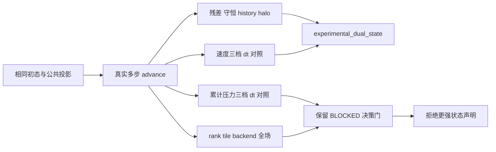

# AVWiS C3 长程时间审计与 M2 拒绝契约

_2026-10-11 · C3 第三增量 · 全周期固定 analytic_shear · double/3D · locked AMReX 26.04 / SHA `9219ba416b7ba2073dd1b12bf19fdce27391f17b`_

## 🎯 结果与决策

先按优先级 A 实施长程真实推进和固定时间三档 dt 证据，再按数值结果落实 B 的
明确可拒绝状态契约。固定网格 Ucat 和三个 Ucont 的时间差呈一阶自收敛；去 datum
后的累计 P 差随 dt 减半约翻倍，物理压力时间门 BLOCKED。细 dt 的 MPI Phi
相对 L2 也未全部满足 `1e-12`，保留后端全场门 BLOCKED。

生产改动只增加 `avwis.state_contract=experimental_dual_state` 的声明/拒绝入口和
测试模式 dispatch。压力、对流、黏性、时间离散、metric、workspace 及默认 MLMG
设置与上一轮逐字保持。本轮没有以替换 P、旧压力项、重构 Ucat 或重建 Ucont
临时修补数学接缝，也没有放宽任何数值门。

主统计仍为 14 已完成、20 进行中、19 未开始，共 53。M2/M4、P5-005、C3 总门
继续开放，C4 未开始。C7 分项 profiling/CUDA-aware MPI、一般 19 点、非正交物理
BC、SNES/BDF2、完整应力、IBM/FSI 和 shear checkpoint/restart 未完成。

## 📋 基线与保护复核

开始前读取主清单、C3 实施/决策报告、C3 workspace 续报、C7、README、迁移方案、
曲线规格、审阅及已有 diff，并检查最近三后端测试日志。确认第二增量的 persistent
workspace、先准备后提交、tilebox、四步混合 xy/xz、history/halo/失败恢复已在。
基线完整套件为 CPU 54/54、MPI 55/55、CUDA 45/45；此前 17 组 MPI 及 CPU/CUDA
六范数最大差约 `1.37e-14` 是历史证据，本轮没有改写成新事实。

开始时为 34 个可直接解析的 modified/untracked 源码等路径保存 SHA-256，
tracked diff 另行保存（中文文件名被 Git 引号转义，未纳入此份 hash 清单）。产物位于 `/tmp/avwis-c3-temporal-initial-sha.json`、
`/tmp/avwis-c3-temporal-initial.diff`。C7 专用输入、测试/比较器及三份 C3/C7 历史
报告保持原样；C7/C3 初次报告另与上一轮 hash 清单一致，workspace 续报本轮未写入。
试验后生产 mapped/deferred 文件与初始 hash 相同。
没有访问仓库外 `../../CUDA/`，没有 reset/checkout/clean/commit，没有修改
MEMORY.md、AGENTS.md 或 OpenClaw 配置。

## 📐 数学与状态语义

沿用第二增量的定义：I 为 cell-to-face 插值/面积内积，C 为 cell physical gradient，
G 为完整 pressure face flux，L=DG。每步实际执行

$$
u^*=u^n+\Delta t[\mathcal A(U^n,u^n)+\nu L_h u^n],\qquad U^*=Iu^*,
$$

$$
L\Phi=D(U^*)/\Delta t,\quad U^{n+1}=U^*-\Delta t G\Phi,
\quad u^{n+1}=u^*-\Delta t C\Phi,\quad P^{n+1}=P^n+\Phi.
$$

旧 P 不进入当前 explicit predictor。Ucont 是质量通量权威，Ucat 是传输状态，
P 是累计 correction history，Phi 是投影 workspace。共同 halo epoch 表示通信
新鲜，不表示 `Ucont=I(Ucat)` 或 cell/face 变换互逆。

`DG` 与 `DIC` 不被本离散约定为同一算子，所以 `D(Ucont)=0` 不保证
`DI(Ucat)=0`。本审计使用完全相同的初始混合模态和一次 `dt=1` 的公共投影，再
统一令初始 P=0；这一步只为隔离 dt，不改变生产算法。初始面散度约
`9.30e-12`，但从该 Ucat 独立插值所得散度为 `0.085266493`。因此“面状态已投影”
不能充当“所有表示已处于同一约束子空间”的证明。

固定时间审计的最后 Phi 最大值在三档 dt 下约 `0.024777/0.024774/0.024772`，
没有随 dt 成比例缩小；累计 P 的体积加权 L2 从 `4.06313` 到 `8.13006` 再到
`16.26392`。这排除了把累计 P 当作该轨迹上时间收敛物理压力的声明。反例只针对
受限离散和指定初值；速度一阶自收敛也不是连续 PDE 或 legacy executable 验收。

### 固定门与失败边界

|门|量/规则|当前含义|
|---|---|---|
|真实耦合|每步 predictor divergence > `1e-8`，max abs Phi > `1e-6`|拒绝 free-stream/零 RHS shortcut 充当推进证据|
|求解/质量|每步 full physical relative residual ≤ `1e-11`，post-projection divergence ≤ `1e-10`|生产 gate 不变|
|守恒/状态|全周期体积加权动量漂移、积分散度 ≤ `1e-12`；cell/face 两层 history error=0；halo fresh|每一步实际核对|
|时间自收敛|相邻两档全场差的比在 `[1.8,2.2]`，差幅 > `1e-14`|显式 Euler 约一阶；不是二阶空间门|
|backend 全场|逐点 `2e-10+2e-11 max(abs(a),abs(b))`，相对 L2 ≤ `1e-12`|所有 canonical fields，失败保留 BLOCKED|
|零散度 backend 尺度|divergence/DI(Ucat) 至少采用物理 U/L=1|沿用近零散度尺度；Phi 没有放宽或 floor|

审计分开输出 `invariant_status`、`velocity_time_gate`、`pressure_time_gate` 和
`backend_field_gate`。CTest 审计成功只证明前两个门；不会把 pressure 或 backend 的
BLOCKED 写成 PASS。`--require-pressure-convergence` 将压力门作为硬拒绝条件。
带 reference 的比较默认严格失败；显式 `--observe-peer` 保存每个原阈值的
PASS/BLOCKED，用于复合审计，绝不宣布未过的全场数值门完成。

### M2/P5-005 可拒绝接口

|请求|行为|拒绝依据|
|---|---|---|
|analytic_shear 的默认/experimental_dual_state|接受现有 explicit Euler、Ucont mass/Ucat transport/P history|限定实验声明；不选择另一套算法|
|single_authority|在 solver 分配前拒绝|逐字段 epoch、重构和 consistency 尚未冻结|
|time_converged_pressure|在 solver 分配前拒绝|本轮压力时间门 BLOCKED|
|其他 mapping 的 state_contract key|明确拒绝 scoped key|不把 shear 声明静默推广到 Cartesian/正交路径|
|SNES/semi-implicit/BDF2|沿用 time_integrator 拒绝|nonlinear residual/Jacobian、系数、停止、整步失败事务仍缺|
|full stress、非正交物理 BC、shear restart|沿用既有拒绝|M6/M3、完整 schema/恢复验收仍缺；epsilon=0 restart 也拒绝|



### Owner、epoch、layout 与 workspace 成本边界

全部 flow/metric 仍由原 solver 所有，BA/DM/metric epoch 绑定不变；没有加入新的
生产 owning MultiFab 或 hierarchy cache。审计拥有独立的历史副本、积分/散度和
独立 I(Ucat) scratch，采用 solver 的 BA/DM 和 converted face layout，写后同步
owner；观察过程不覆盖 Ucont 或改变 valid epoch。测试快照 gather 到唯一 canonical
valid domain，再复制到 pinned host；它不是生产 MPI/GPU I/O 或 checkpoint。

原投影的数值失败事务继续只保护 flow valid state；Phi/scratch 可脏，下次重算。
完整 advance 的 history/predictor 没有 rollback/retry 保证。MLMG/hierarchy 仍每次
构造；workspace 只复用六个 face 和七个 cell 存储。新审计的计时包含重复 history/
稳定性/守恒观测，不能作为纯 advance 性能或分项 profiling。M4 的 diagonal solve、
cross action、halo、scratch/MLMG 分配、内存和代表性成本预算仍 OPEN。

## 🔧 实际修改文件

|文件|责任|
|---|---|
|`src/main.cpp`|M2 scoped acceptance 声明/拒绝，保留旧默认|
|`src/RunMode.{H,cpp}`|独立 contract_c3_temporal dispatch，参数沿用 dt/viscosity/run_steps/metadata_file|
|`tests/contracts/AVWiSContractRunner.{H,cpp}`、`AVWiSContractTestAccess.H`|composed test facade/bridge|
|`tests/contracts/AVWiSC3TemporalChecks.cpp`|生产真实推进、每步门、历史、质量、momentum、初始/末态表示缺陷及 canonical 快照|
|`tests/c3_temporal_audit.py`|固定终止时间全场差、独立压力/后端门、日志、超时/进程组回收|
|`tests/test_c3_temporal_audit.py`|六组比较器契约：压力不收敛不被速度掩盖、每步/shape/NaN/rank/时间错误、场扰动、BLOCKED 保留|
|`inputs/c3_temporal.in`、`c3_reject_{state,pressure}_contract.in`|正向实际推进及两种状态请求拒绝|
|`CMakeLists.txt`、`tests/static_contract_check.sh`|注册审计/拒绝/4-rank small-tile/idle-rank；静态边界|
|README、任务清单、迁移方案、规格、审阅追记、本报告|同步最新证据与未决门；状态/历史不改写|

## 🧪 数值、命令与产物

统一网格 `16x16x4`，epsilon=0.15，scale=(1.1,0.9,1.05)，
stretch=(0.25,-0.15,0.1)，nu=0.01。主矩阵 dt=`2.5e-4/1.25e-4/6.25e-5`，
分别 32/64/128 步到 T=0.008；长程 256 步、dt=2.5e-4 到 T=0.064。
每个 audit 共 480 个实际耦合 advances，均保留每步数值报告，不含自由流替代。

|字段|dt 与 dt/2 的全场 L2 差|dt/2 与 dt/4 的差|差比/门|
|---|---:|---:|---|
|Ucat（体积加权）|`4.4136483e-6`|`2.2068545e-6`|`1.9999725` PASS|
|Ucont_x（canonical RMS）|`1.6231729e-8`|`8.1133448e-9`|`2.0006212` PASS|
|Ucont_y|`3.9454549e-8`|`1.9722839e-8`|`2.0004498` PASS|
|Ucont_z|`1.3259953e-8`|`6.6285878e-9`|`2.0004189` PASS|
|P（体积加权、去 datum）|`4.0669277`|`8.1338631`|`0.4999995` BLOCKED|

CPU 主矩阵最大 full residual=`9.98678e-12`，最大逐步投影散度=`4.11310e-13`，
momentum 最大漂移=`3.33067e-16`，history error=0。epsilon=-0.25 和 epsilon=0
另各执行同一长程矩阵，Ucat 时间差比分别 `2.0000788`、`2.0000105`，压力比分别
`0.4999995`、`0.4999995`。零 shear 沿原 C2 diagonal 路径，其 deferred residual
字段为默认 0，不解读为实测 full residual=0。

MPI rank2/grid4 和 rank4/grid16/tile=(4,4,2) 都执行上述 480 步。后者三个 ranks
为空闲。Ucat/P/Ucont/volume/初值/散度等全场门通过，但 Phi 的 dt/2、dt/4 门失败：
rank4 相对 L2=`1.20742e-12/2.70852e-12`，rank2=`1.26425e-12/2.45093e-12`。
原始值保留于 peer_fields，后端全场总门 BLOCKED。Phi 是 workspace，但本轮没有
把它移出比较、改归一化或放宽门；诊断的具体 roundoff/条件数来源仍须独立审计。

CUDA 单 Box 相同 480 步最终完成。Ucat/Ucont 三档误差比与 CPU 相符，压力门
继续 BLOCKED。CPU/CUDA 全场对照只有细 dt 的 Phi 未过 L2：dt/2=`1.49484e-12`，
dt/4=`2.79876e-12`；其他字段过门。完整比较保存于
`build/c3-20261011-cpu/c3_temporal_cuda_peer_final/comparison.json`，并写回 CUDA
审计的 `backend_field_gate=BLOCKED`。CUDA 480 步最大 full residual=`9.98392e-12`，
最大逐步散度=`4.10559e-13`，momentum 漂移=`1.11022e-16`；CPU/CUDA 的
Ucat/P/Ucont 最大全场相对差=`1.47469e-14`。这不是全场全部 PASS 或 CUDA-aware MPI。

CPU 每步迭代数据进一步给出有限的 M4 工作量证据（不含初始公共投影）：

|轨迹|真实步数|累计 outer|累计 inner|单步累计 inner 最大值|
|---|---:|---:|---:|---:|
|dt|32|355|8965|292|
|dt/2|64|706|18164|292|
|dt/4|128|1408|36691|293|
|long|256|2819|74773|304|

inner 最大值是一个时间步内全部 outer solves 的和，不是一个 MLMG solve 的上限。
这些计数无法分离 kernel、通信、分配或 hierarchy 工作，也不能建立加速比。

### 构建与验证命令

复用 locked installed dependency 和三个已有 consumer；GNU 13.3.0、OpenMPI 4.1.6、
CUDA 12.6.85/arch89。没有 mismatch override，没有重建或改变依赖。

```bash
cmake --build build/c3-20261011-cpu -j 4
cmake --build build/c3-20261011-mpi -j 4
cmake --build build/c3-20261011-cuda -j 3
ctest --test-dir build/c3-20261011-cpu --output-on-failure
ctest --test-dir build/c3-20261011-mpi --output-on-failure
ctest --test-dir build/c3-20261011-cuda --output-on-failure
ctest --test-dir build/c3-20261011-cuda \
  -R 'avwis_c3_(temporal|state_contract|pressure_contract)' --output-on-failure
python3 -B amrex_port/tests/c3_temporal_audit.py \
  --exe build/c3-20261011-mpi/avwis --input amrex_port/inputs/c3_temporal.in \
  --work build/c3-20261011-mpi/c3_temporal_rank2 --mpi-exec /usr/bin/mpiexec \
  --mpi-preflag=--oversubscribe --ranks 2 --max-grid 4 \
  --reference build/c3-20261011-cpu/c3_temporal/audit.json --observe-peer
python3 -B amrex_port/tests/c3_temporal_audit.py \
  --exe build/c3-20261011-cpu/avwis --input amrex_port/inputs/c3_temporal.in \
  --work build/c3-20261011-cpu/c3_temporal_pressure_required_final \
  --require-pressure-convergence
python3 -B amrex_port/tests/test_c3_temporal_audit.py
bash amrex_port/tests/static_contract_check.sh
git diff --check
```

pressure-required 命令预期 exit=1：保存数值 evidence 后明确拒绝，不产生压力 PASS。
CPU/MPI 结果与 audit summaries 位于各 build 的 `c3_temporal*`。日志统一为
`/tmp/avwis-c3-temporal-*.log`，构建 `*-build-accepted.log`、最后完整 CTest
`{cpu,mpi}-ctest-accepted.log`、CUDA 初次完整 `cuda-ctest-final.log` 与最终 focused
`cuda-focused-accepted.log`。这些是本机可审计产物，脚本/输入可重生成。

### 失败、试验和最终验证记录

|验证|结果/边界|日志或证据|
|---|---|---|
|CPU 最终完整 CTest|58/58 PASS，68.22 s|`/tmp/avwis-c3-temporal-cpu-ctest-accepted.log`|
|MPI 最终完整审计 CTest|60/60 PASS，129.61 s；Phi backend 总门 BLOCKED|`/tmp/avwis-c3-temporal-mpi-ctest-accepted.log`|
|CUDA 初次完整适用 CTest|48/49 PASS，610.27 s；新 dt4=128 步超出 180 s 单次预算|`/tmp/avwis-c3-temporal-cuda-ctest-final.log`|
|CUDA 最终 focused|4/4 PASS，666.71 s；480 个真实 advances；pressure/backend 总门 BLOCKED|`/tmp/avwis-c3-temporal-cuda-focused-accepted.log`|
|比较器契约|6/6 PASS；不会把 observation 的 BLOCKED 当 PASS|`test_c3_temporal_audit.py`|
|state_contract scope|Cartesian 请求 key，exit=1，准确 scoped 拒绝；不分配 solver|`/tmp/avwis-c3-temporal-state-scope.log`|
|压力硬门|exit=1，物理压力门 BLOCKED；数值报告仍保留|`/tmp/avwis-c3-temporal-pressure-required-final.log`|
|MPI 超时回收探针|0.02 s 预算，exit=1；日志保留、无 audit.json，无孤儿 ranks|`/tmp/avwis-c3-temporal-timeout-probe.log`|
|静态/格式/保护/统计/进程|PASS；统计 14/20/19；运行任务均结束|`/tmp/avwis-c3-temporal-audit-final.log`|

首次 MPI 全套为 59/60，明确由 Phi 严格 L2 门失败。随后尝试将完整/inner residual
从 `1e-11/1e-12` 收紧到 `1e-12/1e-13`，仍出现 Phi 差 `1.260e-12`，没有解决
问题。这个试验开关未保留，三份 mapped/deferred 生产文件 hash 恢复为本轮初值；
日志 `*-strict*.log` 和 `c3_temporal*_strict/` 保留为未接受的试验记录。
最终通过明确 observation 接口记录 BLOCKED，而没有改变原阈值或宣称 backend
总门完成。下一步仍须定位误差传播/roundoff，不能以更严求解必然更一致作假设。

CUDA 的初次 dt4 超时没有生成 PASS summary。试验减为 16/32/64 加 128 步时，
匹配 CPU 的 Ucont_x 比为 `2.42553`，不在已冻结 `[1.8,2.2]`，故撤回短矩阵，
保持全后端同一 32/64/128+256 真实矩阵。仅 CUDA 使用单 Box、单次 480 s 和
CTest 1800 s 墙钟预算；求解内层 1600、outer 40、full/divergence 门不变。
这是测量预算调整，不是性能提升证据。此任务中不同后端的运行有重叠，墙钟不能
用于速度提升、退化或 scaling 结论。

## 🚧 下一步与拒绝条件

1. M2/P5-005 先设计预测步是否包含旧 pressure gradient、P/Phi 更新和约束变量；
   同时检查 `DG` 与 `DIC` 的差、cell projection 的幂等性和 mixed-mode aliasing。
   冻结 before/after 物理 residual 和压力 MMS/reference，再决定单一权威/逐字段
   epoch，不能以共用 freshness 或重构次数替代数学证明。
2. 未验证该 pressure/velocity residual 前，拒绝 BDF2/SNES/半隐式，以及强行
   `P=Phi`、每步重构 Ucat 或从 Ucat 重建已投影 Ucont 的迁移。未来更换策略必须
   保留 epsilon=0 正交 tight regression，并验时间收敛、守恒和失败事务。
3. M4 再拆 diagonal solve、cross action、halo、分配及内存/迭代成本，审查浅
   hierarchy；本轮数据只扩展真实状态/时间证据，不关闭成本门。
4. 独立处理细 dt Phi 后端差和 C7 profiling/CUDA-aware MPI；随后才考虑 C4/19 点
   或非正交物理 BC。shear checkpoint/restart 持续明确拒绝。

## 🔗 依据与通知

本地依据：[C3 初次实施/决策](./AMReX_C3_弱剪切算子与算法决策_20261011.md)、
[C3 workspace 续报](./AMReX_C3_多步状态与workspace_20261011.md)、
[C7 历史报告](./AMReX_C7_MPI_CPU-GPU对照_20261011.md)、
[曲线规格](./AVWiS曲线坐标实现规格.md)、[任务清单](./AMReX移植任务清单.md)、
[生产时间推进](../amrex_port/src/AVWiSTime.cpp)、
[生产投影](../amrex_port/src/AVWiSProjection.cpp)。没有引用新版本外部 API。

完成全部已授权工作、最终复核和归档后，仅执行一次：
`openclaw message send --channel telegram --target '5602246804' --account default
--reply-to '4913' --message '<本轮简要结果>'`。exit=0，CLI 确认
`Sent via telegram. Message ID: 4915`；日志为
`/tmp/avwis-c3-temporal-telegram.log`。未重试，未使用 system event 或 heartbeat。
