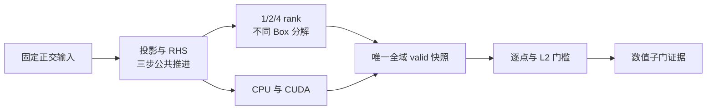

# AMReX C7 MPI 与 CPU/GPU 数值对照实施报告

_日期：2026-10-11 · 范围：单层 separable analytic-orthogonal mapping 的运行/分块/后端契约 · AMReX 26.04 / `9219ba416b7ba2073dd1b12bf19fdce27391f17b`_

---

## 🎯 结果与任务状态

按 [2026-09-18 审阅](./AMReX移植审阅_20260918.md) 的第一优先级推进 C7，新增实际
调用生产算子的数值快照和自动对照工具。周期与入口/出口两个正交 mapped 配置通过
1/2/4-rank、Box 分解、串行 CPU/MPI CPU 及 CPU/CUDA 全场对照。最终完整 CTest：
**CPU 47/47、MPI 48/48、CUDA 38/38 PASS**。CPU/CUDA 最大逐点绝对差为
`4.547473508864641e-12`，最大全场相对 L2 差为 `5.030350699839933e-14`。

这关闭的是 C7 的限定数值对照子门。C7/P5-003 保持“进行中”，P 级任务统计仍为
14 已完成、19 进行中、20 未开始，总计 53。kernel/MLMG/halo/同步分项 profiling、
CUDA-aware MPI、MPI/GPU restart 尚未完成。一般非正交、19 点算子、一般曲面、
legacy 可执行程序等价、LES、IBM、FSI、AMR 和物理 case 全面验收均不在本次范围。

初始 `git status --short` 仅显示仓库外 `?? ../../CUDA/`，未触碰该目录；未执行
reset/checkout/清理，未修改 MEMORY.md、AGENTS.md 或 OpenClaw 配置，未提交 commit。

## 🔧 实现与验收契约

|文件|改动与目的|
|---|---|
|`amrex_port/tests/contracts/AVWiSC7ContractChecks.cpp`|新增测试实现，使用既有 composed friend bridge 访问 solver；非平凡初始化、正交投影、初始对流/黏性 RHS、三步显式推进、归约和确定性全场快照|
|`tests/contracts/AVWiSContractRunner.{H,cpp}`、`AVWiSContractTestAccess.H`|增加 C7 的测试门面和桥接方法，保持 solver 生产 API/字段封装|
|`amrex_port/src/RunMode.{H,cpp}`|增加显式 `contract_c7_backend` 操作，要求 `metadata_file`，沿用 AVWiS 与 legacy namespace 约定|
|`amrex_port/inputs/c7_mapped_{periodic,boundary}.in`|固定 mapping、网格、dt、黏度、周期/物理 BC 的两个契约输入|
|`amrex_port/tests/c7_backend_compare.py`|标准库驱动，启动不同 rank/分块/后端，校验 provenance/shape/finiteness，再作逐点和 L2 对照；保留每次 stdout 日志和 JSON|
|`amrex_port/tests/test_c7_backend_compare.py`|6 个 focused comparator tests：roundoff 可接受；每个字段扰动、相对范数超限、NaN/Inf、截断/缺字段、错误 rank/backend/SHA/history、质量归约错误和冻结历史层均拒绝|
|`amrex_port/CMakeLists.txt`|纳入 C7 测试源，CPU/CUDA 各注册比较器和三分块测试，MPI build 额外注册 1/2/4-rank 矩阵；使用 CMake MPI launcher/flags，Python 命令用 `-B` 避免源码目录 bytecode|
|主清单、README、审阅追记、本报告|更新最新证据、命令、能力边界和下一步；保持历史报告为当时事实|

两个配置共同使用 `16x8x8` cells、`nghost=2`、mapping scale
`(1.25,0.9,1.1)`、stretch `(0.35,-0.2,0.15)`、`dt=1e-4`、`nu=0.01`。
周期配置为三方向 periodic，压力为 volume-weighted zero-mean correction；边界配置为
`xlo=inflow`、`xhi=outflow`、`y=periodic`、`zlo=slip`、`zhi=symmetry`，线性入口剖面
全局归一化到积分通量 0.7，出口压力 0.25。非平凡三分量初值具有非零散度，先投影，
再计算 RHS 并推进三步；确保两类 RHS 和三个速度历史层均非平凡。



快照保存 18 个全场数组：三个 `Ucat` 历史层、三个方向各三个 `Ucont` 历史层、
`P/Phi`、初始 advective/viscous RHS、末步散度及逐 cell 物理体积。每个原始
`MultiFab` 的 valid 区通过 `ParallelCopy` 汇集到 IO rank 的一个全域 Box，面域保持
对应 nodal `IndexType`，包含两个周期端面，无 inter-Box 重复面；FAB 按 `i,j,k,component`
存储顺序输出。CUDA 只在测试观察点把结果复制到 pinned host FAB，生产算子仍在设备
运行。该机制不是 production checkpoint、plotfile 或 P8 sampling 接口。

验收门槛在报告生成前执行：

- version/SHA、实际 backend、`NProcs`、active-rank 数、网格、字段长度、有限值、
  `step=3/history_depth=3/time=3e-4` 必须匹配；实际使用少于请求 rank 会失败
- 初始投影前散度大于 `1e-3`，投影后及末步最大散度小于 `1e-10`；积分散度与
  唯一物理边界净通量的差小于 `1e-12`；CFL/扩散数均不超过 1
- 所有字段逐点满足 `abs(a-b) <= 2e-10 + 2e-11*max(abs(a),abs(b))`
- 每个全场还必须满足 `||a-b||2/max(||a||2,||b||2) <= 1e-12`，符合
  [曲线规格 multibox/MPI 门槛](./AVWiS曲线坐标实现规格.md#测试矩阵)；精确解为零的
  散度采用 `U/L=1` 物理尺度，分母至少为 `sqrt(number_of_cells)`，不将 roundoff
  残差本身当参考规模。初始/末步散度、积分质量及稳定性参数另作全局归约对照
- 每次运行前仅移除其同名旧 snapshot，以及旧 `comparison.json`；非零返回码、
  120 秒超时、缺失报告或比较失败不会生成 PASS summary。无递归删除工作目录

CPU/CUDA 各对 `max_grid_size=4/8/16` 检查 16/2/1 个 Box。MPI 再检查
`(rank,grid)=(2,4),(2,8),(4,4),(4,8)`：四 rank/16 Box 全部 rank 有数据，
四 rank/2 Box 则有两个空闲 rank，覆盖 empty-rank collective 路径。正常 MPI consumer
完整 CTest 中其他测试默认以一 rank 启动；48/48 不意味着每个旧契约均已用四 rank 验收。

## 🧪 实测数值与运行结果

|对照矩阵|比较数量|最大逐点绝对差|最大全场相对 L2 差|结果|
|---|---:|---:|---:|---|
|串行 CPU 三分块、两个配置|4|`2.7284841053187847e-12`|`3.2872034200063326e-14`|PASS|
|MPI CPU 1/2/4 rank 与分块、两个配置|12|`2.7284841053187847e-12`|`3.2872034200063326e-14`|PASS|
|CUDA 三分块、两个配置|4|`2.7284841053187847e-12`|`3.406223959208226e-14`|PASS|
|CPU/CUDA 脚本：4 个 CPU 分块 + 6 个跨后端比较|10|`4.547473508864641e-12`|`5.030350699839933e-14`|PASS|
|MPI/串行 CPU 脚本：12 个 MPI + 6 个跨 build 比较|18|`2.7284841053187847e-12`|`3.2872034200063326e-14`|PASS|

上表矩阵有重叠，不将其数量相加作为独立测试数量。绝对差对全部字段/归约取最大值，
相对 L2 差对全场字段取最大值；相对误差均显著小于 `1e-12`，没有放宽规格的 MPI 门槛。

|配置与后端（grid=8）|投影前最大散度|初始投影后|末步最大散度|末步质量恒等式绝对缺陷|
|---|---:|---:|---:|---:|
|周期 CPU|`6.3301239103e-1`|`3.3463652999e-12`|`3.9774330581e-14`|`3.08e-33`|
|周期 CUDA|`6.3301239103e-1`|`3.3456703921e-12`|`4.0103497455e-14`|0|
|入口/出口 CPU|`4.3139568364`|`8.7297055106e-11`|`1.5739247428e-11`|`1.50e-16`|
|入口/出口 CUDA|`4.3139568364`|`8.7297703790e-11`|`1.5738500459e-11`|`6.91e-17`|

|验证|最终结果|
|---|---|
|CPU fresh Release configure/build/link + 完整 CTest|47/47 PASS，6.58 s|
|MPI dependency fresh build/install + consumer fresh build/link + 完整 CTest|48/48 PASS，35.69 s|
|CUDA fresh configure/compile/device-link/link + 完整适用 CTest|38/38 PASS，100.46 s|
|新增 focused tests|CPU 2/2、MPI 3/3、CUDA 2/2 PASS；comparator 内部 6 tests PASS；最后补充固定终止时间校验后再次定向通过 2/2、3/3、2/2|
|静态契约、补丁格式、任务计数|`static_contract_check.sh` PASS；`git diff --check` PASS；53 项统计复核|

### 硬件与环境诊断

环境为 Linux `5.15.167.4-microsoft-standard-WSL2`，16 个可用逻辑 CPU，
GNU 13.3.0、CMake 3.28.3、OpenMPI 4.1.6、CUDA 12.6.85，AMReX double/3D。
CUDA runtime API 直接查询得到 `NVIDIA GeForce RTX 4060 Laptop GPU`，
compute capability 8.9、global memory `8585216000` bytes；依赖及 consumer 使用 `sm_89`。

`timeout 15 mpiexec --oversubscribe -n 2 /bin/hostname` 成功打印两行 hostname，
后续真实 1/2/4-rank 应用进一步确认本次不存在历史 PMIx socket 启动阻塞。
`nvidia-smi` 不在 PATH；显式 `/usr/lib/wsl/lib/nvidia-smi` 报
`Failed to initialize NVML: GPU access blocked by the operating system`，`/dev/dxg`
也不可见，但 `cudaGetDeviceCount/cudaGetDeviceProperties` 与 AMReX CUDA 初始化、
数值测试均成功。因此结论是 **NVML/设备节点探针不可用，CUDA 计算运行可用**，
不能把这些设备探针失败误记为本轮 CUDA runtime BLOCKED。

`advance_seconds_max` 记录的是三个完整 `advance_one_step` 调用的最大 rank 墙钟时间，
在导出快照前采样，并显式 MPI max reduction。观察到 CPU 单 rank 约 0.009–0.011 s，
CUDA 单 rank 约 0.38–0.54 s（这些 run 与其他测试有重叠）。网格很小，计时没有预热、
重复统计、负载隔离或阶段拆分，**不形成速度提升、性能退化或扩展性结论**。
P8-004 不因这个整体计时而转为完成。

## 📋 构建命令与产物位置

所有依赖、consumer 构建及运行产物均在被忽略的 `build/` 下；日志另保留于 `/tmp`。
CPU/CUDA 复用已有 installed locked dependency，MPI 用现存干净 Git 源树新建
独立 build/install。源树 `git rev-parse HEAD` 为精确 lock SHA，`git status --short`
为空；未从缺失 `.git` 的 archive 构建，未使用版本 mismatch override。

以下命令在项目根目录执行：

```bash
git -C build/deps/amrex-26.04-git rev-parse HEAD
git -C build/deps/amrex-26.04-git status --short

cmake -S build/deps/amrex-26.04-git \
  -B build/deps/amrex-26.04-mpi-c7-build \
  -DCMAKE_INSTALL_PREFIX="$PWD/build/deps/amrex-26.04-mpi-c7-install" \
  -DCMAKE_BUILD_TYPE=Release -DAMReX_SPACEDIM=3 -DAMReX_PRECISION=DOUBLE \
  -DAMReX_MPI=ON -DAMReX_OMP=OFF -DAMReX_GPU_BACKEND=NONE \
  -DAMReX_FORTRAN=OFF -DAMReX_LINEAR_SOLVERS=ON \
  -DAMReX_PARTICLES=OFF -DAMReX_EB=OFF
cmake --build build/deps/amrex-26.04-mpi-c7-build -j 4
cmake --install build/deps/amrex-26.04-mpi-c7-build

cmake -S amrex_port -B build/c7-20261011-cpu -DCMAKE_BUILD_TYPE=Release \
  -DAMReX_DIR="$PWD/build/deps/amrex-26.04-git-install/lib/cmake/AMReX"
cmake --build build/c7-20261011-cpu -j 4
ctest --test-dir build/c7-20261011-cpu --output-on-failure

cmake -S amrex_port -B build/c7-20261011-mpi -DCMAKE_BUILD_TYPE=Release \
  -DAMReX_DIR="$PWD/build/deps/amrex-26.04-mpi-c7-install/lib/cmake/AMReX" \
  -DMPIEXEC_PREFLAGS=--oversubscribe
cmake --build build/c7-20261011-mpi -j 4
ctest --test-dir build/c7-20261011-mpi --output-on-failure

cmake -S amrex_port -B build/c7-20261011-cuda -DCMAKE_BUILD_TYPE=Release \
  -DCMAKE_CUDA_ARCHITECTURES=89 \
  -DAMReX_DIR="$PWD/build/deps/amrex-26.04-cuda-install/lib/cmake/AMReX"
cmake --build build/c7-20261011-cuda -j 3
ctest --test-dir build/c7-20261011-cuda --output-on-failure

python3 -B amrex_port/tests/c7_backend_compare.py \
  --exe build/c7-20261011-cpu/avwis --inputs amrex_port/inputs \
  --work build/c7-20261011-cpu/c7_cuda_peer \
  --peer-exe build/c7-20261011-cuda/avwis
python3 -B amrex_port/tests/c7_backend_compare.py \
  --exe build/c7-20261011-mpi/avwis --inputs amrex_port/inputs \
  --work build/c7-20261011-mpi/c7_serial_peer \
  --mpi-exec /usr/bin/mpiexec --mpi-preflag=--oversubscribe \
  --peer-exe build/c7-20261011-cpu/avwis --peer-backend CPU
python3 -B amrex_port/tests/test_c7_backend_compare.py
bash amrex_port/tests/static_contract_check.sh
git diff --check
```

原始字段与每次运行日志位于 `build/c7-20261011-{cpu,mpi,cuda}/c7_layout/`，MPI
多 rank 矩阵在 MPI build 的 `c7_mpi/`，跨 build 对照在上列 `c7_cuda_peer/`、
`c7_serial_peer/`；各目录的 `comparison.json` 保存逐字段最大差和相对 L2 差。
完整 CTest 日志为 `/tmp/avwis-c7-cpu-ctest.log`、`/tmp/avwis-c7-mpi-ctest.log`、
`/tmp/avwis-c7-cuda-full-ctest.log`，依赖/consumer configure/build 日志为
`/tmp/avwis-c7-{mpi-dep,cpu,mpi,cuda}-{configure,build}.log`。这些是本机可审计产物，
不是随 Git 分发的 reference；重跑上述命令可重新生成。最后一轮 focused 日志为
`/tmp/avwis-c7-{cpu,mpi,cuda}-focused-final.log`。

首次 focused CPU 运行因周期输入未显式启用 boundary configuration，被既有
`P3 diagnostics require explicit boundary configuration` 正确拒绝。输入已补齐
`avwisbcs.enabled=1/geometry=mapped_orthogonal` 及三方向空 BC 名；未绕过生产检查。
之后按曲线规格增加独立相对 L2 门槛、收紧散度/质量判据，再完成最终复测。

## 🚧 下一步与未关闭边界

1. 优先继续 C7/P8-004：在代表性网格上设计并实现 kernel/RHS、MLMG、halo、同步和
   host-device copy 分项计时；记录预热、重复统计和最大 rank 规则，再讨论性能。
2. CUDA-aware MPI 需独立构建 MPI+CUDA AMReX，并检查通信栈支持；本次 MPI CPU 与
   CUDA 单 rank 的分离成功不构成 MPI+CUDA 验收。MPI/GPU restart 仍由生产 scope
   检查拒绝，须单独冻结 writer/reader ownership、schema 与 continuation 契约。
3. 获取 legacy 输入、网格、reference output 与 PETSc/HYPRE 可复现依赖；当前 source
   stencil/解析物理 reference 与 C7 数值一致性均不能替代 executable-to-executable 对照。
4. 后续按主计划推进 P5-005、M6、P6-001 设计与最小实现，再进入 C3/C4。此次没有
   展开新的积分器、黏性模型或 IBM 路线，也不修改其状态。

### 完成通知结果

按要求仅执行一次 `openclaw message send --channel telegram --target '5602246804'
--account default --reply-to '4883' --message '<本轮简要结果>'`。命令 exit code 为 1：
状态数据库初始化报 `attempt to write a readonly database`，随后报
`GatewayTransportError: gateway closed (1006 abnormal closure (no close frame))`，
gateway 为 `ws://127.0.0.1:18789`。本次没有成功发送的确认，不记作已送达；未重试、
未修改 OpenClaw 配置，未发送 system event 或 heartbeat。该通知失败不影响上述
代码、构建、数值验收和文档产物。
