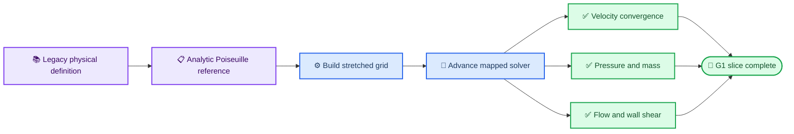
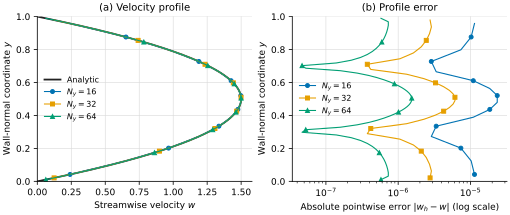
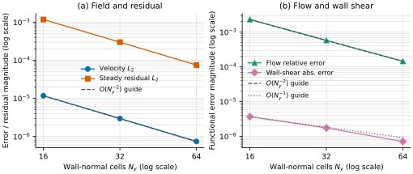

# AMReX C8-G1 正交 mapped 通道物理 reference

_日期：2026-09-18 · 范围：单层、CPU 单进程、separable analytic-orthogonal mapping · Reference：解析 Poiseuille 解与 legacy 源码物理定义_

---

## 🎯 结论

C8 的 G1 正交子切片已经完成。新增压力梯度等效体力驱动的平面 Poiseuille case，
在 `y` 向正交拉伸网格上运行 100 个显式步，并以解析稳态解检查速度、去 datum 压力、
质量、流量和壁面剪切。16/32/64 三组壁法向网格的速度、稳态动量残差和流量误差
均呈二阶收敛；64 层网格速度 $L_2$ 误差为 $7.41\times10^{-7}$，流量相对误差为
$1.44\times10^{-4}$，散度和去 datum 压力误差为 0。

这关闭的是 **separable-orthogonal physical reference**，不是弯管或一般非正交
curved-channel。仓库没有 legacy `control.dat`、网格、reference output 或可复现的
PETSc 3.4 依赖包，因此本轮只建立源码可追踪的 legacy 物理定义，不声称运行过旧可执行程序。

## 📋 Case 定义

流向取 `z`，壁法向取 `y`，`x/z` 周期，`y=0,1` 为 no-slip wall。mapping 为

$$
y(\eta)=\eta+0.35\frac{\sin(2\pi\eta)}{2\pi}.
$$

运动黏度为 $\nu=0.01$，均匀流向体力为 $f_z=0.12$，等价 legacy 配置为
`-dpdz -0.12`。解析稳态解和 reference 量为

$$
w(y)=\frac{f_z}{2\nu}y(1-y)=6y(1-y),\qquad
Q=\int_0^1w\,dy=1,\qquad
|\tau_w|=\nu|w'(0)|=0.06.
$$

`w=6y(1-y)` 与 legacy `BcsUtility.C` 的 `inletprofile=4` 单位体积流量剖面一致；
`RHSSolver.C` 的 `-dpdz` 分支提供对应恒定平均压力梯度语义。



## 📊 数值结果

所有网格使用 `8 × Ny × 8` cells、`dt=1e-4`、`final_time=1e-2`，只细化壁法向。

| $N_y$ | 速度 $L_2$ | 速度 $L_\infty$ | 稳态残差 $L_2$ | 流量相对误差 | 壁面剪切最大误差 |
| ---: | ---: | ---: | ---: | ---: | ---: |
| 16 | 1.1715133e-5 | 2.3500421e-5 | 1.1783947e-3 | 2.3073866e-3 | 3.6824632e-6 |
| 32 | 2.9648013e-6 | 6.1056357e-6 | 2.9904380e-4 | 5.7769731e-4 | 1.7431384e-6 |
| 64 | 7.4136365e-7 | 1.5411424e-6 | 7.5041106e-5 | 1.4447503e-4 | 7.0671289e-7 |

| 指标 | 16→32 ratio / order | 32→64 ratio / order | Gate |
| --- | ---: | ---: | --- |
| 速度 $L_2$ | 3.9514 / 1.982 | 3.9991 / 2.000 | 二阶 |
| 稳态残差 $L_2$ | 3.9405 / 1.978 | 3.9851 / 1.995 | 二阶 |
| 流量误差 | 3.9941 / 1.998 | 3.9986 / 1.999 | 二阶 |
| 壁面剪切误差 | 2.1125 / 1.079 | 2.4665 / 1.302 | 单调且至少一阶 |

三个网格的 `divergence_linf`、积分散度、散度 $L_1$、去 datum 压力
$L_2/L_\infty$ 均为 0。细网格数值流量为 `1.0001444750282487`；上下壁面剪切为
`+0.060000706712891261` 和 `-0.060000706712891261`。


_Figure 1: 三网格数值剖面与解析抛物线重合；右图以对数横轴显示逐点绝对误差随网格加密下降。数值点之间的连线仅用于视觉引导，不参与误差计算。_


_Figure 2: 速度、稳态残差和流量误差跟随二阶参考斜率；壁面剪切误差下降较慢，并与一阶参考斜率单独比较。参考线在 $N_y=16$ 归一化，不是拟合结果。_

可复现绘图脚本、原始 JSON/CSV、PNG/SVG 和变换 manifest 位于
[`run_cases/mapped_channel_reference/`](../run_cases/mapped_channel_reference/README.md)。PNG
按 180 mm 宽、301 DPI 导出，并已检查为不含透明层的 RGB；SVG 保留可编辑文本。

## 🔍 审阅中发现并修正的问题

首轮物理 case 显示：流量误差二阶，但速度仅约半阶到一阶，壁面剪切随细化恶化。
根因是 mapped 黏性在 Dirichlet wall 直接使用 mirror ghost，壁面一阶梯度误差除以首层
cell volume 后形成 $O(1)$ 局部截断误差。

修正后的黏性边界通量在 separable orthogonal no-slip/moving wall 上使用“壁面值 +
前两个物理 cell center”的非均匀二次拟合。ghost 语义保持不变，仅 viscous face flux
升级为二阶；修正后速度、残差和流量恢复约 2 阶。壁面剪切是导数量，目前观测为
1.08–1.30 阶，报告和测试均使用独立 functional gate，没有将其误报为二阶。

## 🔗 Legacy 证据边界

|证据|状态|含义|
|---|---|---|
|`BcsUtility.C` profile 4|已追踪|`6*(y-y*y)`，单位 bulk flow|
|`RHSSolver.C -dpdz`|已追踪|恒定平均压力梯度；本 case 等价 `dpdz=-0.12`|
|AMReX 解析 reference|已运行|同剖面、流量、壁面剪切与压力 datum|
|legacy 可执行程序|未运行|缺 `control.dat`、网格、reference output 与可复现 PETSc 3.4 环境|

因此当前结论是“analytic reference + legacy source-traceable physical definition”，
不是 legacy whole-program parity。若后续取得旧 case 包，应保持本 case 参数不变并增加
速度剖面、去 datum 压力和时间历史的 executable-to-executable 比较。

## ✅ 验证证据

|检查|结果|
|---|---|
|C8-G1 focused CTest|PASS，0.91 s|
|CPU Release 完整 CTest|45/45 PASS，6.20 s|
|CUDA clean incremental build|PASS|
|CUDA mapped 受影响回归|8/8 PASS，9.91 s|
|输出|每个网格一份 JSON/CSV；两组 PNG/SVG；figure provenance manifest|

复现命令：

```bash
cmake --build build/review-cpu -j2
ctest --test-dir build/review-cpu \
  -R avwis_c8_g1_mapped_channel_reference --output-on-failure
```

运行产物位于 `build/review-cpu/c8_g1_mapped_channel/`。CTest 每次先清理该目录，
然后重新生成三组 JSON/CSV，避免把陈旧结果当作证据。纳入版本控制的结果副本和
绘图脚本位于 `run_cases/mapped_channel_reference/`；脚本不做过滤、平滑或数据排除。

## ⚠️ 剩余边界

- C8-G1 当前为 CPU 单进程；MPI/多 Box 后端一致性属于 C7。
- case 是正交拉伸平直通道，不是弯曲中心线或一般非正交网格。
- 真正 curved-channel 仍依赖 C3 cross term、C4 19 点压力路径和一般曲面 BC。
- legacy executable 对照需要用户提供或恢复受版本控制的旧 case 输入、网格与输出。
