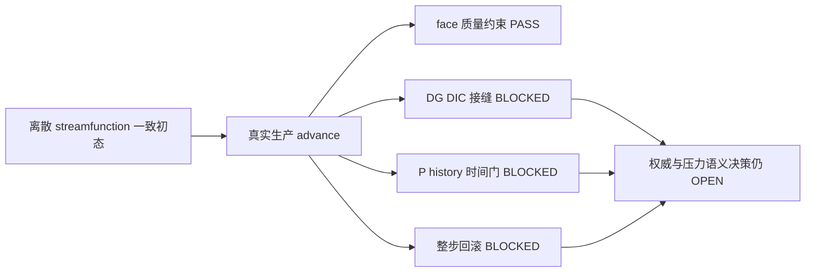

# AVWiS M2 一致初态、幂等性与失败事务诊断实施报告

_2026-10-11 · M2/C3/P5-005 诊断增量 · AMReX 26.04 / SHA `9219ba416b7ba2073dd1b12bf19fdce27391f17b` · double / 3D_

---

## 🎯 结果与边界

完成有非零压力响应的一致初态 reference、独立 DG/DIC residual、压力 datum、两种
重投影、真实整步失败及最小时间收敛证据。没有发现可通过局部压力加法修复解决的生产缺陷，
本轮生产源码全部保留。数学结论是：**初态一致仍不足以让运行期双表示一致，也不足以让
累计 P 成为时间收敛的物理压力；整个 advance 目前具有 fatal failure 合同，没有回滚事务。**

原 stretched reference 的累计压力时间门和 fine-dt Phi 后端门继续 BLOCKED；本轮未重跑
原 32/64/128+256 步矩阵。新 affine reference 的限定 transport 后端 PASS 不能替代这些门。
53 项主清单仍为 **14 已完成、20 进行中、19 未开始**；M2/P5-005/M4/C3/C7 进行中，C4 未开始。

## 🔍 基线保护与实施范围

起始保存 workspace 内 248 个 tracked/untracked 文件的 SHA-256 与完整 scoped diff：
`/tmp/avwis-m2-consistent-initial-sha.json`、`/tmp/avwis-m2-consistent-initial.diff`。
核对任务清单、README、方案、曲线规格、审阅、上一 Pressure/Phi 报告、三个 build cache
和已有证据。适用父级 AGENTS 已核对；未读取或修改仓库外 CUDA 文件内容。

实际实施采用用户指定的委派配置 `gpt-6.1-sol` / `high`；该记录仅指实施子代理配置，
不宣称主会话模型已切换。主代理负责独立审阅和唯一收尾通知。

新增实现只在 `contract_c3_temporal` 的 `consistent_reference=1` 分支工作；与
`pressure_reference=1` 同时选择时准确拒绝。原 reference body 和普通 temporal 分支保留。
新路径只允许 nonzero affine shear（`mapping.stretch=0 0 0`）、positive dt/nu、1..64 步；
原 stretched mapping 反例没有被覆盖或改成 affine。新增 Python driver/reference 检查、
两项 CTest、静态合同及五份指定文档。没有引入新生产状态合同或一般求解器。

## 📐 一致初态与压力 reference

固定 `16×16×4`、epsilon=0.15、scale=(1.1,0.9,1.05)，采用

$$
A=\begin{pmatrix}s_x&\epsilon s_y&0\\0&s_y&0\\0&0&s_z\end{pmatrix},\quad
\psi=0.04\sin(2\pi\xi)\sin(2\pi\eta),
$$

$$
v=(\delta_\eta\psi,-\delta_\xi\psi,0),\quad
u_0=Av+(0,0,0.1\sin(2\pi(\xi+\eta))),\quad U_0=Iu_0.
$$

此处 $\delta$ 是 centered cell difference，三角函数导数因子为
$\sin(2\pi h_d)/h_d$，不是直接代入连续导数。affine mapping 上 mixed centered
差分可交换，第三速度分量与 z 无关，故 $DIu_0=DU_0=0$ 至舍入精度。
**初态权威为 cell streamfunction，face 从 I 一次构造**；随后执行实际生产双表示推进，
face 仍负责质量约束。这只是初态约定，没有宣称运行期 `Ucont=I(Ucat)`。

|一致初态/独立 reference 检查|CPU max/relative|判定|
|---|---:|---|
|初态 DI(Ucat)、D(Ucont)|均 6.62182e-15|绝对原散度门 PASS|
|初态 Ucont 与 I(Ucat)|逐值相等|PASS|
|独立 streamfunction Ucat|逐值相等|PASS|
|初态压力 source max abs|3.69290|非零响应|
|DG multiplier 与独立 Fourier inverse|relative 1.10415e-13|PASS|
|DG multiplier source residual|relative max 2.55422e-13|PASS|
|DIC multiplier source residual|relative max 0.1464466094|BLOCKED，约束不同|
|reference multiplier 体积均值|5.21502e-19|既有 zero-mean datum PASS|

以实际生产 advection/viscosity 形成 $R_0$，定义初始 **face-constraint multiplier**
$DG\lambda_0=DI R_0$。Python 独立从 canonical metric/initial_rate 重算 DI source，
并使用 affine DG Fourier symbol 求逆；没有替换生产求解器，也没有减 RHS 均值。
只在通过 compatibility 后选择 Fourier pressure 常数模态为零，对应原体积加权 datum。
生产 `P0=lambda0`，`Phi0=0`，全部 old/older 速度层初始化为同一一致状态。

DG 与 DIC 的 Fourier symbols 为

$$
\widehat{DG}=-4\sum_dH_{dd}\frac{\sin^2(\theta_d/2)}{h_d^2}
-2\sum_{d<t}H_{dt}\frac{\sin\theta_d\sin\theta_t}{h_dh_t},
$$

$$
\widehat{DIC}=-\sum_dH_{dd}\frac{\sin^2\theta_d}{h_d^2}
-2\sum_{d<t}H_{dt}\frac{\sin\theta_d\sin\theta_t}{h_dh_t},\quad H=A^{-1}A^{-T}.
$$

此 even periodic 网格的 DG 只有常数 null mode；DIC 还有 checkerboard 模态，总计
8 个 null modes。因此“改成 DIC 求解”也不是只切换一个离散 action：必须先规定
额外零空间/可解性合同，不能仅用原 zero-mean gauge 关闭 cell authority。
此为离散 reference；没有建立连续压力 MMS、一般 stretched 一致构造或物理 BC。

## 🧪 初态一致后的真实时间推进

固定 T=0.002，CPU 真正运行 4/8/16 步，dt=5e-4/2.5e-4/1.25e-4，
每步 residual<=1e-11、divergence<=1e-10。第一步 Phi max 均约 0.0245440742，
不再出现上一不一致初态反例的 O(1/dt) 初始 correction。

忽略舍入后，第一步满足

$$
DG\Phi_1=DI R_0,\quad DIu_1=dt\,(DG-DIC)\Phi_1,\quad DU_1\simeq0.
$$

独立全 velocity 更新 identity relative=8.02e-17（CPU4）通过原比较门。
直接小 DI identity 比较仍保留原 relative<=1e-12 门：CPU4/8/16 为
3.10e-12/5.85e-12/1.10e-11，判为 BLOCKED；CPU4 absolute difference 仅 1.80e-15。
这些近零 cancellation 数据没有被删去或改用 scale floor。CUDA 初态独立 DI 的
relative=0.05618、absolute=4.27e-16 同样 BLOCKED；非零 source 对照 relative=5.98e-17 PASS。
初态绝对约束和独立完整速度构造通过，与近零场 relative gate 是不同陈述。

|固定时间全场差分量|coarse/fine L2 差比|原一阶比值门|
|---|---:|---|
|Ucat|1.999386118|PASS|
|Ucont x/y/z|1.999011179 / 1.999245965 / 1.999999548|PASS|
|累计 P，初值为 lambda0|0.499989895|BLOCKED|
|最后一步 Phi|0.300831315|BLOCKED|

`P(T)=lambda0+sum(Phi)` 的两档差分别 2.02328 与 4.04664，细化 dt 后变大。
此最小参考足以反驳“只修初态即可使累计 P 时间收敛”；它不是充分的长程/渐近阶数审计。
Phi 的短序列也没有满足一阶差比，不可将 `P=Phi` 当作已经验证的修复。
既有 old-P 扰动证据表明 predictor 不消费旧 P；本轮没有重复该扰动，不把它写作新证据。

## 🔄 幂等性与整步失败事务

在完整 15 个 registered state 字段（Ucat 三层、Ucont 三方向各三层、P/Phi/Nvert）
保存 canonical valid 快照，并保留每个本地 field 包含全部 allocated ghosts 的 exact
change norm。另记录 time/step/history_depth、valid/halo/physical epoch 和上一次成功 advance
计时。压力算子 workspace/scratch 不属于回滚声明，也没有在失败后继续推进。

|实验|实际结果|合同结论|
|---|---|---|
|保持 projected Ucont，再直接 project_mapped|current/history Ucat/Ucont/P/Nvert 含 halos 全部逐值不变；Phi 被重置为 0|flow 幂等 PASS；含 Phi 的全字段幂等 BLOCKED|
|先 sync_ucont_from_ucat，再 projection|CPU4 before D=3.15914e-4，after=1.23e-15|重插值重投影幂等 BLOCKED|
|真实 advance 的 deferred max_iterations=1|准确 `deferred pressure exhausted max_iterations=1` 拒绝；current 和 old/older velocity/face 已改变；P/Nvert 未变|准确失败拒绝 PASS；整步 rollback BLOCKED|
|失败 metadata|CPU4 time=0.002、step=4、history=3 不动，valid/halo epoch 18→20，last-success timing 不动|没有假装整步状态保持|

失败配置仅在测试中临时设为1，catch后恢复原配置；没有增迭代、没有生产 rollback 补丁。
失败后的 flow state 保留原样作为证据，当前 test 随即退出。上一独立 `project_mapped`
失败保护 PASS 不意味着 `advance_one_step` 有恢复事务。



## ⚙️ 后端证据与复现

主矩阵：`build/m2-consistent-20261011-matrix/run-i7eergo6/`。
CPU reference=4 Boxes、grid8；layout16=1 Box；MPI4 grid8四 ranks 均有 Box；CUDA grid8。
后端比较相同初态、T、16步及所有 126 个诊断 fields，没有删近零 residual 或 Phi 字段。

|新 affine backend 对照|六 transport fields|Phi relative L2|全诊断 fields|
|---|---|---:|---|
|CPU layout16|PASS|0|PASS|
|MPI4|PASS|0|PASS|
|CUDA|PASS|2.85946e-13|13 项 BLOCKED，完整列表在 evidence|

六 transport fields 是 final Ucat/P/Phi 与三方向 Ucont。CUDA 的 13 项含近零 D/DI、
final_phi_DG、重插值 residual/Phi 与 failed_before_Phi；不能称完整全场 PASS。
MPI4/CUDA 此轮后端矩阵只比较最细档16步；三个 dt 的时间比值是 CPU 证据；MPI/CUDA 时间收敛本轮 NOT TESTED。
原 stretched fine-dt Phi 门是历史 BLOCKED，本轮 NOT RERUN。

```bash
cmake --build build/c3-20261011-cpu -j 4
cmake --build build/c3-20261011-mpi -j 4
cmake --build build/c3-20261011-cuda -j 3
python3 -B amrex_port/tests/consistent_state_reference.py \
  --cpu build/c3-20261011-cpu/avwis --mpi build/c3-20261011-mpi/avwis \
  --cuda build/c3-20261011-cuda/avwis --input amrex_port/inputs/c3_temporal.in \
  --work build/m2-consistent-20261011-matrix
python3 -B amrex_port/tests/test_consistent_state_reference.py
```

首次加强独立近零 DI check 时，CUDA 如实写 `INCOMPLETE/error`，证据仍留
`run-c2nuemfq/`。随后保留该 relative BLOCKED 数据，非零 source 和全 velocity identity
继续严格验收，完整矩阵写 `DIAGNOSTICS_COMPLETE`。没有放宽数值门或改生产字段。
摘要追加三面 temporal ratio 和完整诊断 blocked list 时只重读已存快照，未重跑数值。

`--require-decision` 实际 exit=1，artifact 为 `DIAGNOSTICS_COMPLETE` 且
`mathematical_decision_gate=BLOCKED`；准确失败日志为
`/tmp/avwis-m2-consistent-strict.log`，快照在 `build/m2-consistent-20261011-strict/run-2ru21_t6/`。
不是其他错误造成的退出；默认 driver 的成功仅代表证据收集/拒绝合同完成。

## ✅ 验证、风险与下一决策

|实际验证|结果|证据|
|---|---|---|
|CPU build、定向 CTest|13/13 PASS，2.20s|`/tmp/avwis-m2-consistent-cpu-{build,ctest}.log`|
|MPI build、定向 CTest|14/14 PASS，69.60s|`/tmp/avwis-m2-consistent-mpi-{build,ctest}.log`|
|CUDA build/device-link、定向 CTest|13/13 PASS，75.25s|`/tmp/avwis-m2-consistent-cuda-{build,ctest}.log`|
|独立 Fourier/reference 拒绝检查|4/4 PASS|`test_consistent_state_reference.py`|
|原 Pressure/Phi Python reference 检查|6/6 PASS|`test_pressure_phi_reference.py`|
|三项实际拒绝|互斥 selector、non-affine、65步准确拒绝|matrix command/log/evidence|

定向 CTest 含新增 M2 reference/FFT、时间系数、C3 输入拒绝、原 temporal comparator
及正交 projection；不是完整套件，不能把手动矩阵与 CTest 数量相加当算法验收。
后端只验证当前固定 mapping/网格，未证明一般 geometry、连续 pressure MMS、物理 BC、
长程收敛或 MPI/GPU checkpoint。未实现 C4/SNES/BDF2/完整应力/IBM/FSI。

现有证据允许排除“只修初态”“只修 P 加法”“直接 P=Phi”作为无条件生产修复。
下一步数学决策应分别规定：

1. 若运行期 cell 为唯一权威并要求 Ucont=Iu/DIu=0，pressure correction 必须满足 DIC
   约束或更换一致离散，同时处理 checkerboard 零空间，不能继续把 DG 当 DIC。
2. 若 face 为唯一质量权威，必须设计与其一致的 transported cell/predictor 同步合同，
   不能在下个 predictor 无条件 I 重建时假设质量约束已保持。
3. 瞬时 multiplier 与增量 pressure 是不同时间语义。采用增量路线须消费旧 P 梯度并
   配合一致约束；采用瞬时路线须有独立时间/空间压力 reference，当前 Phi 短序列不足。
4. 保持现有 fatal failure 或提供全 advance 事务必须显式选择。当前失败 solver 不可作为
   可恢复状态继续使用；实际 rollback 需覆盖历史、fields、epoch 和成功 diagnostics。

这些是有证据的算法选择边界，不是未经验证的生产改动。M2 总门继续 BLOCKED。

来源：[上一 Pressure/Phi 根因诊断](./AMReX_Pressure-Phi_reference根因诊断_20261011.md)、
[生产时间推进](../amrex_port/src/AVWiSTime.cpp)、[生产投影](../amrex_port/src/AVWiSProjection.cpp)、
[新增一致初态实现](../amrex_port/tests/contracts/AVWiSPressureReference.cpp)、
[独立 reference driver](../amrex_port/tests/consistent_state_reference.py)。


最终保护审计：248个基线文件中238个SHA-256不变，仅测试/接入/静态合同5个和指定文档5个
有增量变化，无基线文件删除。全部 `amrex_port/src/` 生产源码、原输入、原历史报告和
既有Python审计文件逐字保留。保护摘要 `/tmp/avwis-m2-consistent-protection.json`。
静态合同及 scoped `git diff --check` 通过；收尾可见进程表无cmake/CTest/MPI/avwis/nvcc后台任务。
没有reset/checkout/clean/commit/push，没有修改AGENTS、MEMORY或通知配置；通知由主代理
按用户已授权的唯一Telegram命令收尾，本实施代理没有发送任何外部通知。

主代理最终审计已完成，记录为 `/tmp/avwis-m2-consistent-root-final-audit.json`。
唯一一次用户授权 Telegram 收尾通知由主代理实际执行：指定 target/account、reply-to4931，
CLI exit=0，返回 `Sent via telegram. Message ID: 4933`；日志
`/tmp/avwis-m2-consistent-telegram.log`。未重试或补发，本实施代理没有发送通知。
通知记录追加后 scoped `git diff --check` 通过，可见进程表无后台 build/test。
