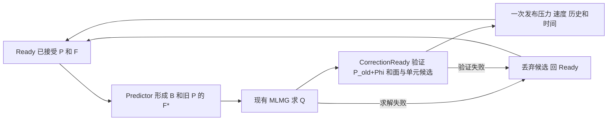

# AMReX M2 增量压力状态与移位求解实施报告

_2026-10-12 · 受限生产算法增量 · 全周期非零 affine analytic_shear · explicit Euler · AMReX 26.04，锁定 SHA `9219ba416b7ba2073dd1b12bf19fdce27391f17b`_

## 🎯 决策与交付边界

新增 `face_authoritative + incremental_pressure`，接入真实
`AVWiSSolver::advance_one_step()`，包含旧压力 predictor、当步 Phi、累计 P 和
候选发布状态机。选择现有 metric face gradient、deferred MLMG 和重构 R；没有
进入 C4 一般19点、SNES/BDF2、物理 BC 或完整应力。该生产功能可通过配置回退。

本轮交付的是可审计的压力增量状态与数值失败提交保护，尚未完成连续物理压力。
在当前线性面约束离散中，移位后的累计 P 和速度与 instantaneous 投影代数等价；
因此不声称提高速度精度、物理压力精度或求解性能。改进在于生产 Phi 真正表示
压力增量，旧 P 与当步增量的角色明确，数值求解失败不发布不完整整步。

默认 `experimental_dual_state + accumulated_correction` 保持原 predictor 与累计
输出；`face_authoritative + instantaneous_pressure` 保持 P=Phi 原行为。注册15个
字段的顺序、默认门限、依赖、checkpoint 限制均未变。任务主统计仍14/20/19共53项；
M2/C3/P5-005/M4/C7 继续进行中，C4 未开始。

## 📐 离散推导与变量语义

本地依据：[`AVWiSTime.cpp`](../amrex_port/src/AVWiSTime.cpp)、
[`AVWiSProjection.cpp`](../amrex_port/src/AVWiSProjection.cpp)、
[`AVWiSDeferredProjection.cpp`](../amrex_port/src/AVWiSDeferredProjection.cpp)、
[`AVWiSMetricData.cpp`](../amrex_port/src/AVWiSMetricData.cpp)。metric 的 beta=1；
Euler 的 `TimeStepDiagnostics::projection_time_coefficient=1`，生产 advance 不读取
非1系数，既有可调 alpha 仅适用于独立旧投影契约。

定义 F=Ucont（已积分面体积通量），V 为 cell volume，N 为带符号面净通量，
D=V^-1 N。I 将 Cartesian cell acceleration 插值为积分面加速度通量；G_f
为共享的完整 metric 面压力梯度通量，包含当前剪切 cross 项；R 为既有六面重构。
令 A^n 表示 advection+component-viscosity+body-force，不含压力。

现有 instantaneous 路径：

$$
B=F^n+\Delta t\,I(A^n),\qquad
(-NG_f)\Phi=-\frac{\alpha}{\Delta t}N(B),\qquad
F^{n+1}=B-\frac{\Delta t}{\alpha}G_f\Phi,\quad P^{n+1}=\Phi.
$$

旧 dual-state predictor 同样不消费旧 P，但输出 P+=Phi 历史。因此直接把当前
instantaneous 的赋值改成累加，会重复累加当步约束乘子，不能据此定义物理压力。
投影源码中“incremental pressure correction”注释本身不足以证明旧 predictor 具有
增量压力算法的数学语义。

新契约固定 alpha=1：

$$
F^*=B-\Delta t\,G_fP^n,\qquad
(-NG_f)\Phi=-\frac{N(F^*)}{\Delta t},\qquad
P^{n+1}=P^n+\Phi,\qquad F^{n+1}=F^*-\Delta t\,G_f\Phi.
$$

令 $\mathcal A=-NG_f$，由线性性得到
$\mathcal A\Phi=-N(B)/\Delta t-\mathcal A P^n$，所以选择移位未知量
$Q=P^n+\Phi$：

$$
\mathcal A Q=-\frac{N(B)}{\Delta t},\qquad
\Phi=Q-P^n,\qquad
P_{\rm candidate}=P^n+\Phi,\qquad
F_{\rm candidate}=B-\Delta t\,G_fP_{\rm candidate},\quad
Ucat_{\rm candidate}=R(F_{\rm candidate}).
$$

代码实际形成旧 P predictor F* 并报告其投影前散度；MLMG 求 Q，以避免直接小增量
RHS 的相消。P_candidate 使用真实浮点 P_old+Phi，面修正使用该同一 combined P，
随后重新计算其 full residual，不能仅引用求 Q 时的残差证明发布值合格。

|变量|代码中的含义|恢复量纲时的离散量纲|时间系数/层|
|---|---|---|---|
|Ucat|Cartesian cell velocity；R(F)|L/T|提交 n+1|
|Ucont=F|积分面体积通量|L³/T|提交 n+1|
|A^n|不含压力的 cell acceleration|L/T²|显式 n 层|
|G_f(P)|积分面压力加速度通量，beta=1|L³/T²|predictor 用 P^n|
|P|累计的离散 face 约束乘子|运动学压力 L²/T²，自然尺度 U0²|存储槽 n+1；对应显式 n 层 RHS，物理时间层未验证|
|Phi|最后一次接受的压力增量 Q-P^n|与 P 相同 L²/T²|alpha=1；压力更新无额外 1/dt|
|Q|MLMG 中移位后的完整乘子候选|与 P 相同|不是额外持久物理字段|

代码字段实际均为无量纲。尚未冻结完整 L0/U0/rho 到 dimensional Pa 的转换，
不得把自然运动学压力尺度解释为已验证的物理单位。全周期 Q 沿用体积加权 zero
mean；initialize 为 P^0=Phi^0=0，P 保持该 datum 到浮点舍入精度。Phi 是同 datum
压力状态的差分，不能与 instantaneous 模式的完整 Phi 直接当同一变量做后端比较。

连续物理压力仍缺对应的 reference/MMS、压力梯度与离散动量残差匹配、空间重构
影响以及发布存储层与真实物理时间层的验证。本轮只验离散 P/Phi 时间行为。

## 🔧 生产入口、失败与回退

|入口/文件|本轮实际改动|
|---|---|
|`src/AVWiSMappedOperators.cpp`|只为 face_authoritative 接受 incremental_pressure；原默认选择保持|
|`src/AVWiSSolver.H/.cpp`|opt-in 分配两份标量候选和 phase；字段/运行 metadata 明确压力含义与失败范围|
|`src/AVWiSTime.cpp`|advance_one_step 的新分支；私有 advance_incremental_pressure 实现真实候选求解与发布|
|`src/AVWiSProjection.cpp`|新契约禁止 standalone project_mapped 提交增量，避免重播 Phi|
|`tests/contracts/AVWiSPressureIncrementChecks.cpp`|真实推进、失败注入及少量 P/Phi 快照|
|`tests/pressure_increment_audit.py`|固定 T 的小验收，独立逐步 P_old+Phi 精确检查|
|`inputs/m2_pressure_increment.in`、CMake/temporal test dispatch|可执行输入与单项 CTest 注册|



发布前检查有限值、原 full relative residual≤1e-11 和投影散度≤1e-10；内层
MLMG relative≤1e-12/absolute=0、compatibility、外层40次预算、zero-datum 规则不改。
所有数值检查完成后才轮转历史、发布 P/Phi/Ucont/Ucat 和时间/step/epoch。失败后
scratch 重建，不使用失败候选作为初值。phase 在失败后回 Ready；旧路径仍使用
原有 fatal 整步语义。本轮测试还确认初态 fresh 时失败前后所有注册字段及 halos
逐值相同。一般 stale halo 刷新不属于未触碰 scratch 的声明。

运行时设备/MPI/复制故障发生在发布中仍为 fatal，未实现跨运行时故障的原子事务；
不承诺异常断电恢复或 GPU/MPI checkpoint。没有公开 P+=Phi 重播接口，连续两次
standalone projection 都在变更前明确拒绝。

回退配置选择 `pressure_contract=instantaneous_pressure`，或选择原默认
`state_contract=experimental_dual_state`、`pressure_contract=accumulated_correction`。
全周期非零 affine shear、stretch=0、explicit Euler/component Laplacian 之外的范围
保持拒绝；新功能不自动推广到 Cartesian、正交、一般非正交或物理边界。

### 直接增量候选的舍入底

原候选直接对 F* 形成增量 RHS、求 Phi；CPU dt/2 第二步 inner=1600 后失败：
initial residual=1.15466e-6，final residual=2.42887e-18，相对约2.10e-12，
第400/600次已停在相同水平。故未达到原1e-12 inner停止条件。小 RHS 来自近抵消
旧压力的 predictor，工作日志支持舍入残差底判断；没有据此修 mean 或调阈值。

候选源码及失败日志已保存在证据目录的 `direct-increment-candidate.cpp` 和
`direct-increment-blocked.log`。最终交付数学等价的移位求解；旧路径 stencil、归约
及阈值未调整。CUDA 私有方法设备 lambda 编译限制通过 AMReX 的 Copy/Add/plus
解决，最终候选方法保持私有，稳定性检查仍统一由 advance_one_step 执行。

## 🧪 数值验收与门状态

固定16×16×4、epsilon=.15、scale=(1.1,.9,1.05)、stretch=0、nu=.01，
一致 mixed-mode 初态先使用既有 projection 形成面约束，再显式设置 P^0=Phi^0=0。
测试初始化属于 test runner，生产 solve 仍使用既有零初态。T=.002，
(dt,steps)=(.0005,4)/(.00025,8)/(.000125,16)。CPU 和 MPI4 相同小验收，
CUDA 在 RTX4060 Laptop / sm89 上真实运行；既有 CUDA fast-math 构建参数不改。

|验收|CPU|MPI|CUDA|范围|
|---|---|---|---|---|
|小项 CTest 核心回归|PASS 6/6|PASS 6/6（MPI executable，单rank）|PASS 5/5|旧 P=Phi、旧显式推进/Cartesian 投影、拒绝；CPU/MPI集含新增单项|
|新路径固定 T 和状态验收|PASS|PASS MPI4|PASS|4/8/16步真实非零投影；CUDA单独运行同一新项|
|旧 dual-state 本轮基线对比|PASS 126字段 exact|PASS MPI4 126字段 exact|PASS 126字段 exact|既有 consistent reference 短轨迹；未扩展矩阵|
|正式 solve +非零三分量 body force|PASS|PASS MPI4|PASS|零初态真实4步、alpha=1日志和metadata|
|压力增量首步/零更新/重复提交|PASS|PASS MPI4|PASS|P^0=0首步 P=Phi；零B时 Phi=-P；再一步 P=Phi=0；standalone重播拒绝|
|数值失败不发布及重试|PASS|PASS MPI4|PASS|真实max_iterations=1 exhaustion；注册状态/history/metadata exact；dirty scratch重试提交一次|
|历史 CPU布局/CUDA 首步 P/Phi|BLOCKED|历史限定子门 PASS|BLOCKED|本轮不重跑原后端矩阵；继承1.11620e-12/1.19446e-12；原≤1e-12门不改|
|连续物理压力/物理时间层|NOT_TESTED|NOT_TESTED|NOT_TESTED|M2/C3总体物理压力门继续 BLOCKED；不是本次离散时间子门|
|全套、长程/一般网格、MPI+CUDA、checkpoint|NOT_TESTED|NOT_TESTED|NOT_TESTED|范围不扩张|

CPU/MPI4 的固定 T 最终 P RMS 为 .00658098951/.00657979112/.00657919236；
末步 Phi RMS 为9.10114343e-6/4.54557275e-6/2.27153718e-6。
P 两级时间差 RMS 为4.54115600e-6/2.26895808e-6，细化比2.00142789；
Phi 范数细化比2.00219949/2.00109987。CUDA相应比例2.00142789、
2.00219949/2.00109987。验收只说明该离散乘子的一阶时间细化和 Phi=O(dt)，
不把相邻时间轨迹的一致性冒充连续压力正确性。

三个后端最大投影散度6.78203e-15，提交 combined-P 的 full relative residual
最大7.66606e-12，体积动量漂移最大2.22045e-16。每个接受步均独立检查
P_old+Phi 与发布 P 逐值精确；首步 P=Phi，后续 Phi 与累计 P 分离。
粗dt四步累计P与原 instantaneous 模式P（该模式P=Phi）在各后端均逐值一致。
新路径失败时保留上一次接受 Phi，而旧路径失败可留下未接受 workspace Phi；
两者状态语义在日志/报告中分别保留。

## 🧾 复现命令与证据

所有命令在仓库根目录运行，日志/command.json 和 JSON 快照归档于
`build/m2-incremental-20261012-evidence/`；构建退出0，所有最终列举验收退出0。

```bash
cmake --build build/c3-20261011-cpu -j 4
cmake --build build/c3-20261011-mpi -j 4
cmake --build build/c3-20261011-cuda -j 2

pattern='^(avwis_m2_pressure_increment|avwis_m2_face_authority|avwis_p5_explicit_time|avwis_p4_periodic_projection|avwis_c3_pressure_contract_rejected|avwis_c3_integrator_rejected)$'
ctest --test-dir build/c3-20261011-cpu -R "$pattern" --output-on-failure
ctest --test-dir build/c3-20261011-mpi -R "$pattern" --output-on-failure
# CUDA 的新增项由下面专用命令验收，避免再重复执行。
ctest --test-dir build/c3-20261011-cuda \
  -R '^(avwis_m2_face_authority|avwis_p5_explicit_time|avwis_p4_periodic_projection|avwis_c3_pressure_contract_rejected|avwis_c3_integrator_rejected)$' \
  --output-on-failure

python3 -B amrex_port/tests/pressure_increment_audit.py \
  --exe build/c3-20261011-mpi/avwis --input amrex_port/inputs/m2_pressure_increment.in \
  --work build/m2-incremental-20261012-evidence/mpi --mpi-exec mpiexec --ranks 4
python3 -B amrex_port/tests/pressure_increment_audit.py \
  --exe build/c3-20261011-cuda/avwis --input amrex_port/inputs/m2_pressure_increment.in \
  --work build/m2-incremental-20261012-evidence/cuda

# 每后端在本轮保存的 executable 基线和最终 executable 上执行同一旧路径。
python3 -B build/m2-incremental-20261012-evidence/old_regression.py cpu
python3 -B build/m2-incremental-20261012-evidence/old_regression.py mpi
python3 -B build/m2-incremental-20261012-evidence/old_regression.py cuda

build/c3-20261011-cpu/avwis amrex_port/inputs/m2_pressure_increment.in \
  avwis.mode=solve avwis.pressure_increment_reference=0 avwis.run_steps=4 \
  'avwis.body_force=0.01 -0.02 0.03' \
  avwis.metadata_file=build/m2-incremental-20261012-evidence/solve-cpu.json
# MPI：在对应 mpi executable 前加 mpiexec -n 4；CUDA使用对应 cuda executable。
bash amrex_port/tests/static_contract_check.sh
git diff --check
```

新增验收只输出必要的 P/Phi 时间序列和标量诊断；没有扩展已有大矩阵/逐字段
comparator。既有旧路径回归保留，用它验证用户工作区的原行为。历史后端压力门的
量值来源为[上一轮报告](./AMReX_M2_后端舍入候选审计与M4范数复用_20261012.md)，
不能写成它在本轮被重跑或变为 PASS。

## 📍 文档、工作区保护与下一步

同步 [README](../amrex_port/README.md)、[任务清单](./AMReX移植任务清单.md)、
[迁移方案](./AMReX迁移方案.md)、[曲线规格](./AVWiS曲线坐标实现规格.md)、
[审阅追记](./AMReX移植审阅_20260918.md)。本报告保留直接增量候选失败、移位决策、
量纲/时间层限制和各门范围，不改写历史报告。当前主线从测试/微优化转为压力生产算法。

起点保存259份仓库文件的逐字节快照/hash及三后端 executable。只对13份起点文件
追加授权增量，新增本报告、一个输入、一个C++验收和一个Python验收；其余246份
起点文件保持原hash。候选在证据目录保留，未用git checkout/reset覆盖用户未提交
修改；没有commit/push，仓库外CUDA目录未触碰。自己的进程在结束前全部回收。
本会话没有可切换/核验模型的工具，因此不声称已经核验用户要求的gpt-6.1-sol/high。

下一项算法增量：建立显式 n 层面乘子的非零物理压力 reference/MMS，冻结它与
发布 n+1 存储槽的时间对应，再检查压力梯度、动量残差和空间重构误差。需要可独立
比较的解析/离散参考，才能提出物理压力许可。旧首步后端精度门继续单独阻塞；
不会通过调阈值、删首步或改Phi定义来关闭它。C4/一般19点和SNES/BDF2继续后置。
