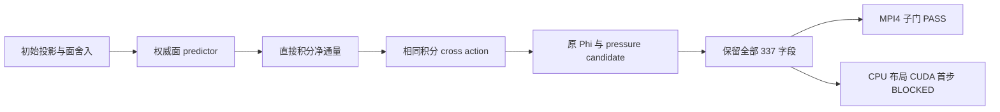

# AVWiS M2 积分 RHS 统一与首步压力门实施报告

_20261011 本轮任务 · 收尾跨至 2026-10-12 · locked AMReX 26.04 / SHA `9219ba416b7ba2073dd1b12bf19fdce27391f17b` · double / 3D_

## 🎯 结果与状态

在用户已有未提交实现上完成最小生产修复：仅 `face_authoritative` 的压力 RHS 与
延迟 cross action 改为直接计算积分面净通量，消除 `net/V*V` 舍入往返；默认
`experimental_dual_state` 保留原公式，入口与压力语义不变。没有改阈值、gauge、
mean repair、迭代次数或停止条件，没有 rounding、scale floor、忽略首步或删字段。

**P/Phi 完整后端门仍 BLOCKED**。MPI4 的限定 337 字段全部 PASS；CPU 布局与 CUDA
各仍只有首步 P/Phi 两字段 BLOCKED，其余 335 字段 PASS。不能把 MPI 子门或末步
压力 PASS 写成全部后端通过；M2/P5-005/M4/C3/C7 仍进行中，C4 未开始。
主清单仍为 **14 已完成、20 进行中、19 未开始**，总计 53 项。

|验收范围|本轮结果|
|---|---|
|三后端真实编译、device link、定向 CTest|PASS，各 12/12|
|独立 I / DG / R、每步散度、full physical residual、动量、P=Phi|PASS|
|MPI4 与 CPU 完整 337 字段|PASS，仅本次 affine periodic 短矩阵|
|CPU 布局、CUDA 首步 P/Phi 原严格门|BLOCKED|
|CPU/MPI4/CUDA 旧默认路径 126 字段回归|PASS，各自与本轮修改前逐值相同|
|连续物理压力、压力时间层、原 stretched 长矩阵|本轮 NOT TESTED；原压力/Phi 门保留 BLOCKED|
|整个 advance rollback|BLOCKED；fatal 失败 witness PASS|
|一般 19 点、SNES/BDF2、完整应力、IBM/FSI、shear restart|NOT TESTED / 未实现|

## 🔧 实际生产改动与数学合同

设 $N(F)$ 为三方向积分面净通量，$D(F)=N(F)/V$。压力算子仍为原 diagonal+cross
面梯度 $G$，投影仍满足

$$
B=-\frac{\alpha}{dt}N(U^*),\qquad
A_{diag}\Phi=B+N(G_{cross}\Phi_{old}),\qquad
A_{diag}=-V D G_{diag}.
$$

[Mapped operators](../amrex_port/src/AVWiSMappedOperators.cpp) 新增
`compute_metric_net_flux()`，验证现有 cell/face layout、metric epoch 和非空指针，
每 cell 按 `((Fx_hi-Fx_lo)+(Fy_hi-Fy_lo))+(Fz_hi-Fz_lo)` 顺序计算；无临时
MultiFab、归约或体积乘除。[头文件](../amrex_port/src/AVWiSMappedOperators.H)
新增该函数合同，不改变已有 API 的含义。

[Projection](../amrex_port/src/AVWiSProjection.cpp) 在 opt-in 分支用该函数形成
`B`；[deferred solve](../amrex_port/src/AVWiSDeferredProjection.cpp) 同样用它形成
cross action。两者共享积分通量算术，不再分别执行 D 后乘 V。生产 pressure candidate
仍由原 solver 的 Phi 生成，P=Phi；corrected faces 与 R 候选检查后才提交。

full acceptance 仍检查实际 $DG\Phi+B/V$ 的物理残差，relative <=1e-11；
MLMG inner relative <=1e-12、bottom smoother=256、max inner=1600、输入 outer 上限=40
均保留。原 volume-weighted zero-mean datum、compatibility 与 no mean repair 保留。
`net_flux` 的局部运算顺序统一不意味着 upstream face/metric 或全局求解归约 bitwise
可复现，也不声称此次简单路径能消除全部后端差异。

默认分支仍是原 `divergence*volume` RHS/cross action，未修改时间 predictor、对流、
黏性、metric 生成、face correction 或 reconstruction 的公式。用户切回
`experimental_dual_state + accumulated_correction` 即回退；新 opt-in pair 与原 affine
periodic 范围、fatal/checkpoint/rollback 拒绝接口均不变。静态检查仅追加上述路径存在性
检查，不把字符串检查视为数值验收。

## 🔍 首步差异归因与拒绝不安全修补

先读取任务清单、README、当前 diff 与上一份
[面权威生产增量报告](./AMReX_M2_面守恒权威生产增量_20261011.md)，保存起始 diff/status
及 `amrex_port/_Docs` 182 个既有文件 SHA-256。实际重新运行修复前 CPU、layout16、
MPI4、CUDA 矩阵，完全复现上一报告首步数字；未拿历史输出冒充本轮基线。

修复前 canonical 数据表明：初始投影后的 Ucont 最大跨后端差约 1e-18，初始 Phi
相对差仅 8.62e-17 / 1.15e-16 / 1.67e-16。CPU 两布局所有 metric 数组逐值相同，
而首步 predictor 的积分 RHS 相对差为 1.01589e-11 / 1.04245e-11 / 8.90366e-12。
该差在除小 dt 后传播至首步约 1.18e-12 的压力。

独立离散 Fourier 响应分析中，初始面约束差响应与实际首步压力差的范数之比为
0.999672 / 0.997175 / 0.999485；这是响应范数比，不是误差方差的百分比。
CPU 两布局与 MPI 的完整 RHS 差响应相对误差分别约 1.97e-4 / 1.17e-4；CUDA 约
0.0288，包含实际 metric 与面预测运算的后端舍入差。首步压力差 RMS 约 7.8e-15，
其体积加权均值差仅约 1e-19；常数 datum 不能解释主要空间差。

随后用只链接本轮真实 `avwis_metric` 库与 locked AMReX 的临时 replay harness，将
同一 CPU 积分 RHS 送给 opt-in `solve_deferred_metric_poisson()`。harness 在 ignored
`build/` 中，未新增生产输入 selector、修改测试阈值或取代实际 advance。

|peer|同 RHS Phi relative L2|自身 RHS 交回 CPU 对自身实际 Phi 的 relative L2|
|---|---:|---:|
|CPU layout16|1.11625e-16|9.49136e-17|
|MPI4|0|1.51008e-16|
|CUDA|1.33043e-16|3.42491e-14|

CPU replay 对自身 actual Phi 为 7.19016e-17；冻结 RHS 文件 SHA-256 为
`19b96f6565f49aab0e293b70cede2cca6adf7312f3a1df3e584555a1f77de0d2`。
三 peer 的 outer/inner 序列同为 `41,11,10,9,8,7,6,5,4,3,3`，11 outer、107 inner。
各 rank 从同一 17 位文本读取同一有限 RHS；实际 consumer 有 1/4 rank 与 CPU/CUDA
metadata，pressure trace 保留原 datum/残差观察。候选 RHS 从原 audit predictor 重建；
CUDA 的 FMA/metric 舍入使 response 不是 bitwise actual，不能据此替代原全场门。

这些证据将本反例主因定位在求解前状态/RHS 的舍入传播。face-authoritative RHS 不消费
DIC 或旧 P，不支持把 DG/DIC 接缝或累计压力赋值当作本首步差的原因。同 RHS MLMG
并未产生 1e-12 级差。初始 projection 的具体首次 reduction/逐点 correction 舍入
尚未逐指令定位；本轮没有证明某一个归约是唯一根因，更没有建立一般后端误差保证。

因此只保留有有限体积依据的直接积分路径；**明确拒绝靠改阈值解决**。不减掉上一投影
实际留下的散度，不修改 gauge，不把微小 RHS/Phi 舍入成相同值，也不以单个子门通过
为由调整 solver 停止规则。继续消除剩余差需要独立审阅可复现的初始 projection/
归约/面状态表示及成本，不能把它藏在此次最小 RHS 改动里。



## 🧪 修复前后全场与物理验证

同一 16×16×4、epsilon=.15、scale=(1.1,.9,1.05)、stretch=0；CPU grid8 为4 Boxes，
layout16 为1 Box，MPI4 grid8 四 ranks 全部持有 Box，CUDA grid8。固定 T=.002，CPU
真实跑 4/8/16 步，dt=5e-4/2.5e-4/1.25e-4；各 peer 对照最细16步。

|完整 337 字段 peer|修复前首步 P/Phi L2|修复后首步 P/Phi L2|修复后 max absolute|全场门|
|---|---:|---:|---:|---|
|CPU layout16|1.1855793e-12|1.1161993e-12|2.3918367e-14|BLOCKED，仅首步2字段|
|MPI4|1.1837511e-12|9.3984009e-13|2.6411165e-14|PASS，337/337|
|CUDA|1.1811189e-12|1.1944587e-12|2.5091040e-14|BLOCKED，仅首步2字段|

CUDA 未改善，没有隐去这个结果。末步 P/Phi relative 分别为
5.99071e-13 / 6.58213e-13 / 6.19525e-13；不能用末步 PASS 覆盖首步 BLOCKED。
原 `<=1e-12` relative 和逐点门均原样执行，近零/history/failure 字段和两端周期面保留。

矩阵每步及 force probe 的独立 I/DG/R identities 全部 PASS，P=Phi 和旧 P 扰动后
全15注册字段含halos逐值一致。最大 production full relative residual 为
7.66839e-12，独立 full DG physical relative residual 为 8.66331e-12；投影后散度最大
6.88883e-15，production 体积动量漂移最大 1.66533e-16，独立 canonical 积分漂移
最大 1.32357e-17。真实非零 body-force probe 与每步非零 Phi/predictor divergence
继续验收，没有改用零场替代非平凡矩阵。

固定时间粗细差比 Ucat=2.0003513、Ucont x/y/z=2.0004108/2.0007828/2.0003496、
P/Phi=2.0014279。仅证明该离散 multiplier 的限定时间行为，未验收连续物理压力
MMS、空间阶或随 n+1 发布压力的物理时间层。

## 🔄 失败、回退与真实执行

真实整步把 outer 上限临时设为1，准确拒绝 `deferred pressure exhausted
max_iterations=1`。current P/Ucat/Nvert 含halos不变；Phi、面 predictor、old/older history
可变化。time/step/history depth/上次成功计时不提交，valid/halo epoch增1。
失败 solver 不继续使用；仍是 fatal，整步 rollback BLOCKED。矩阵10项入口拒绝全部
PASS，包括错误 state/pressure pair、non-affine、BC、checkpoint、rollback 等。

修复前分别保存 CPU/MPI4/CUDA 的旧一致初态4步输出，修复后重新跑相同配置；
每后端126个字段逐值相同、changed_fields=[]。这包括 Phi、近零字段与失败 witness，
不是把旧后端互相比的近零差重新判成 PASS。证据：
`build/m2-rhs-unified-20261011-old/exact-regression.json`，同目录保留 before/after/commands/logs。

|真实执行|结果|日志/证据|
|---|---|---|
|CPU build + CTest|PASS，12/12，3.13s|`/tmp/avwis-rhs-cpu-{build,ctest}.log`|
|MPI build + CTest|PASS，12/12，22.74s|`/tmp/avwis-rhs-mpi-{build,ctest}.log`|
|CUDA build + device-link + CTest|PASS，12/12，99.96s|`/tmp/avwis-rhs-cuda-{build,ctest}.log`|
|strict 三后端矩阵|exit=1；完整证据完成、decision=BLOCKED|`/tmp/avwis-rhs-final-matrix.log`|
|同 RHS / candidate response|三后端真实生产 solver PASS|`build/m2-rhs-unified-20261011-replay/integrated-evidence.json`|
|生产 solve 零乘子分支|CPU/MPI4/CUDA 各4步、非零 body_force、exit=0|`build/m2-rhs-unified-20261011-solve/`|
|默认路径126字段回归|三后端各自 exact PASS|`build/m2-rhs-unified-20261011-old/`|

临时 CUDA replay harness 首次链接失败（`__cudaRegisterLinkedBinary_*` 未定义），
原因是将已做 device-link 的 `avwis_metric` 当普通 archive 又参与 device-link；
为 imported target 明确 `CUDA_RESOLVE_DEVICE_SYMBOLS=ON` 后正确编译并实际运行。
原始失败日志 `/tmp/avwis-rhs-replay-cuda-build.log`、中间失败与最终修复日志均保留，
没有改生产 CMake 或依赖。该 harness 失败不冒充生产 build 失败或 runtime PASS。

主证据目录：修复前 `build/m2-rhs-unified-20261011-before/run-saeggvp4/`，
修复后 `build/m2-rhs-unified-20261011-final/run-5vdvoufk/`，总摘要
`build/m2-rhs-unified-20261011-summary.json`；临时日志与起始保护记录另归档到
`build/m2-rhs-unified-20261011-evidence/`。中间 CPU/MPI direct-net 验证也保留。

```bash
cmake --build build/c3-20261011-cpu -j 4
cmake --build build/c3-20261011-mpi -j 4
cmake --build build/c3-20261011-cuda -j 3
python3 -B amrex_port/tests/face_authority_audit.py \
  --cpu build/c3-20261011-cpu/avwis --mpi build/c3-20261011-mpi/avwis \
  --cuda build/c3-20261011-cuda/avwis --input amrex_port/inputs/m2_face_authority.in \
  --work build/m2-rhs-unified-20261011-repeat --strict
# 上一命令预期 exit=1，保存完整 BLOCKED 证据；不表示证据收集失败。
python3 -B build/m2-rhs-unified-20261011-replay/run_integrated.py
bash amrex_port/tests/static_contract_check.sh
git diff --check
```

## 📍 剩余决策与收尾保护

下一步应审阅初始投影在不同 layout/后端下的 reduction 和逐点面修正，把严格首步
压力门当作初始面误差经 `1/dt` 放大的约束；评估可复现求解/守恒面表示及 M4 成本。
不应通过丢弃已存在的约束余量、改变 datum、增加尺度 floor 或隐式更改压力语义过门。
连续压力 reference/时间层、一般几何/初态、长程与稳定性、整步恢复事务仍需独立工作。

本轮只改4个生产文件（含1个头文件）、静态检查和5份指定档案，新增本报告；保留用户
所有既有修改和历史报告。未触碰仓库外原有 CUDA 目录；没有 checkout/reset/clean、
commit/push，也没有修改 AGENTS、memory、OpenClaw 或通知配置。
最终 diff/static/status/process/保护 hash 与唯一 Telegram 通知结果在收尾记录中补充。
