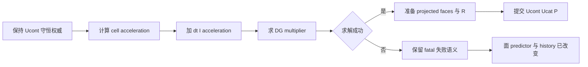

# AVWiS M2 面守恒权威生产增量实施报告

_2026-10-11 · opt-in affine periodic face authority · AMReX 26.04 / SHA `9219ba416b7ba2073dd1b12bf19fdce27391f17b` · double / 3D_

---

## 🎯 结果与验收边界

本轮已从诊断进入真实生产算法增量：`advance_one_step()` 新增显式 opt-in 的
`face_authoritative` 分支，以 Ucont 为守恒面权威，仅插值 cell acceleration，成功
DG 投影后以现有六面剪切重构生成 Ucat。默认旧 `experimental_dual_state` 保留。
生产入口、metadata 和字段说明显式区分 `instantaneous_pressure` 与
`accumulated_correction`，拒绝不支持的组合及 `failure_contract=rollback`。

限定 CPU 4/8/16 步时间子门与独立 I/DG/R 更新通过；完整后端门仍 **BLOCKED**。
新分支的 `instantaneous_pressure` 只是当步离散 face 约束乘子，未建立连续物理压力
MMS/空间阶/正确时间层的验收。原 stretched 累计压力时间门、fine-dt Phi 后端门、
M2/C3 总门和整步 rollback 保留原 BLOCKED，没有更改阈值、datum、mean repair
或迭代上限。53 项主清单仍为 **14 已完成、20 进行中、19 未开始**；
M2/P5-005/M4/C3/C7 进行中，C4 未开始。

## 📐 算法、状态与压力合同

记 $U^n$ 为三方向积分面体积通量，$u^n=\mathcal R U^n$ 为重构 cell 速度，
$\mathcal I$ 为现有两侧 cell 平均与面面积向量点积，$D$ 为净积分通量除单元体积，
$G$ 为现有完整 diagonal+cross metric pressure face flux。cell acceleration 为

$$
f^n=\operatorname{Advection}(u^n,U^n)+\operatorname{Viscosity}(u^n)+b,
\qquad U^*=U^n+dt\,\mathcal I f^n.
$$

新生产算法调用原 deferred solve，保持 full relative residual <=1e-11、原 gauge
和 compatibility 合同；显式 Euler 的 $\alpha=1$，定义

$$
DG\Phi=\frac{\alpha}{dt}DU^*,\qquad
U^{n+1}=U^*-\frac{dt}{\alpha}G\Phi,\qquad
u^{n+1}=\mathcal R U^{n+1},\qquad P=\Phi.
$$

上式的 $u^{n+1}$ 为 cell 速度，使用现有剪切三角六面归一化重构：先对各方向两面
flux/normal-area 作平均，再令 $u_x\leftarrow u_x+\epsilon u_y$。
`instantaneous_pressure` 指该次投影的离散 multiplier；cell RHS 在 n 层计算，
随 n+1 速度发布的 P 不能直接视为已验证的物理 $p(t_{n+1})$。旧 P 不进入 predictor。
零散度 shortcut 在该分支先检查 R 候选有限，再将 P/Phi 置零并保持 R 合同；没有沿用上一瞬时乘子。

|选择|生产状态|压力输出|支持范围|
|---|---|---|---|
|默认 experimental_dual_state|cell 增量推进、I 重建面、两套 pressure correction|P+=Phi accumulated_correction|保留原受限 shear 路径|
|opt-in face_authoritative|U+=dt I(f)、DG、Ucat=R(U)|P=Phi instantaneous_pressure|非零 affine shear、全周期|
|其它压力组合|准确拒绝|不接受混称|入口/算子合同|
|failure_contract=fatal|失败不得继续依赖该 solver 状态|P 保留最后成功值|无整步 rollback|

新分支准确拒绝 non-affine stretch、epsilon=0、不支持 state/pressure pair、
物理/nonperiodic BC、未知 pressure、reference selector 冲突、其它 contract mode、
checkpoint/restart 和 rollback 声明。保留 existing explicit Euler/component Laplacian
选择；不实现 C4 一般算子、SNES/BDF2、完整应力、IBM/FSI 或新初场导入。
仅在 affine 上验证 R 后的体积动量守恒，不据此接受 stretched R 的守恒性。



## 🔧 实际代码与可回退入口

新增配置位于 [MappingOperatorConfig](../amrex_port/src/AVWiSMappedOperators.H)，
[main 入口](../amrex_port/src/main.cpp)读取 state/pressure/failure 选择，
[共享 config validation](../amrex_port/src/AVWiSMappedOperators.cpp)保证 direct solver/API
也不接受错误组合。[生产时间推进](../amrex_port/src/AVWiSTime.cpp)分别执行旧 cell
predictor 和新 face acceleration predictor；[生产投影](../amrex_port/src/AVWiSProjection.cpp)
的 opt-in 路径先在 solver-owned workspace 准备 corrected faces 与 reconstructed cell，
验证候选有限、计算散度，随后提交。

[Deferred workspace](../amrex_port/src/AVWiSDeferredProjection.cpp)增加 rate、面候选和
R cell scratch，仍不缓存 MLMG hierarchy，不改变原 solve 的数值停止规则。zero-multiplier 分支同样在提交前检查 R 候选有限。
[字段/metric metadata](../amrex_port/src/AVWiSSolver.cpp)标记 P/Phi 的离散语义和 fatal
合同；registered state 仍为原15个字段，未删字段。旧默认路径增加 scratch 存储与
metadata 说明，数值公式保留。

用户可在原 affine periodic shear 输入中选择：

```text
avwis.state_contract = face_authoritative
avwis.pressure_contract = instantaneous_pressure
avwis.failure_contract = fatal
avwis.mapping.stretch = 0 0 0
```

同时保留 `coordinates=mapped`、`mapping.type=analytic_shear`、非零 epsilon、
`projection.operator=deferred_nonorthogonal`、`is_periodic=1 1 1`、`avwisbcs.enabled=0`
和现有 dt/grid/viscosity/steps。生产 `mode=solve` 接受该配置；默认初始化仍是零场，
现有 body_force 可推进。测试输入 [m2_face_authority.in](../amrex_port/inputs/m2_face_authority.in)
采用 test-only 非平凡初态，再调用真实 `advance_one_step()`；测试没有替代生产公式。
切回 `experimental_dual_state` + `accumulated_correction` 即恢复旧数值路径，
不需要删除新实现或修改默认。

## 🧪 三后端、时间细化与完整字段证据

主矩阵目录：`build/m2-face-authority-20261011-final/run-4257ewak/`。固定 16×16×4、epsilon=.15、scale=(1.1,.9,1.05)、
stretch=0，CPU grid8=4 Boxes、layout16=1 Box、MPI4 每rank有Box、CUDA grid8。
固定 T=.002，CPU 真正运行 4/8/16 步，dt=5e-4/2.5e-4/1.25e-4。
layout16/MPI4/CUDA 对照最细16步；本轮没有重跑原 stretched 长程矩阵。

|CPU 固定时间字段|coarse/fine L2 差比|原一阶门|
|---|---:|---|
|Ucat|2.0003513|PASS|
|Ucont x|2.0004108|PASS|
|Ucont y|2.0007828|PASS|
|Ucont z|2.0003496|PASS|
|P 与 Phi 当步 multiplier|2.0014279|限定离散时间 PASS|

[新增 C++ audit](../amrex_port/tests/contracts/AVWiSFaceAuthorityChecks.cpp)保存初态、
每步 rate/predictor/after state、最终、非恒定旧 P 扰动与失败的所有15注册字段，
并保留含全部 allocated halos 的 exact change norm。
[独立 Python audit](../amrex_port/tests/face_authority_audit.py)从 canonical metric 和
完整快照独立重算 I/DG/R、散度、每步体积动量及非零 body-force probe。
每个实际 advance 有非零 Phi、非零 predictor divergence，原 projection residual <=1e-11
和 divergence <=1e-10 均通过；独立 full DG residual 最大8.67e-12。
history/R、生产 predictor-correction identity、P=Phi exact、旧P扰动后全部字段含halos
逐值一致通过。矩阵动量漂移最大2.22e-16，投影后散度最大6.84e-15。

|完整337字段后端对照|首步 P/Phi relative L2|首步 max absolute|全字段门|
|---|---:|---:|---|
|CPU layout16|1.1855793e-12|2.9870204e-14|BLOCKED，仅2项|
|MPI4|1.1837511e-12|2.4571057e-14|BLOCKED，仅2项|
|CUDA|1.1811189e-12|2.6140548e-14|BLOCKED，仅2项|

每一后端其余335字段通过；最终 P/Phi relative L2 分别7.05e-13、6.45e-13、6.31e-13
通过不能替代完整 trajectory 门。相对 <=1e-12 和原逐点门未修改，没有删除首步场，
没有加 scale floor 或更改 gauge。默认 driver exit=0 只表示证据收集完成；
`--require-decision`/`--strict` 实际非零且保存 `decision_gate=BLOCKED`。
此处判断是新限定算法的门，不能替代旧 stretched Phi/累计 pressure 或 M2/C3 总门。

## 🔄 失败事务、旧路径与实际验证

实际整步把 deferred max_iterations 临时设为1，准确报
`deferred pressure exhausted max_iterations=1`。P、current Ucat、Nvert 含halos逐值不变，
说明不完整 Phi 没有提交为 P 或用于 R；current Ucont 保留已执行的 predictor，
old/older history 已滚动，Phi/scratch 可改变。time/step/history_depth 与上次成功 advance
计时不提交，valid/halo epoch 增1。失败后测试随即结束，没有继续使用该 solver。
这仍是 **fatal failure**，整步 rollback **BLOCKED**；生产入口准确拒绝 rollback 声明。
投影 commit 中的 MPI/device/运行时致命异常不提供可恢复事务保证。

在改动前分别保存 CPU/MPI4/CUDA 旧一致初态4步输出；最终源码编译后各自重新跑
相同旧配置，全部126个 canonical诊断字段逐值一致（包括Phi、近零D/DI和失败字段），
证据 `/tmp/avwis-authority-old-exact.json`。这是与各自旧基线的兼容回归，
不是把CPU/CUDA彼此的所有近零场改判为PASS。

|实际验证|结果|日志|
|---|---|---|
|CPU build/定向 CTest|build PASS；12/12 PASS，3.17s|`/tmp/avwis-authority-cpu-build-verified.log`、`/tmp/avwis-authority-cpu-ctest-final.log`|
|MPI build/定向 CTest|build PASS；12/12 PASS，24.12s|`/tmp/avwis-authority-mpi-build-verified.log`、`/tmp/avwis-authority-mpi-ctest-final.log`|
|CUDA build/device-link/定向 CTest|build/device-link PASS；12/12 PASS，95.14s|`/tmp/avwis-authority-cuda-build-verified.log`、`/tmp/avwis-authority-cuda-ctest-final.log`|
|新三后端矩阵、独立全场|证据完成；完整后端门BLOCKED|`/tmp/avwis-authority-strict.log`（同次最终矩阵）|
|准确入口拒绝|10/10 PASS|matrix command/log/evidence|
|strict decision|exit=1，准确 decision BLOCKED|`/tmp/avwis-authority-strict.log`|
|真实 solve/零乘子分支|CPU/MPI4/CUDA 各4步，非零 body_force，metadata合同 PASS|`/tmp/avwis-authority-solve-{cpu,mpi,cuda}.log`、同名JSON|
|旧三后端回归|全部126字段 exact|`/tmp/avwis-authority-old-exact.json`|
|diff/static/process/保护hash|diff/static PASS；251基线文件中234不变，17项计划内修改，无删除|`/tmp/avwis-authority-protection.json`|

复现：

```bash
cmake --build build/c3-20261011-cpu -j 4
cmake --build build/c3-20261011-mpi -j 4
cmake --build build/c3-20261011-cuda -j 3
python3 -B amrex_port/tests/face_authority_audit.py \
  --cpu build/c3-20261011-cpu/avwis --mpi build/c3-20261011-mpi/avwis \
  --cuda build/c3-20261011-cuda/avwis --input amrex_port/inputs/m2_face_authority.in \
  --work build/m2-face-authority-20261011-matrix
bash amrex_port/tests/static_contract_check.sh
git diff --check
```

本轮实际实施代理与测试子代理均使用用户指定 `gpt-6.1-sol` / `high`；仅记录实施配置，
不宣称协调主会话模型发生切换。工作开始保存 scoped diff 与protected SHA-256，
不读取或修改仓库外 CUDA 文件，不 reset/checkout/clean/commit/push，不改变AGENTS、
memory或通知配置；唯一外部收尾通知由协调主代理最终明确转交本实施代理按用户授权执行，结果见末段。

## 📍 未完成内容与下一步

新分支已建立 face authority 和压力语义的最小可回退生产合同；后续需要独立连续压力
reference 与时间层对齐、空间阶、一般初态/geometry、稳定性/长程验证和受支持BC。
全337字段的首步压力后端门仍需保留为严格 BLOCKED；本轮不通过更改阈值继续追求PASS。
整步恢复事务须另外覆盖 current/history/fields、epoch、time/counters、成功diagnostics，
当前 fatal 合同不表示该事务已实现。C4/SNES/BDF2/完整应力/IBM/FSI继续原状态。

历史证据：[一致初态与失败事务诊断](./AMReX_M2_一致初态与失败事务诊断_20261011.md)、
[Pressure/Phi 根因诊断](./AMReX_Pressure-Phi_reference根因诊断_20261011.md)。


最终保护审计：251个初始protected文件中234个SHA-256不变，17个变化全部位于
计划内生产接口/推进/投影/workspace、测试接入/静态合同和五份指定文档，无文件删除。
基线hash/diff为 `/tmp/avwis-authority-baseline-sha.json` 与
`/tmp/avwis-authority-baseline.diff`，保护摘要 `/tmp/avwis-authority-protection.json`。
原mapping/viscosity/advection/checkpoint/RunMode、C7专用实现、旧reference/audit与历史报告
未改变。最终 `git diff --check` 与静态合同通过，可见进程表无cmake/CTest/MPI/avwis/nvcc
构建或测试残留。协调主代理完成最终独立审阅后，明确转交用户已授权的唯一通知；实施代理仅执行下面这一条通知。


最终独立审阅后，协调主代理明确转交一次性 Telegram 命令给本实施代理执行：
指定 target `5602246804`、account `default`、reply-to `4939`，CLI exit=0，
返回 `Sent via telegram. Message ID: 4941`，日志 `/tmp/avwis-authority-telegram.log`。
没有重试、补发或其它通知/system event/heartbeat。追加此实际记录后再次通过
`git diff --check`，可见进程表无构建、测试或通知后台任务。
