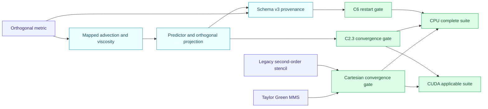

# AMReX P10-001、C2.3 与 C6 实施及验证

*日期：2026-09-18 · 范围：单层 Cartesian 与 separable analytic-orthogonal mapping · 依赖：AMReX 26.04 / `9219ba416b7ba2073dd1b12bf19fdce27391f17b`*

---

## 🎯 结论

本轮完成三个目标：P10-001 Cartesian Taylor–Green MMS/legacy stencil reference、
C2.3 正交 mapped 对流/黏性/显式推进，以及 C6 mapped checkpoint/restart。
CPU Release 完整测试为 **44/44 PASS**；CUDA `sm_89` 已完成 clean configure/build，
并通过 **36/36** 项适用测试。该结论只覆盖单层均匀网格和
separable orthogonal mapping，不外推到一般非正交、MPI restart、GPU restart、AMR、
IBM/FSI 或 legacy PETSc 程序整机等价。

## 🔧 实现摘要

|范围|实现与契约|
|---|---|
|P10-001|新增 `benchmark_cartesian_mms`；Taylor–Green 对流、黏性三网格空间收敛；每个网格用 `dt/dt/2` 检查显式时间误差；独立转录 legacy `RHSSolver.C` 的 `-second_order` Cartesian conservative stencil 并逐点比较|
|C2.3 对流|面动量通量使用积分体积通量 `Ucont[d]` 与相邻 `Ucat` 中心值，净面通量只除一次 `cell_volume_cc`|
|C2.3 黏性|使用正交 face-gradient metric 与 cell volume 组成物理 Laplacian；保持常系数运动黏度语义|
|C2.3 推进|mapped CFL/扩散稳定性指标、显式 Euler predictor、orthogonal projection 和 free-stream preservation 接入公共推进路径|
|C6|checkpoint schema 升至 v3；保存并严格校验坐标模式、mapping 类型/参数、projection、metric 离散版本与 FNV-1a checksum；metric 在 solver 构造时重建，不序列化派生量|
|跨分解恢复|Header 记录磁盘 BoxArray；恢复时验证其无重叠覆盖整个 domain，再由临时 `MultiFab` `ParallelCopy` 到当前 BoxArray|

审阅过程中还修正了两个会污染结论的实现问题：CPU tiling 下增量 kernel 曾对
`validbox()` 重复执行，现改为 `tilebox()` 或禁用相应 face tiling；投影后 `Ucat`
曾从 face flux 全量重构并形成逐步滤波，现只施加压力修正。修复后结果与
`max_grid_size=8/16/32/64` 的分块无关。

## 🧪 数值结果

### C2.3 orthogonal mapped

|网格|对流 $L_2$|黏性 $L_2$|manufactured step error|free-stream step error|
|---:|---:|---:|---:|---:|
|16³|3.7901924702e-2|6.1495360352e-3|0|0|
|32³|9.5321534924e-3|1.5629133146e-3|0|0|
|64³|2.3865938648e-3|3.9235917877e-4|0|0|
|16→32 ratio|3.976218462|3.934662260|—|—|
|32→64 ratio|3.994040894|3.983373906|—|—|

### P10-001 Cartesian Taylor–Green

|网格|对流 $L_2$|黏性 $L_2$|时间误差比 `dt/(dt/2)`|legacy stencil 最大差|
|---:|---:|---:|---:|---:|
|16³|1.9664536176e-1|7.1380767879e-3|1.744323051|0|
|32³|5.0136348000e-2|1.7914107677e-3|1.994774014|0|
|64³|1.2595832188e-2|4.4828452841e-4|1.989991038|0|
|16→32 spatial ratio|3.922211521|3.984611970|—|—|
|32→64 spatial ratio|3.980391867|3.996146764|—|—|

时间积分终点为 `2e-4`，用于日常 CPU/CUDA 回归；空间门为误差比大于 3.2，
时间门为误差比大于 1.5。legacy 最大差为 0 证明的是同一 Cartesian stencil 的
source-level parity，不包含旧程序的 SNES、BC、压力或整机时间轨迹。

### C6 checkpoint/restart

|契约|结果|
|---|---|
|同 mapping、同分解连续运行与 restart continuation|bitwise 一致|
|`max_grid_size=4` 写、`max_grid_size=8` 读|PASS|
|mapping 参数/checksum 错配|按预期严格拒绝|
|旧 Cartesian schema-v1/v2 读取|保持兼容|
|GPU/MPI restart|明确拒绝，未宣称支持|

## 🖥️ 构建与回归证据

|检查|配置|结果|
|---|---|---|
|CPU 完整 CTest|Release，double，3D，MPI OFF，CUDA OFF|44/44 PASS，5.19 s|
|CUDA 构建|CUDA 12.6.85，RTX 4060 Laptop，compute capability 8.9|PASS|
|CUDA 完整适用 CTest|排除明确只支持 CPU 的 restart、host sampling 与依赖它们的 case|36/36 PASS，117.07 s|
|静态契约|`tests/static_contract_check.sh`|PASS|
|补丁格式|`git diff --check`|PASS|

CUDA 路径保持 `ParallelFor` 和 device-resident 数值 kernel；同步只保留在阶段边界或
归约需要处。本轮记录的是正确性证据，没有形成 CPU/GPU 性能加速结论。

## ⚠️ 能力边界

- C6 当前刻意限制为 CPU 单进程；这是受支持范围，不是 CUDA/MPI I/O 的隐式实现。
- 正交黏性是常系数分量 Laplacian；变系数、张量黏性与非正交 cross term 尚未实现。
- 正交 projection 仍是当前显式 Euler 基线，不等价于 legacy PETSc SNES。
- 一般非正交 19 点压力路径、曲面 BC、物理 curved-channel reference 尚未关闭。

## 🚧 下一步

1. C7：完成 1/2/4-rank MPI、CPU/CUDA 紧容差对照，并单独设计 MPI/GPU checkpoint I/O。
2. C8：冻结 curved-channel/legacy 物理 reference，报告速度、去 datum 压力、质量、壁面剪切与流量网格趋势。
3. 并行关闭 P5-005 SNES/半隐式、M6 黏性与 P6-001 IBM 路线决策，再进入 C3→C4 非正交路径。
