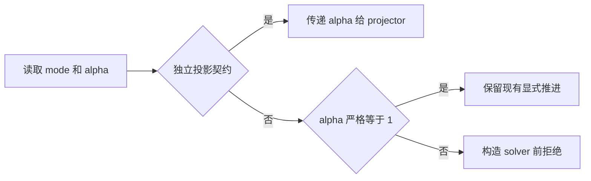

# AVWiS P5-005 投影时间系数拒绝契约实施报告

_2026-10-11 · C3/M2 后续增量 · locked AMReX 26.04 / SHA `9219ba416b7ba2073dd1b12bf19fdce27391f17b` · double/3D_

## 🎯 结果与选择

修复生产入口静默忽略 `projection_time_coefficient` 的问题：`solve` 等未消费
该参数的模式只接受缺省或严格等于 1；非 1 请求在 solver 构造前拒绝。
四个独立投影契约继续允许可调系数。生产改动只有 `RunMode.cpp` 新增的 12 行
注释/判定/异常，没有改变 predictor、P/Phi 更新、速度修正、metric、MLMG 或 workspace。

本轮不具备安全关闭累计压力时间门或细 dt Phi 全场门的证据，两个门继续
BLOCKED。P5-005/M2/M4/C3/C7 保持进行中，C4 未开始；53 项主任务仍为
14 已完成、20 进行中、19 未开始。此次是拒绝接口进展，不是隐式算法或压力收敛修复。

## 🔍 基线与两个 BLOCKED 的复核

开始完整检查当前 status/diff、主任务表、README、三份 C3 报告、C7 报告与审阅记录，
并核对迁移方案/曲线规格。启动命令参数为 `-m gpt-6.1-sol` 和
`-c model_reasoning_effort=high`；没有切换配置或启动子代理。进程表没有遗留
cmake/编译器/CTest/AVWiS/mpiexec 构建测试任务。

仓库已有 23 个 tracked 修改及 25 个 untracked 移植文件；它们都是本轮基线。
242 个 workspace 内 tracked/untracked 文件的起始 SHA-256 和 tracked diff 保存于
`/tmp/avwis-m2-rejection-initial-sha.json`、`/tmp/avwis-m2-rejection-initial.diff`。
Git 显示的仓库外 `../../CUDA/` 没有访问、遍历、hash 或修改。

### 累计压力时间门

既有生产流程为 $u^*=u^n+dt\,R(u^n,U^n)$、$U^*=Iu^*$、
$DG\Phi=D(U^*)/dt$，独立修正 cell/face 状态后累加 $P\leftarrow P+\Phi$。
predictor 不读取旧 P 的梯度；`DG` 与 `DIC` 未被约定为同一离散算子。
不能以共同 halo epoch 宣称 `Ucont=I(Ucat)`。

只读重算既有 CPU `c3_temporal/{dt,dt2,dt4}.json` 的证据：

|量|dt=2.5e-4|dt/2|dt/4|
|---|---:|---:|---:|
|共同初态投影后 DUcont|9.30394e-12|同左|同左|
|由初态 Ucat 独立插值的 DI(Ucat)|0.085266493|同左|同左|
|第一步 predictor 散度|0.085574425|0.085420459|0.085343476|
|第一步 max abs Phi|5.894634537|11.775669069|23.537738133|
|末步 max abs Phi|0.024777076|0.024774054|0.024772198|
|累计 P 的去 datum 体积加权 L2|4.063133673|8.130060559|16.263923214|

从初态约束缺陷和第一步 Phi 随 1/dt 放大的事实推断，压力问题涉及初态所在
约束子空间与时间/压力更新语义，不是多做几次 pressure solve 的充分理由。
`P=Phi`、加入旧压力项、每步重构 Ucat、从 Ucat 覆盖已投影 Ucont 都会改变
现有算法，缺少冻结 residual、压力 MMS/reference 和失败事务证据时不接受这些修补。
既有压力全场时间差比 `0.4999995319`，不在冻结 `[1.8,2.2]`；保留 BLOCKED。

### 细 dt Phi 全场门

以现有 CPU `build/c3-20261011-cpu/c3_temporal/` 为 reference，只读调用原比较器
`compare(..., observe=True)` 重算 MPI4 与 CUDA 快照，沿用相对 L2 `1e-12` 和
原逐点门，没有改 gauge、尺度或 field 集合。

|peer / run|Phi 相对 L2|Phi 差 RMS|体积加权差均值|原门|
|---|---:|---:|---:|---|
|MPI4 dt/2|1.20742e-12|1.25444e-14|1.36001e-18|BLOCKED|
|MPI4 dt/4|2.70852e-12|2.81378e-14|-2.90214e-19|BLOCKED|
|CUDA dt/2|1.37856e-12|1.43224e-14|1.21529e-18|BLOCKED|
|CUDA dt/4|3.01707e-12|3.13431e-14|6.08638e-20|BLOCKED|

MPI peer 为 `build/c3-20261011-mpi/c3_temporal_mpi/`；CUDA peer 为
`build/c3-20261011-cuda/c3_temporal/`。此处 CPU 为 grid8、CUDA 为 grid16，
属于 layout/backend 联合对照；其数值不冒充上一报告使用 matching CPU grid16
peer 时的 `1.49484e-12/2.79876e-12`。原报告数字/快照保持原样。
新离线摘要在 `/tmp/avwis-m2-alpha-existing-blocked-evidence.json`。

差均值比全场 RMS 小约四个数量级以上，说明简单常数 datum 修正不能解释主要
空间差异。与 1/dt 放大相符是推断，尚未隔离 RHS 形成、solver、metric 或归约的
贡献。上一轮已收紧 full/inner 容差仍失败，故本轮不再盲调 solver 或重复 480 步长测。
所有其他字段在这次离线比较中过门，但 Phi 仍属于原全场门，不能删去以取得 PASS。

## 🔧 最小生产实现与接口边界

实际复现入口缺口：旧 CPU 程序运行 `solve`、一步、请求 alpha=1.5，exit=0，
生成 metadata；源码实际仍使用 `TimeStepDiagnostics` 固定 alpha=1。
复现日志与 schema 为 `/tmp/avwis-m2-alpha-ignored-baseline.{log,json}`。
设置 3/2 也不等于实现 BDF2；问题是请求没有被消费却被接受。

|运行模式|最终行为|
|---|---|
|contract_p4、contract_p5_orthogonal、contract_p5_mapped_boundary、contract_p5_mapped_boundary_c52|继续把配置 alpha 传给独立 projector，原 finite/positive 校验不变|
|其余 19 种模式|缺省/显式 1 接受；其余值（含 NaN/Inf）准确拒绝|
|legacy vwis.*|相同规则，既有 namespace 选择和弃用提示不变|
|public projector API|原 `dt/alpha` 与 `alpha/dt` 接口不变|
|state_contract、time_integrator、viscous_operator|沿用上一轮声明/拒绝，不增新物理含义|

检查在 `read_run_configuration()` 中执行；main 先读取 RunConfiguration，之后才读取
geometry/boundary/mapping、构造 solver。没有增加 owning MultiFab、epoch、cache、
通信或热路径归约，无法据此作性能结论。



变更文件为生产 `src/RunMode.cpp`、CTest 注册 `CMakeLists.txt`、静态契约脚本、
新 `tests/p5_time_coefficient_contract.py`，以及任务清单、README、迁移方案、
规格、审阅追记和本报告。既有 C7 文件、C3 三份历史报告及数值源码均受保护。

## 🧪 定向验证与复现

复用三个已有 consumer 和 locked installed dependency；GNU 13.3.0、
OpenMPI 4.1.6、CUDA 12.6.85 / arch89。只增量重编译 RunMode 并 link/device-link，
没有重建或改依赖，没有 version mismatch override。

新增 executable 契约每个后端配置包含 31 次运行：19 种模式拒绝、5 个非法/非 1
数值拒绝、legacy 拒绝、四个 alpha=1.5 的真实投影契约、两条 16 步混合模态轨迹。
非消费模式注入非法 coordinates，并仍要求准确的 alpha 拒绝原因，证明检查先于
mapping/solver 构造。使用 fresh `run-*` 目录保存 stdout/snapshot/contract.json，
超时回收整个进程组；失败不生成 PASS summary。两条轨迹逐字段、逐步诊断及
元数据严格相等，只排除实际墙钟值。沿用原 temporal `validate()` 的数值/history 门。

|本轮验证|结果|日志|
|---|---|---|
|CPU 新契约|1/1 PASS，0.95 s|`/tmp/avwis-m2-alpha-cpu-contract.log`|
|CPU 既有相关定向集|16/16 PASS，0.37 s|`/tmp/avwis-m2-alpha-cpu-focused.log`|
|MPI consumer 定向集|18/18 PASS，73.62 s；含 MPI 单 rank 与 mpiexec 4 ranks 两个新契约|`/tmp/avwis-m2-alpha-mpi-focused.log`|
|CUDA 定向集|17/17 PASS，72.21 s；含新契约|`/tmp/avwis-m2-alpha-cuda-focused.log`|

各套件与新契约不是独立数量相加；CPU 本轮共 17 个 CTest，MPI 18、CUDA 17。
现注册完整套件数量为 CPU 59、MPI 62、CUDA 50，本轮没有运行这些完整套件，
不能把注册数量报告为 PASS。相关旧回归涵盖 P4 三类投影、显式时间、C2.2/C2.3、
C5/C5.2 和 M2/P5/M6 拒绝；未重复 C3 480 步、三网格 shear 长测或完整 C7 矩阵。

四个新运行配置为 serial CPU、MPI consumer 单 rank、MPI4、CUDA 单 rank。
每个配置两条 16 步轨迹，总计 128 次真实 advance；MPI4 短轨迹单 Box、三个
空闲 ranks，四个独立投影契约仍用多 Box 配置。最大逐步 full residual
`8.37503e-12`、投影散度 `4.11244e-13`、动量漂移 `3.33067e-16`，history error=0。
这些短轨迹验证输入与既有推进不变量，未构成新的时间自收敛或跨后端全场验收。
摘要 `/tmp/avwis-m2-alpha-short-validation.json`；原始证据在各 consumer 的
`p5_time_coefficient*/run-*/`。并行验证的墙钟不用于 scaling/加速声明。

```bash
cmake --build build/c3-20261011-cpu -j 4
cmake --build build/c3-20261011-mpi -j 4
cmake --build build/c3-20261011-cuda -j 3
ctest --test-dir build/c3-20261011-cpu -R '^avwis_p5_time_coefficient_contract$' --output-on-failure
ctest --test-dir build/c3-20261011-mpi -R '^avwis_p5_time_coefficient.*contract$' --output-on-failure
ctest --test-dir build/c3-20261011-cuda -R '^avwis_p5_time_coefficient_contract$' --output-on-failure
# 修复后预期 exit=1，准确说明 alpha 只支持 1，不分配 solver/不输出 metadata。
build/c3-20261011-cpu/avwis amrex_port/inputs/c3_temporal.in \
  avwis.mode=solve avwis.run_steps=1 avwis.projection_time_coefficient=1.5
# 原 P4 alpha=1.5 输入继续运行真实投影，预期 exit=0。
build/c3-20261011-cpu/avwis amrex_port/inputs/p4_periodic_projection.in
bash amrex_port/tests/static_contract_check.sh
git diff --check
```

定向集准确选择表达式保存在 `/tmp/avwis-m2-alpha-reproduction.sh`，构建日志为
`/tmp/avwis-m2-alpha-{cpu,mpi,cuda}-build.log`。以上本机产物可从版本化脚本/输入重生成。

## 🚧 未关闭门与下一步

1. M2/P5-005：冻结一致初态、旧压力项、P/Phi 更新和 cell/face constraint 的 residual，
   以压力 MMS/reference 和投影幂等性证据决定改离散；当前拒绝接口不能替代该决定。
2. Phi backend：先隔离 `Iu`/divergence/RHS 的 1/dt 误差传播、metric/provenance、
   solver 和归约贡献。保持每个原字段/原阈值，不能用 gauge、尺度 floor 或删 Phi 关闭门。
3. M4 diagonal/cross/halo/分配与内存成本、C7 profiling/CUDA-aware MPI、MPI/GPU
   restart 仍开放；C4 一般 19 点、非正交物理 BC、SNES/BDF2、完整 stress、IBM/FSI
   和 shear checkpoint/restart 均未实现。

## 🔗 最终复核与通知

本地依据：[时间审计及 M2 决策](./AMReX_C3_时间审计与M2拒绝契约_20261011.md)、
[workspace 报告](./AMReX_C3_多步状态与workspace_20261011.md)、
[C3 初次算法审计](./AMReX_C3_弱剪切算子与算法决策_20261011.md)、
[C7 报告](./AMReX_C7_MPI_CPU-GPU对照_20261011.md)、
[legacy residual](../vwis2.0/Integrator.C)、[固定 timeCoeff](../vwis2.0/UData.h)、
[生产时间推进](../amrex_port/src/AVWiSTime.cpp)。没有引用新版本外部 API。

最终 `git diff --check`、静态 P0–P8/C3/M2/P5-005 契约 PASS。242 个基线文件中，
234 个 SHA-256 不变；仅上述 8 个授权既有文件作增量修改，新增本报告和运行契约
脚本，没有删除基线文件。C7 专用文件、三份 C3 历史报告及时间/压力/黏性/metric/
workspace 生产源码逐字保持。统计按 53 个 P 级 ID 精确解析，结果 14/20/19。
最终无构建、CTest、AVWiS、mpiexec 或编译器后台进程；复核日志
`/tmp/avwis-m2-alpha-final-audit.log` 和保护摘要
`/tmp/avwis-m2-alpha-protection.json`。没有 reset/checkout/clean、commit 或 push，
没有修改 AGENTS/MEMORY/OpenClaw 配置；仓库外 CUDA 内容没有访问或改动。

收尾后仅执行一次指定命令：`openclaw message send --channel telegram --target
'5602246804' --account default --reply-to '4921' --message '<简短中文结果>'`。
退出码 0，CLI 确认 `Sent via telegram. Message ID: 4923`；日志
`/tmp/avwis-m2-alpha-telegram.log`。消息准确保留两个 BLOCKED；没有重试或发送
额外 system event/heartbeat。通知记录追加后再次检查 diff 格式与进程，均通过。
