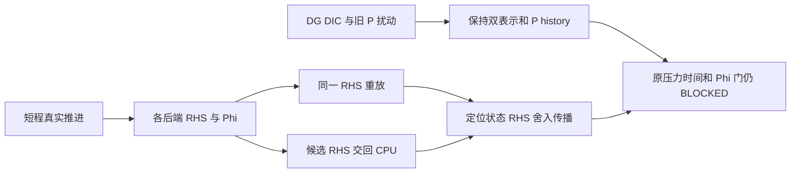

# AVWiS Pressure/Phi reference 根因诊断实施报告

_2026-10-11 · P5-005/M2/C3/C7 后续诊断 · locked AMReX 26.04 / SHA `9219ba416b7ba2073dd1b12bf19fdce27391f17b` · double/3D_

---

## 🎯 结果与边界

完成最小可重放 reference 和明确诊断契约，没有安全的压力算法生产修复。
累计 P 时间门与细 dt Phi 后端全场门继续 BLOCKED；不改变阈值、gauge 或字段集合。
53 项主任务仍为 14 已完成、20 进行中、19 未开始，P5-005/M2/M4/C3/C7
保持进行中，C4 未开始。

本反例的初态约束缺陷可直接归因于 DG 与 DIC 不同；旧 P 扰动不改变实际推进，
而 P 的累加等式成立。细 dt Phi 差则已通过固定 RHS 和候选 RHS 回交实验定位到
状态/RHS 的舍入差传播；固定 RHS 的算子和求解路径不产生同量级差异。
这是限定离散 reference，不是连续压力 MMS，也不证明所有长轨迹或其他网格的根因。

## 🔍 基线、保护与工作选择

先检查 scoped git status/diff、主任务清单、README、最新 P5-005/M2 报告、已有
CPU/MPI/CUDA build/CTest 证据与数值源码，并核对方案、曲线规格和审阅记录。
保存 244 个 workspace 内 tracked/untracked 文件的 SHA-256 及完整 scoped diff：
`/tmp/avwis-pressure-reference-initial-sha.json`、
`/tmp/avwis-pressure-reference-initial.diff`。起始及收尾可见进程表没有遗留构建/测试。
用户的已有改动作为基线保留；未读取或修改仓库外 CUDA 文件内容。

用户要求 gpt-6.1-sol/high；当前工具没有提供主会话模型切换或身份核验接口，
本轮未启动其他模型代理，也不提供未经核验的切换声明。

选择先隔离约束与 RHS/solver 贡献，不重复已有 32/64/128+256 步矩阵，也不盲调
MLMG 容差。参考原时间审计的压力差比 `0.4999995319` 和细 dt Phi 失败，
它们是历史证据，未以本轮短轨迹重新验收。

## 📐 压力时间问题：约束与更新语义

记 I 为 cell-to-face 面积内积插值，C 为 cell 梯度，G 为 full pressure face flux，
D 为净积分面通量除 cell 体积。生产源码仍为

$$
u^*=u^n+dt\,R(u^n,U^n),\quad U^*=Iu^*,\quad DG\Phi=D(U^*)/dt,
$$

$$
U^{n+1}=U^*-dt\,G\Phi,\quad u^{n+1}=u^*-dt\,C\Phi,\quad P^{n+1}=P^n+\Phi.
$$

旧 P 不参与 R，P 是累计 correction history。reference 采用既有混合 xy/xz 初值，
共同 `dt=1` 投影后，独立保留 Ucat/Ucont 并观测插值，不覆盖 Ucont。

|共同初态量|本轮 CPU 结果|
|---|---:|
|raw D(Iu)|1.13235488728|
|投影后 D(Ucont)|9.30394334148e-12|
|投影后 DI(Ucat)|0.0852664929892|
|作用于 initial Phi 的 max abs(DG−DIC)|0.0852664929827|

逐场检验 `DI(u_projected)=D(Iu_raw)−DIC(Phi_initial)`，相对 L2 通过原
`1e-12` 门；DG 和 DIC 的不同正是 cell 插值约束未消失的原因。独立 NumPy
串行数组算子从 canonical metric/标量重算 full、diagonal、cross 和 DIC；
不能以这项 PASS 宣称 DG=DIC 或 Ucont=I(Ucat)。

|dt|第一步 predictor max divergence|第一步 max abs Phi|dt × max abs Phi|
|---|---:|---:|---:|
|2.5e-4|0.085574424741|5.89463453726|0.00147365863432|
|1.25e-4|0.085420459|11.7756690693|0.00147195863366|
|6.25e-5|0.085343476|23.5377381333|0.00147110863333|

初态 DI 不是 O(dt)，由 `D(Iu*)/dt` 可直接形成 O(1/dt) 初始 correction。
reference 在相同速度初态上分别以旧 P=0 和非恒定 dyadic probe P 执行真实
`advance_one_step`；每个运行中 Ucat/Phi 逐值相同，P 增量等式误差最大
`8.8818e-16`。这证明当前 predictor 没有消费旧 P，并未发现 P 加法实现错误。

因此不能把压力问题描述为单纯线性求解失败或一处符号错误。当前 P history
契约成立，但它不足以成为时间收敛物理压力：既有长程最后 Phi 仍约 0.02477，
累计 P 随步数增加。若要把 P 改为瞬时 multiplier，或保留增量压力而加入旧 P
梯度，均是离散语义决策；还必须处理 DG/DIC 与一致初态。这里没有用 `P=Phi`、
强行重构 Ucat 或覆盖 Ucont 修补算法。

reference 的 old-P 分支在测试状态中恢复当前速度并重置 P；它只检查显式 Euler
当前状态依赖，不声明历史层回滚或 BDF2。短轨迹的 P 快照同样在目标一步前归零，
用于测量单步累加，不充当新的 16 步累计 P 时间证据。

## 🧪 Phi 后端问题：同 RHS 与反向重放

采用 `16×16×4`、epsilon=0.15、scale/stretch 与原输入相同；CPU baseline 为
max_grid=8，共 4 Boxes。固定 `dt=6.25e-5`，15 步真实 warmup 后审计第 16 步。
CPU layout16 为单 Box；MPI4/CUDA 保持 max_grid8，MPI4 四 ranks 均持有 Box。
所有 canonical 字段及周期两端面保持可见。

|peer|自身形成 RHS 的相对 L2 差|真实一步 Phi 相对 L2 差|完全相同 RHS 的 Phi 差|原 Phi 门|
|---|---:|---:|---:|---|
|CPU layout16|1.21685e-11|2.01587e-12|7.82998e-17|BLOCKED|
|MPI consumer 单 rank|0|0|0|PASS（该隔离对照）|
|MPI4|1.20385e-11|1.96771e-12|1.33146e-16|BLOCKED|
|CUDA|1.30821e-11|2.05219e-12|1.50729e-16|BLOCKED|

RHS 文件为 CPU 的真实 predictor 所形成 `−V D(Iu*)/dt`，17 位文本往返后各 peer
的 `solve_rhs` 逐值相同。SHA-256：
`995b8e2397a531700e7fc0f0a47df958309318b8a87bd625ecc42a9f44a1a6a8`。
CPU replay 与它自己的真实 Phi 逐值相等；独立保留 predictor divergence 与 actual
projector before 也一致，没有以 surrogate RHS 代替 actual advance。

所有 frozen RHS replay 使用同一个生产 `solve_deferred_metric_poisson`，11 个 outer
的 inner 次数均为 `72,50,41,35,25,21,15,13,8,6,3`，总计 289。
最终 physical relative residual 约 `7.9729e-12`，inner 初末残差逐 outer 留存。
积分 inner residual 与除体积后的 full physical residual 是不同量，不能直接比绝对值。

再把 CPU layout16、MPI4、CUDA 各自形成的 RHS 交给 CPU grid8 同一 solver，
得到的 Phi 与各候选自己的真实 Phi 相对差分别为
`1.01610e-16 / 6.68885e-17 / 1.29532e-16`。候选 Phi 的约 2e-12 差可由其 RHS
重放恢复，无需改变求解器或算子。

|候选解释|本轮判别|
|---|---|
|gauge 常数差|真实 Phi 差 RMS 为 2.1–2.2e-14，体积加权差均值仅约 1e-19 或更小；去常数不能消除主要空间差。仅报告 centered RMS，不修改原字段/gauge|
|layout/归约顺序|CPU 改 Box 分解即可复现；初始/目标 Ucat 最大差 1–3e-16，经 DI 和 1/dt 后 RHS 差约 1e-11 relative。具体是哪一个归约或舍入操作首先引入差，尚未逐 kernel 定位|
|MLMG 迭代路径|同 RHS 的计数相同，Phi 差约 1e-16；不支持作为这个反例的主因。不同 RHS 的舍入与 residual 差仍完整保留|
|真实算子不一致|同一 dyadic probe 的 DG/DIC 在 CPU 两布局和 MPI4 逐值相等，CUDA relative 约 5–6e-16；独立 reference 通过。仅排除所测 mapping/probe 上足以解释 2e-12 差的算子不一致|

该隔离结论不能关闭原长轨迹 Phi 门；原 gate、原快照与所有字段均保持。
也没有把 near-zero 的新诊断散度场当 transport gate，比较结果即使 BLOCKED 仍写入。
没有启用更紧容差、mean repair、尺度 floor、deterministic reduction 或新一般 19 点算子。



## ⚙️ 实现、拒绝与复现

生产库只追加 `DeferredProjectionIteration/Trace` 与默认 nullptr 的可选观察参数；
trace 非空时记录已完成 outer 的 MLMG getter 与已有 gauge/full residual。
默认调用不分配 trace、不增加归约、不改变算术、容差、停止/失败条件或 flow commit。
所有生产 `AVWiSTime/Projection/Viscosity/Advection/metric/solver/RunMode/main` 文件
除上述两个观察接口文件外与起始 hash 相同。

测试新增 `AVWiSPressureReference.cpp`、Python driver 与六项 reference/rejection 检查。
已有 temporal 测试仅增加 opt-in 分支；正常 temporal schema/流程不改。
`pressure_reference_warmup` 只允许 0..16；immutable RHS 必须恰好每 cell 一个有限数，
所有 rank 读取并做 collective 校验后 host staging 本地 valid boxes。
不兼容积分 RHS 的实际负向运行 exit=1，保留 `solve_failed=true` 快照与准确错误日志，
Python inspection 拒绝该快照。一般 driver 异常写 `INCOMPLETE/error`；
`--require-backend` 保存 evidence 后将 isolated BLOCKED 作为失败，不伪造算法 PASS。

```bash
cmake --build build/c3-20261011-cpu -j 4
cmake --build build/c3-20261011-mpi -j 4
cmake --build build/c3-20261011-cuda -j 3
python3 -B amrex_port/tests/pressure_phi_reference.py \
  --cpu build/c3-20261011-cpu/avwis --mpi build/c3-20261011-mpi/avwis \
  --cuda build/c3-20261011-cuda/avwis --input amrex_port/inputs/c3_temporal.in \
  --work build/pressure-reference-20261011-matrix
python3 -B amrex_port/tests/test_pressure_phi_reference.py
bash amrex_port/tests/static_contract_check.sh
git diff --check
```

driver 使用 NumPy 独立 serial array action，实测版本 2.5.1；无需新 AMReX 依赖。
MPI launcher 实测 OpenRTE 4.1.6；snapshot 记录 backend、MPI 编译开关、ranks/active ranks、
Boxes、mapping/provenance 和 local sum/norm0 后 ParallelDescriptor SUM/MAX。
Box 大小与 tile 参数在每个 command JSON；本轮不是 CUDA-aware MPI 或性能测试。

主矩阵全场与命令/日志位于 `build/pressure-reference-20261011-matrix/run-6whlu3md/`，
最终加强检查后的摘要为 `/tmp/avwis-pressure-reference-final-evidence.json`。
先行 CPU 诊断 `build/pressure-reference-20261011-cpu/run-95bzpzab/` 保留，未覆盖。
新 driver 可生成同等矩阵/response evidence；本轮最终 Python 检查加强后复查了已有
全部快照，未为格式变化重复数值长测。

## ✅ 风险匹配验证与收尾

|本轮实际验证|结果|证据|
|---|---|---|
|CPU 定向 CTest|14/14 PASS，1.09 s|`/tmp/avwis-pressure-reference-cpu-focused.log`|
|MPI 定向 CTest|15/15 PASS，76.00 s|`/tmp/avwis-pressure-reference-mpi-focused.log`|
|CUDA 定向 CTest|14/14 PASS，63.51 s|`/tmp/avwis-pressure-reference-cuda-focused.log`|
|三后端既有 C3 单网格契约|各 1 次 exit=0，含不可兼容/owner/epoch/outer exhaustion/flow 失败保护与四步推进|`build/pressure-reference-20261011-recovery/`|
|独立 Python reference/rejection|6/6 PASS；离散 DG/DIC Fourier eigenvalue、零 cross、空间误差非 gauge、非有限/shape/peer 拒绝|`tests/test_pressure_phi_reference.py`|
|不可兼容 frozen RHS|预期准确拒绝；保留失败 JSON/日志|`build/pressure-reference-20261011-negative/`|
|隔离 Phi 原门|3 peers BLOCKED，同 RHS/response 对照通过|主矩阵及最终摘要|

定向 CTest 包括时间系数、全部 C3 拒绝、temporal comparator、P4 与正交投影。
这些数量不是完整套件数量，不与手动矩阵相加称算法 PASS。构建日志为
`/tmp/avwis-pressure-reference-{cpu,mpi,cuda}-build.log`；锁定依赖未重建/修改。
没有修改或实现 SNES/BDF2、完整应力、一般 19 点、非正交物理 BC 或 shear restart。

## 🚧 下一轮自动优先级

1. 先冻结 pressure/reference 数学决策：物理压力是瞬时 multiplier 还是含旧 P 的
   incremental scheme；选定一致 cell/face 初态与 constraint residual，再建立压力
   MMS、投影幂等性/时间收敛及整步失败事务。保留当前实验路径供对照。
2. 对 Phi 先沿初始化 gauge reduction、cell correction、I/D/predictor 的首个差异
   做逐 kernel paired replay；评估无量纲 correction 或 reproducible sum 的代价与
   residual/failure 合同，证据足够再最小修复。不能直接增加迭代或改相对门。
3. 完成限定数学与后端门后，再推进 M4 成本/C7 profiling 与 M5/C4 路线。

依据：[时间审计/M2 报告](./AMReX_C3_时间审计与M2拒绝契约_20261011.md)、
[上一投影时间系数契约](./AMReX_P5-005_投影时间系数拒绝契约_20261011.md)、
[生产时间推进](../amrex_port/src/AVWiSTime.cpp)、
[生产投影](../amrex_port/src/AVWiSProjection.cpp)、
[新增 reference](../amrex_port/tests/contracts/AVWiSPressureReference.cpp)。

最终保护复核：244 个基线文件中 233 个 SHA-256 不变，只有上述诊断接口、测试接入、
静态契约及五份指定文档共 11 个既有文件增量变化；无基线文件删除。
C7 专用文件、原五份 C3/C7/P5 历史报告及时间/投影/对流/黏性/metric/solver/输入拒绝
数值源码逐字保留。摘要 `/tmp/avwis-pressure-reference-protection.json`；
`git diff --check`、静态契约通过，最终可见进程表无构建/测试后台任务。
未 reset/checkout/clean、commit/push，也未修改 AGENTS/MEMORY/OpenClaw 配置。

本轮收尾通知仅执行一次用户指定的 Telegram reply-to 4927 命令；发送结果另存
`/tmp/avwis-pressure-reference-telegram.log`，不会重试或补发其他通知。

实际以完整 CLI `--require-backend` 运行 CPU 布局短诊断，准确 exit=1，保存
`DIAGNOSTICS_COMPLETE` 且 `isolated_backend_gate=BLOCKED` 的原始证据；不是由
其他错误造成的失败。证据 `build/pressure-reference-20261011-strict/run-*/`，
日志 `/tmp/avwis-pressure-reference-strict.log`；其中候选 RHS response 仍 PASS。

唯一一次 Telegram 通知已完成：指定 target/account/reply-to 4927，CLI exit=0，
返回 `Sent via telegram. Message ID: 4929`。未重试/补发；通知记录追加后再次
检查 diff 格式及可见进程，无后台构建或测试。
