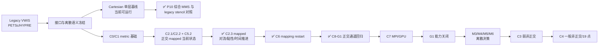

# AVWiS–AMReX 移植审阅与后续路线

> 最新生产算法增量（2026-10-12）：新增 opt-in `face_authoritative + incremental_pressure`，真实 `advance_one_step()` 使用旧 P 的面梯度 predictor，并以移位未知量 Q=P_old+Phi 求解现有 deferred MLMG；Phi 为当步压力增量，P 仅在全部候选通过原残差/散度门后提交。直接小增量 RHS 候选触及内层舍入底，已隔离；未放宽容差。默认 dual-state 与 instantaneous P=Phi 路径保持。连续物理压力、历史首步 CPU布局/CUDA P/Phi 门仍未关闭，C4 未开始、53项统计14/20/19不变。见 [增量压力实施报告](./AMReX_M2_增量压力状态与移位求解_20261012.md)。

> 最新增量（2026-10-12）：复现并否决两种未安全关闭 P/Phi 门的 stencil 舍入候选，已恢复原实现。最终仅 face_authoritative 投影复用当次 Ucat 三分量最大范数，每次少六次局部扫描/全局 max 归约；公式、原门限与 fatal 语义不变。CPU/MPI/CUDA 定向 CTest 为18/19/18项全 PASS，旧路径各126字段及面权威全快照与本轮基线逐值一致。CPU布局/CUDA首步 P/Phi 仍 BLOCKED（1.11620e-12 / 1.19446e-12），MPI4限定337字段 PASS；M2/C3/M4 未关闭，14/20/19与C4未开始保持。见 [候选审计与范数复用报告](./AMReX_M2_后端舍入候选审计与M4范数复用_20261012.md)。

> 最新追记（20261011 积分RHS后续）：批准范围内的最小生产增量消除face-authoritative的net/V*V往返，旧默认路径126字段在CPU/MPI4/CUDA各自exact回归；编译与定向CTest各12/12 PASS。首步P/Phi修复前约1.18e-12，修复后CPU布局1.11620e-12、MPI4 9.39840e-13、CUDA1.19446e-12；MPI局部门PASS不能写成C3/M2总门完成。保持BLOCKED与14/20/19，优先审阅初始projection舍入的确定性/成本，而非再调门槛。见 [本轮实施与审阅证据](./AMReX_M2_积分RHS统一与首步压力门_20261011.md)；下文历史判断保留。

> 审阅日期：2026-09-18
> 范围：`amrex_port/`、legacy `vwis2.0/` 的关键接口、迁移方案与任务清单
> 本次验证：locked AMReX 26.04 / SHA `9219ba416b7ba2073dd1b12bf19fdce27391f17b`，GNU 13.3.0，Release CPU；CUDA 12.6.85 / RTX 4060 `sm_89` 定向 runtime

> 实施追记（2026-09-18）：本审阅提出的前三项已在同日落地。P10-001、C2.3 和 C6 的实现、数值表与 CPU/CUDA 证据见 [`AMReX_P10-001_C2.3_C6_实施与验证_20260918.md`](./AMReX_P10-001_C2.3_C6_实施与验证_20260918.md)。随后完成的 C8-G1 正交 mapped 通道物理 reference 见 [`AMReX_C8-G1_正交mapped通道物理reference_20260918.md`](./AMReX_C8-G1_正交mapped通道物理reference_20260918.md)。

> 实施追记（2026-10-11）：C7 的限定正交 mapped 1/2/4-rank、Box 分解与 CPU/CUDA 全场数值对照已落地；本环境实际 MPI/CUDA 运行成功。分项 profiling、CUDA-aware MPI 和 MPI/GPU restart 仍待完成，C7/P5-003 保持进行中。新证据见 [`AMReX_C7_MPI_CPU-GPU对照_20261011.md`](./AMReX_C7_MPI_CPU-GPU对照_20261011.md)，下文保留 2026-09-18 审阅时点的历史判断。

> 实施追记（2026-10-11，C7 后续）：新增全周期固定弱 xy 剪切 mapping、cross pressure/diffusion flux 和全残差 deferred projection；真实生产 RHS/step、三网格 MMS、守恒、退化极限与失败保护已有证据。P5-005 限定决策/接口已开始，主清单最新统计为 14/20/19。一般非正交 BC、完整 19 点及 SNES/完整应力仍未完成；见 [`AMReX_C3_弱剪切算子与算法决策_20261011.md`](./AMReX_C3_弱剪切算子与算法决策_20261011.md)。下文继续保留原审阅时点判断。

> C3 第二增量（2026-10-11）：solver 持有并复用 deferred scratch，梯度准备前置到 flow commit 之前；四步混合模态实际演化验证状态修正、历史轮转、守恒及 halo freshness。内层上限按持续收敛证据从 800 增至 1600，数值门槛不变。现行 Ucat 增量梯度/Ucont 守恒通量是受限双离散表示，不能把共同 halo epoch 解释为互逆同步；本规格的单一权威/per-field epoch 要求继续 OPEN。成本、失败诊断及最终证据见 [`AMReX_C3_多步状态与workspace_20261011.md`](./AMReX_C3_多步状态与workspace_20261011.md)；历史报告不改写。

> C3 第三增量（2026-10-11）：新增长程真实推进、固定时间三档 dt 与 canonical 全场审计。速度/面通量差约一阶，但去 datum 累计 P 的时间差约按 0.5 比例变化，物理压力时间门 BLOCKED；细 dt 的 MPI/CPU-CUDA Phi L2 门也未全部通过。`state_contract=experimental_dual_state` 明确拒绝未验收单一权威/物理压力声明；数值公式、求解门与 workspace 不变。M2/M4、P5-005 和 C3 总门均未关闭，见 [时间审计及决策](./AMReX_C3_时间审计与M2拒绝契约_20261011.md)。

## 🔎 结论

> P5-005 审阅追记（2026-10-11）：确认累计 P 的第一步约束缺陷及细 dt Phi 空间误差
> 不支持在原物理语义下直接修补生产公式。改为关闭一个可复现的入口遗漏：
> `solve` 等模式不再接受后静默忽略非 1 的 `projection_time_coefficient`；四个消费
> alpha 的独立投影模式继续支持可调值。生产改动为 `RunMode.cpp` 的 12 行检查；
> CPU 17/17、MPI 18/18、CUDA 17/17 定向 CTest PASS，未重跑完整长程套件。
> 压力时间/Phi backend 保留 BLOCKED，统计保持 14/20/19；见
> [本增量报告](./AMReX_P5-005_投影时间系数拒绝契约_20261011.md)。

当前工程已经越过“AMReX 空骨架”阶段：单层均匀 Cartesian 路径具备字段与 halo、物理边界、保守对流、常系数黏性、MLMG 压力投影、显式 Euler 时间推进、受限 checkpoint/restart、诊断以及两个工程 case。解析 separable-orthogonal mapped 路径已经具备 metric、`Ucat↔Ucont`、散度/梯度、周期与混合边界和正交压力投影。

但它还不能称为完整 VWIS 移植。实施追记后，mapped 正交子集已能进行对流、黏性、显式推进和 CPU restart；一般非正交 19 点压力算子、LES、IBM、FSI、AMR、MPI/GPU I/O 和旧程序整机数值等价仍未完成。主任务表更新为 **14 已完成、19 进行中、20 未开始**。

本审阅确定的“先 C2.3、后 C6”顺序已经执行，C8-G1 正交 Poiseuille reference 也已完成；下一关键路径转为 C7 MPI/CPU-GPU 对照、legacy 整机复演和一般非正交 curved-channel 回归。

## ✅ 本次已经修正

|问题|处理|
|---|---|
|边界流水线在每次 RHS/投影前分配诊断 `MultiFab` 并做全局归约|诊断改为显式观察点，默认热路径只做 halo 与物理边界|
|每步重新分配对流、黏性 RHS|改为 solver 所有的持久 scratch `MultiFab`，初始化后复用|
|mapped P3 积分散度仍乘 Cartesian 常体积|统一使用 metric divergence 与逐 cell `cell_volume_cc`，新增离散散度定理回归|
|均匀 Cartesian probe/plane 诊断可误用于 mapped 网格|明确拒绝 mapped 模式，避免输出错误物理坐标与体积|
|RHS 输出只校验 BoxArray/分量数|增加 cell-centering 与 `DistributionMapping` 一致性校验|
|边界 profile、target flux、pressure 可接受 NaN/Inf|增加有限值校验和负向契约|
|physical-channel 允许零黏度后计算 Reynolds 数|要求黏度严格为正|
|CTest `WILL_FAIL` 可能把“因其他原因失败”误判为通过|新增失败包装器，同时校验非零退出码和预期错误文本|
|CMake 中锁定版本/SHA 重复硬编码且版本可被 cache 覆盖|统一从 `amrex_version.lock` 解析并输出锁定 provenance|
|历史规划、文件名、任务统计和下一步顺序过期|标注历史快照，修正路径、统计和 C2.3 关键路径|
|构建目录污染工作树状态|新增根目录 `.gitignore` 忽略本项目 `/build/`|

这些改动降低了每步固定分配与归约开销，但本次没有做正式性能基准，因此不声明具体加速比例。

## ⚠️ 仍需处理的核心风险

|优先级|风险|影响与关闭条件|
|---|---|---|
|P0|尚无 legacy VWIS 同算例、同网格、同时间步的整机数值对照|现有 45 个 CPU 测试、source-stencil parity 和 C8-G1 解析物理 reference 证明工程契约和组件性质，不证明完整 CFD 等价；至少还需可复演的 legacy Cartesian/曲线 reference|
|P0|显式 Euler + Cartesian/正交投影不等价于 legacy SNES|在 P5-005 明确长期积分器与非线性耦合策略，并以 reference case 决策，不应默认把当前基线当最终算法|
|P1|一般非正交 cross term 与 19 点压力路径未实现|C3/C4 前先冻结 M3/M4/M5/M6；operator 与 correction 必须共享同一面梯度/通量语义|
|P1|当前源树尚缺 MPI runtime 与性能证据|单卡 CUDA 已验证 metric/C2.2/C2.3/P10 正确性；C7 仍需 1/2/4 rank、CPU/GPU 紧容差和 profiling|
|P1|依赖安装曾指向已消失的 `/tmp` 前缀|本次已从精确 SHA 的 Git checkout 重建；应把依赖构建脚本或 CI 固化到仓库外的持久 cache，并记录编译选项|
|P2|checkpoint/诊断仍限 CPU 单 rank|C6 已扩展 mapping provenance 与跨 Box 分解恢复；MPI/GPU/AMR I/O 仍须分别验收|
|P2|LES、IBM/EB、FSI、AMR 尚未进入实现|先完成 P6-001 IBM 路线选择和最小静态固体 case，避免同时展开多个高耦合方向|

另有一个上游依赖细节需要保留在构建说明中：AMReX `26.04` 标签的源码归档在没有 `.git` 时会从 `CHANGES.md` 回退出 `26.03` 包版本。本次使用保留 Git 元数据的精确 SHA checkout，正确导出 `26.04`；不应通过放宽版本校验掩盖该 provenance 丢失。

## 🧪 验证结果

|检查|结果|边界|
|---|---|---|
|locked AMReX clean configure/install|PASS|CPU、double、3D、MPI/CUDA OFF|
|AVWiS clean Release build|PASS|GNU C/C++ 13.3.0|
|完整 CPU CTest|**45/45 PASS**|包含 P10、C2.3、C6、C8-G1 正向契约与负向错误原因|
|CUDA build/runtime|**36/36 PASS；改动后定向 8/8 PASS**|RTX 4060 `sm_89` 历史完整适用集；本次 mapped 壁面黏性改动后复测 C2.3/C5/C5.2；明确排除 CPU-only restart、host sampling 及物理 case|
|`static_contract_check.sh`|PASS|静态结构/文本契约|
|`git diff --check`|PASS|无 whitespace error|

本轮没有重新运行 MPI 或 legacy PETSc/HYPRE 整机 solver。C8-G1 给出解析 Poiseuille 物理 reference，但不构成旧程序整机等价或性能加速结论。

## 🚧 推荐执行顺序

1. **C7 MPI/GPU**：完成 1/2/4-rank 分块与归约验证、CPU/CUDA 紧容差对照和 profiling；MPI/GPU restart 作为独立 I/O 子门。
2. **Legacy reference 包**：取得并冻结旧程序 curved-channel 输入、网格、参考输出和可复现依赖；C8-G1 已完成解析正交物理 reference，仍缺 executable-to-executable 对照。
3. **算法决策门**：在进入一般非正交前，完成 P5-005 积分器/SNES、M6 黏性、P6-001 IBM 路线决策。
4. **C3 → C4 → 一般 C8**：先以可调 skew 的弱非正交映射验证 cross term 和退化极限，再实现/评估完整 19 点压力路径，最后以一般 curved-channel 回归关闭声明。

每一步的完成条件应同时包含：干净构建、组件契约、制造解收敛、至少一个物理/reference case，以及与该阶段匹配的 MPI/GPU 证据；单一 sanity case 或“能运行”不足以关闭任务。

### 2026-10-11 Pressure/Phi reference 诊断增量

新增最小压力 reference、独立串行 DG/DIC/diagonal/cross action 与同 RHS 重放，
保持 `experimental_dual_state`、显式 Euler alpha=1、P 累计 correction 和原拒绝规则。
初态 `DI(Ucat)=0.085266493` 与 `DG−DIC` 的约束缺陷一致；非恒定旧 P 扰动不改变
真实一步的 Ucat/Phi。Box 布局、MPI4、CUDA 的短轨迹 Phi 原相对门仍 BLOCKED，
但输入逐值相同 RHS 时差仅约 1e-16；把候选 RHS 交回 CPU 可恢复其 Phi 至同等精度。
证据把本反例定位到状态/RHS 的舍入差经散度和 1/dt 放大，未发现需要换一般算子的依据。
可选 MLMG trace 只观察既有残差/迭代数，默认无新增归约、容差或停止条件变更。
这是诊断/契约进展，两个原门继续 BLOCKED；不改任何 P 级任务状态，
53 项仍为 14 已完成、20 进行中、19 未开始。CPU 14/14、MPI 15/15、CUDA 14/14
定向 CTest 与三后端单网格 C3 失败恢复契约通过；没有重复 480 步长测。
详见 [Pressure/Phi reference 根因诊断](./AMReX_Pressure-Phi_reference根因诊断_20261011.md)。

### 2026-10-11 M2 一致初态与失败事务诊断增量

新增 test-only affine shear 离散 streamfunction 初态：cell 权威一次构造 Ucont=I(Ucat)，
初态 DI/D 均约 6.62e-15，非零 DG multiplier 与独立 Fourier reference 通过；
DIC source residual 约0.14645，even grid有8个checkerboard null modes，不能把DG当DIC。
4/8/16步固定T=0.002的Ucat/三面差比近2，累计P约0.49999、末Phi约0.30083，仍BLOCKED。
直接face重投影的flow字段幂等PASS但Phi被清零，全字段幂等BLOCKED；先I重建再投影不幂等。
真实整步deferred exhaustion准确拒绝，current/history/epoch已改变，整步rollback BLOCKED。
新affine CPUlayout16/MPI4/CUDA六transport字段对照PASS；CUDA全部诊断字段仍13项BLOCKED。
这不是原stretched pressure/Phi门PASS：原门保留历史BLOCKED，本轮未重跑长矩阵。
本轮生产源码保持起始hash；定向CTest CPU13/13、MPI14/14、CUDA13/13通过，
数学决策strict driver准确exit=1并保留完整证据。当前主统计仍14/20/19（53项），
M2/P5-005/M4/C3/C7进行中、C4未开始。
详见 [M2一致初态与失败事务诊断](./AMReX_M2_一致初态与失败事务诊断_20261011.md)。

### 2026-10-11 M2 opt-in 面守恒权威生产增量

新增真实生产 `advance_one_step()` 分支，显式选择
`state_contract=face_authoritative`、`pressure_contract=instantaneous_pressure`、
`failure_contract=fatal`。仅支持非零 affine `analytic_shear`（stretch=0 0 0）、
全周期、无物理 BC、现有 explicit Euler/component Laplacian；默认仍为
`experimental_dual_state` + `accumulated_correction`，没有默认切换。
新面 predictor 为 Ucont[n]+dt*I(advection+viscosity+force)，保持面权威；成功 DG
投影后以现有六面归一化剪切重构 R 得 Ucat=R(Ucont)，不会先以 I(Ucat) 覆盖面状态。
`instantaneous_pressure` 严格指该次 DG 投影的离散 face 约束乘子，P=Phi；其 RHS
在显式 n 层评估，不能宣称发布于 n+1 的 P 已通过连续物理压力/时间层验收。
旧累计输出为 P+=Phi correction history，旧 P 不消费于 predictor。

投影面/cell 候选全部准备后才提交。真实 exhaustion 不提交 P/Ucat/投影修正，
但面 predictor、history、epoch 可改变；整步仍 fatal，`failure_contract=rollback`
准确拒绝。没有全 advance rollback、C4/SNES/BDF2/完整应力/IBM/FSI。
固定 T=.002 的 CPU 4/8/16 步速度/面差比近2，P/Phi 离散乘子差比2.00143；
限定时间子门通过不替代物理压力验收。layout16/MPI4/CUDA 完整337字段中
首步 P/Phi 原 relative<=1e-12 门仍 BLOCKED，其余335字段 PASS；原 stretched
压力/Phi门未重跑，保留 BLOCKED。主统计仍 **14 已完成、20 进行中、19 未开始**，
M2/P5-005/M4/C3/C7 进行中，C4 未开始。实现、最终验证及边界见
[面守恒权威生产增量报告](./AMReX_M2_面守恒权威生产增量_20261011.md)。

### 2026-10-12 本轮保留增量的审阅边界

最终生产差异只有 `AVWiSProjection.cpp` 的当次速度范数复用，static checker 追加
opt-in/默认分支存在性检查。共享 stencil、deferred solver、黏性和既有 face-authority
测试恢复到本轮起点逐字节一致，候选代码和失败证据保存在 ignored build 目录。
配对差分的 CUDA 旧路径101字段变化不能解释成兼容；该候选已撤回。最终旧路径
各126字段、六组 face-authority 全快照和迭代/残差/失败诊断 exact 回归。
本次验收为局部工作量减少及无回归；没有实测加速比、完整压力后端门、物理压力
时间层、全步 rollback 或 C4 支持声明。历史报告和既有未提交修改保持。

### 2026-10-12 增量压力算法审阅追记

本轮审阅结论：允许受限 incremental_pressure opt-in 接入真实 advance_one_step；
P_old 进入面 predictor，Phi 与累计 P 分离。直接小 RHS 的 inner stagnation 候选
已隔离，最终使用同一 MLMG/metric operator 的移位未知量，不放宽任何旧门限。
生产额外验证实际 P_old+Phi 的 full residual 和最终面散度，并在提交历史之前
完成所有可恢复的数值检查；MPI/device 提交故障仍 fatal。standalone increment
提交拒绝、首步零 P、零更新幂等性、真实 exhaustion 后不发布及重试均列入小验收。
这只完成压力增量状态子契约，未完成物理压力/时间层/后端总门；默认 dual-state
和 instantaneous 路径须有本轮基线回归。实施报告列明最终 CPU/MPI/CUDA 命令和结果，
历史首步 P/Phi BLOCKED 及任务统计不改变。
