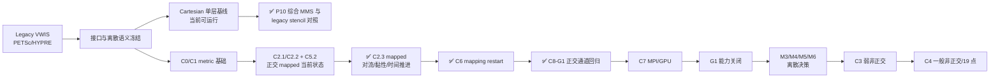

# AVWiS–AMReX 移植审阅与后续路线

> 审阅日期：2026-09-18
> 范围：`amrex_port/`、legacy `vwis2.0/` 的关键接口、迁移方案与任务清单
> 本次验证：locked AMReX 26.04 / SHA `9219ba416b7ba2073dd1b12bf19fdce27391f17b`，GNU 13.3.0，Release CPU；CUDA 12.6.85 / RTX 4060 `sm_89` 定向 runtime

> 实施追记（2026-09-18）：本审阅提出的前三项已在同日落地。P10-001、C2.3 和 C6 的实现、数值表与 CPU/CUDA 证据见 [`AMReX_P10-001_C2.3_C6_实施与验证_20260918.md`](./AMReX_P10-001_C2.3_C6_实施与验证_20260918.md)。随后完成的 C8-G1 正交 mapped 通道物理 reference 见 [`AMReX_C8-G1_正交mapped通道物理reference_20260918.md`](./AMReX_C8-G1_正交mapped通道物理reference_20260918.md)。

## 🔎 结论

当前工程已经越过“AMReX 空骨架”阶段：单层均匀 Cartesian 路径具备字段与 halo、物理边界、保守对流、常系数黏性、MLMG 压力投影、显式 Euler 时间推进、受限 checkpoint/restart、诊断以及两个工程 case。解析 separable-orthogonal mapped 路径已经具备 metric、`Ucat↔Ucont`、散度/梯度、周期与混合边界和正交压力投影。

但它还不能称为完整 VWIS 移植。实施追记后，mapped 正交子集已能进行对流、黏性、显式推进和 CPU restart；一般非正交 19 点压力算子、LES、IBM、FSI、AMR、MPI/GPU I/O 和旧程序整机数值等价仍未完成。主任务表更新为 **14 已完成、19 进行中、20 未开始**。

本审阅确定的“先 C2.3、后 C6”顺序已经执行，C8-G1 正交 Poiseuille reference 也已完成；下一关键路径转为 C7 MPI/CPU-GPU 对照、legacy 整机复演和一般非正交 curved-channel 回归。

## ✅ 本次已经修正

|问题|处理|
|---|---|
|边界流水线在每次 RHS/投影前分配诊断 `MultiFab` 并做全局归约|诊断改为显式观察点，默认热路径只做 halo 与物理边界|
|每步重新分配对流、黏性 RHS|改为 solver 所有的持久 scratch `MultiFab`，初始化后复用|
|mapped P3 积分散度仍乘 Cartesian 常体积|统一使用 metric divergence 与逐 cell `cell_volume_cc`，新增离散散度定理回归|
|均匀 Cartesian probe/plane 诊断可误用于 mapped 网格|明确拒绝 mapped 模式，避免输出错误物理坐标与体积|
|RHS 输出只校验 BoxArray/分量数|增加 cell-centering 与 `DistributionMapping` 一致性校验|
|边界 profile、target flux、pressure 可接受 NaN/Inf|增加有限值校验和负向契约|
|physical-channel 允许零黏度后计算 Reynolds 数|要求黏度严格为正|
|CTest `WILL_FAIL` 可能把“因其他原因失败”误判为通过|新增失败包装器，同时校验非零退出码和预期错误文本|
|CMake 中锁定版本/SHA 重复硬编码且版本可被 cache 覆盖|统一从 `amrex_version.lock` 解析并输出锁定 provenance|
|历史规划、文件名、任务统计和下一步顺序过期|标注历史快照，修正路径、统计和 C2.3 关键路径|
|构建目录污染工作树状态|新增根目录 `.gitignore` 忽略本项目 `/build/`|

这些改动降低了每步固定分配与归约开销，但本次没有做正式性能基准，因此不声明具体加速比例。

## ⚠️ 仍需处理的核心风险

|优先级|风险|影响与关闭条件|
|---|---|---|
|P0|尚无 legacy VWIS 同算例、同网格、同时间步的整机数值对照|现有 45 个 CPU 测试、source-stencil parity 和 C8-G1 解析物理 reference 证明工程契约和组件性质，不证明完整 CFD 等价；至少还需可复演的 legacy Cartesian/曲线 reference|
|P0|显式 Euler + Cartesian/正交投影不等价于 legacy SNES|在 P5-005 明确长期积分器与非线性耦合策略，并以 reference case 决策，不应默认把当前基线当最终算法|
|P1|一般非正交 cross term 与 19 点压力路径未实现|C3/C4 前先冻结 M3/M4/M5/M6；operator 与 correction 必须共享同一面梯度/通量语义|
|P1|当前源树尚缺 MPI runtime 与性能证据|单卡 CUDA 已验证 metric/C2.2/C2.3/P10 正确性；C7 仍需 1/2/4 rank、CPU/GPU 紧容差和 profiling|
|P1|依赖安装曾指向已消失的 `/tmp` 前缀|本次已从精确 SHA 的 Git checkout 重建；应把依赖构建脚本或 CI 固化到仓库外的持久 cache，并记录编译选项|
|P2|checkpoint/诊断仍限 CPU 单 rank|C6 已扩展 mapping provenance 与跨 Box 分解恢复；MPI/GPU/AMR I/O 仍须分别验收|
|P2|LES、IBM/EB、FSI、AMR 尚未进入实现|先完成 P6-001 IBM 路线选择和最小静态固体 case，避免同时展开多个高耦合方向|

另有一个上游依赖细节需要保留在构建说明中：AMReX `26.04` 标签的源码归档在没有 `.git` 时会从 `CHANGES.md` 回退出 `26.03` 包版本。本次使用保留 Git 元数据的精确 SHA checkout，正确导出 `26.04`；不应通过放宽版本校验掩盖该 provenance 丢失。

## 🧪 验证结果

|检查|结果|边界|
|---|---|---|
|locked AMReX clean configure/install|PASS|CPU、double、3D、MPI/CUDA OFF|
|AVWiS clean Release build|PASS|GNU C/C++ 13.3.0|
|完整 CPU CTest|**45/45 PASS**|包含 P10、C2.3、C6、C8-G1 正向契约与负向错误原因|
|CUDA build/runtime|**36/36 PASS；改动后定向 8/8 PASS**|RTX 4060 `sm_89` 历史完整适用集；本次 mapped 壁面黏性改动后复测 C2.3/C5/C5.2；明确排除 CPU-only restart、host sampling 及物理 case|
|`static_contract_check.sh`|PASS|静态结构/文本契约|
|`git diff --check`|PASS|无 whitespace error|

本轮没有重新运行 MPI 或 legacy PETSc/HYPRE 整机 solver。C8-G1 给出解析 Poiseuille 物理 reference，但不构成旧程序整机等价或性能加速结论。

## 🚧 推荐执行顺序

1. **C7 MPI/GPU**：完成 1/2/4-rank 分块与归约验证、CPU/CUDA 紧容差对照和 profiling；MPI/GPU restart 作为独立 I/O 子门。
2. **Legacy reference 包**：取得并冻结旧程序 curved-channel 输入、网格、参考输出和可复现依赖；C8-G1 已完成解析正交物理 reference，仍缺 executable-to-executable 对照。
3. **算法决策门**：在进入一般非正交前，完成 P5-005 积分器/SNES、M6 黏性、P6-001 IBM 路线决策。
4. **C3 → C4 → 一般 C8**：先以可调 skew 的弱非正交映射验证 cross term 和退化极限，再实现/评估完整 19 点压力路径，最后以一般 curved-channel 回归关闭声明。

每一步的完成条件应同时包含：干净构建、组件契约、制造解收敛、至少一个物理/reference case，以及与该阶段匹配的 MPI/GPU 证据；单一 sanity case 或“能运行”不足以关闭任务。
